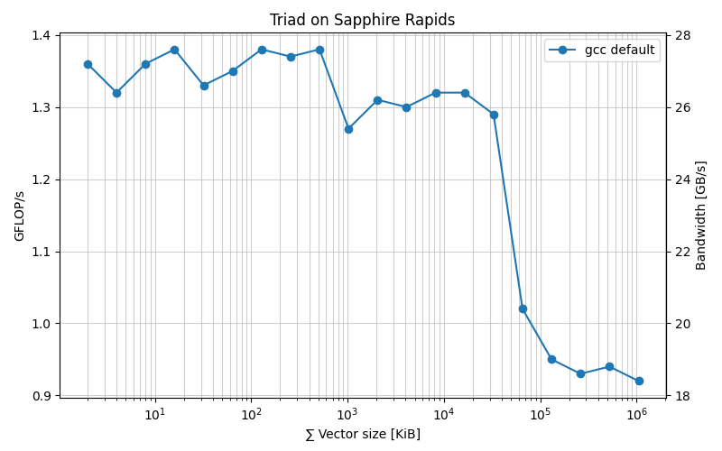
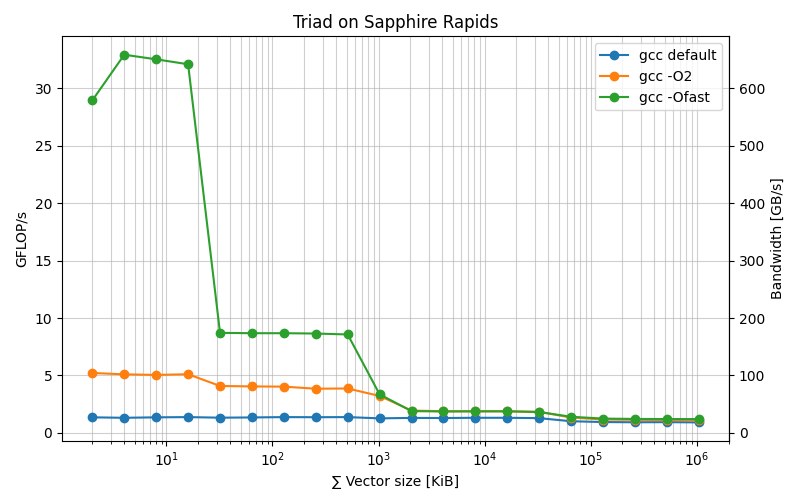
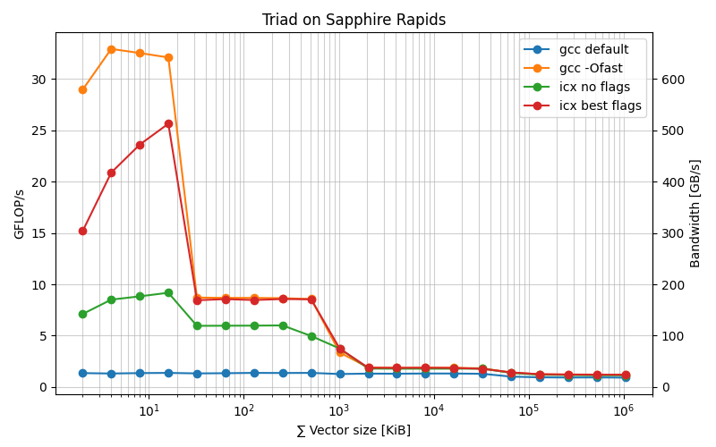
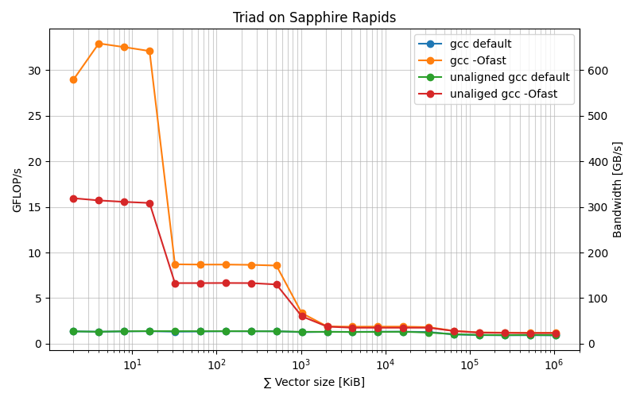
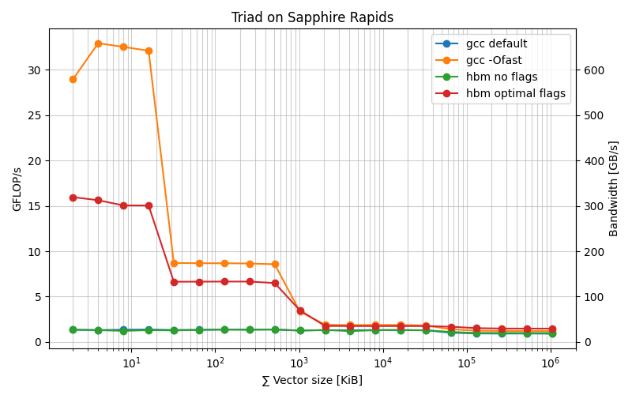

# Assignment 1 - General Questions
# 1.
## a) Floating Point Operations per Iteration

Each iteration consists of 2 floating point operations. If we unpack the statement we can clearly spot both operation:

```
A[i] = (B[i] + (C[i] * D[i]))
```
The first one being the multiplication of *C + D* and the second being the addition with *B*. As storing and loading of floating point numbers doesn't count as a floating point operation the assignment to *A* is not considered.

> **Do we need the following part?**
>
>Thus to calculate the floating point operations per second FLOPs we just measure: 
>
>```
>FLOPs = (2N) / seconds_needed
>```

## b) Conversion to bandwidth utilization
### i) TODO: CACHE SIZE
If the vector fits entirely into the L1 cache a bandwidth measurement would not be possible.
Each value of the vectors *B, C, D* needs to be loaded from memory, while storing the result in the value of *A* also writes to the memory. As double preciscion floating point numbers take up 8 Bytes and we need 4 memory accesses, 32 Bytes get transferred each iteration.

```
8 bytes * 4 transfers = 32 bytes
```

As we have 2 floating point operations per iteration we get:

```
32 bytes / 2 FLOP = 16 bytes / FLOP
```

Thus we can just multiply the FLOPs with 16 to get the memory utilization in bytes per second, as each FLOP equals 16 byte.

### ii)

In write allocate the CPU does an extra memory transfer if the desired address can not be found in the cache yet. It then loads in the entire cache line first, overwriting it with the value in cache. Finally if the cache line gets evicted the expected memory transfer happens.

This means when using write allocate we get an additional memory transfer from the loading of the cache line into the cache. Thus a better estimation for the factor would be 20.

```
8 bytes * 5 transfers = 40 bytes
=> 40 bytes / 2 FLOP = 20 bytes / FLOP
```

## c) Code measurement

### i)

The repetition count decides how often the triad operation is run which itself loops over every entry of the vectors *A, B, C, D*. As one single full run of the triad operation can be very fast depending on the number of elements in one vector, repeating the same operation multiple times can improve measurement accuracy. 

This is due to the fact that small anomalies through for example other system processes, timer inaccuracies, machine accuracy or overhead from creating the thread team get averaged out over the runtime off all repetitions.

### ii)

Additionally to setting the repetition count to a number that the timing test lasts at least the specified minimal time, it also serves as a warm-up. This eradicates inaccuracies from cache cold misses and ensures threads are already pinned down.

### iii)

The verification of the results makes sure that the vector *A* is at least once used, so the compiler doesn't optimizes the whole timing test out. It also serves as a safeguard that the parallelization is done correctly and doesn't output unexpected or wrong values.

## d) Optimization

### i)

The use of *sysconf(_SC_LEVEL1_DCACHE_LINESIZE)* ensures that we allocate the bases of the vectors *A, B, C, D* according to the cache line boundaries of the level 1 cache. As the entires itself match to the length of the cache line we prevent cross line accesses. This can improve performance as it may prevent an additional memory access due to a double value spreading over the end of a cache line.

```
64 bytes line length % 8 byte double size = 0
```

### ii)

*restrict* tells the compiler that the memory the pointer is pointing at will always only be accessed through this very pointer. This means the compiler will know that accesses to entries of *A, B, C, D* will always be independent and thus can be executed in a arbitrary order, allowing parallelization of statements like the triad operation.

## e) Parallelization

### i)

Due to the uniform nature of the triad operation it is useful to access memory in local chunks to improve cache locality. Through the use of the static scheduling of OpenMP threads get allocated in contiguous, equal-sized chunks which is optimal for cache locality and additionally has very little management overhead. 

As there are no dependencies between iterations or even repetitions we can use the *nowait* flag to ignore the implicit join barrier. This lets threads instantly continue with the next repetition saving unnecessary idle time.

Creating the parallel region outside the repetition loop reduces overhead from creating and destroying thread teams. This ensures the thread team is only created once per execution of the timing test instead of every time a new repetition starts. As the repetition is only needed to stabilize the timing results extra overhead would only distort the results.

### ii)

The initialization should be parallelized to make optimal use of the NUMA Domains. In case the parallelization would be done sequentially every vector entry would live in the NUMA Domain where the sequential thread got executed. This is due to the first touch policy of memory allocation.

Instead, if we run the initialization in parallel, too. We allocate the vector entries in the same NUMA domain where we later perform the triad operation. This can lead to better performance as accesses to memory are physically shorter, leading to less idle time.

This is due to the use of the same scheduling strategy for both initialization and actual operation. Even tho the for loops live in completely separate thread teams the deterministic scheduling of OpenMP ensures that the threads get allocated identically both times.

# 2
The following table summarizes the different configurations used for the measurements:
  |Name|Compiler Flags|Memory Allocation|
  -----|--------------|------------------|
gcc default|-fopenmp|aligned|
gcc -O2|-fopenmp -O2|aligned|
gcc -Ofast|-fopenmp -Ofast -march=native -mprefer-vector-width=512|aligned|
icc default|-qopenmp|aligned|
icc -O2|-qopenmp -O2|aligned|
icc -Ofast|-qopenmp -Ofast -march=native -mprefer-vector-width=512|aligned|
unaligned gcc default|-fopenmp|unaligned|
unaligned gcc -Ofast|-fopenmp -Ofast -march=native -mprefer-vector-width=512|unaligned|
hbm no flags|-fopenmp|high bandwidth memory|
hbm optimal flags|-fopenmp -Ofast -march=native -mprefer-vector-width=512|high bandwidth memory|

---

## (a)



The cache sizes of the system used are:
- L1d:                   4.5 MiB
- L1i:                   3 MiB 
- L2:                    192 MiB 
- L3:                    210 MiB 

The plot clearly shows two drops in performance one around the 10^3 KiB mark and one around the 10^5 KiB mark. These correspond to the L1 and L2 cache sizes of the system used. Meaning that when the vector sizes exceed these sizes the data no longer fits into the respective cache leading to more memory accesses in slower chaches or even the main memory and thus a drop in performance.

## (b)
### i.

### ii.


The plots show that with increasing optimization levels the performance increases significantly. This is due to the fact that the compiler is able to apply more aggressive optimizations. For instance the use of the -Ofast flag allows the compiler to use optimizations that may violate strict standards compliance but lead to better performance. This includes for example the use of vectorized instructions that operate on multiple data points simultaneously, significantly speeding up the triad operation. The -mprefer-vector-width=512 flag specifically tells the compiler to prefer using 512-bit wide vector instructions, which can process 8 double-precision floating-point numbers in parallel, further enhancing performance. Without this flag the compiler might choose narrower vector widths, resulting in less parallelism and lower performance in favour of better thermal characteristics.

It is also noticeable that the Intel compiler outperforms the GCC compiler in the default configuration. This is likely due to the Intel compiler being specifically optimized for Intel architectures, allowing it to generate more efficient code for the target system. However, with higher optimization levels and bigger Datasets the performance difference between the two compilers decreases, as both are able to apply similar optimizations and make use of vectorized instructions. It is however important to see the huge performance lead gcc in its optimized configuration has over icc. This is likely due to better vectorization and optimization strategies implemented in gcc for this specific workload.
## (d)


With optimized flags it is noticeable to see that aligned memory is far superior to unaligned memory access. This is due to the fact that the CPU can load and store aligned memory in a single operation while unaligned memory access may span multiple cache lines leading to multiple loads and stores. This is especially notable when using vectorized instructions as these operate on multiple data points at once and thus the chance of spanning multiple cache lines is higher.

## (e)



# Decleration 
