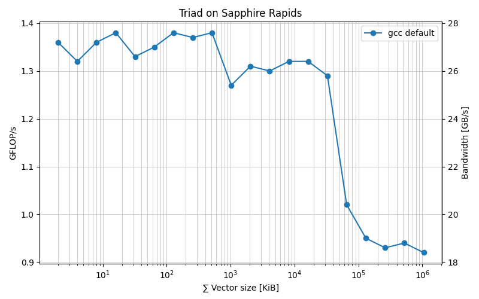
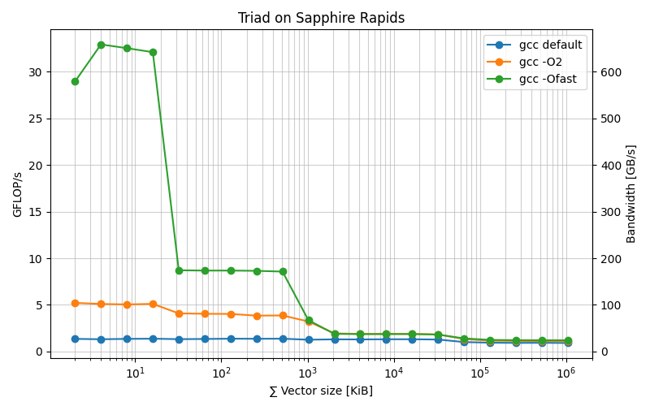
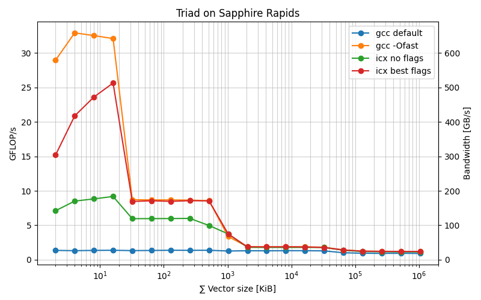
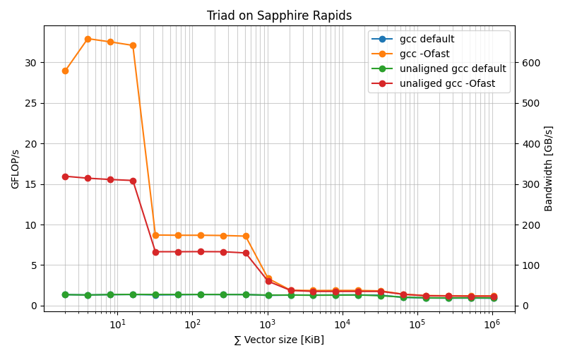
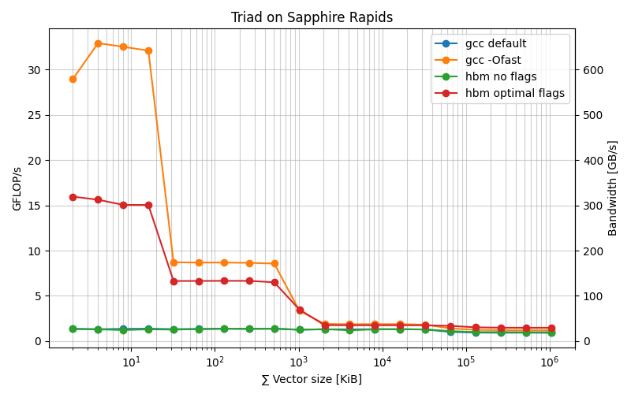

# 2
The following table summarizes the different configurations used for the measurements:
  |Name|Compiler Flags|Memory Allocation|
  -----|--------------|------------------|
gcc default|-fopenmp|aligned|
gcc -O2|-fopenmp -O2|aligned|
gcc -Ofast|-fopenmp -Ofast -march=native -mprefer-vector-width=512|aligned|
icc default|-qopenmp|aligned|
icc -O2|-qopenmp -O2|aligned|
icc -Ofast|-qopenmp -Ofast -march=native -mprefer-vector-width=512|aligned|
unaligned gcc default|-fopenmp|unaligned|
unaligned gcc -Ofast|-fopenmp -Ofast -march=native -mprefer-vector-width=512|unaligned|
hbm no flags|-fopenmp|high bandwidth memory|
hbm optimal flags|-fopenmp -Ofast -march=native -mprefer-vector-width=512|high bandwidth memory|

---

## (a)

The cache sizes of the system used are:
- L1d:                   4.5 MiB
- L1i:                   3 MiB 
- L2:                    192 MiB 
- L3:                    210 MiB 

The plot clearly shows two drops in performance one around the 10^3 KiB mark and one around the 10^5 KiB mark. These correspond to the L1 and L2 cache sizes of the system used. Meaning that when the vector sizes exceed these sizes the data no longer fits into the respective cache leading to more memory accesses in slower chaches or even the main memory and thus a drop in performance.

## (b)
### i.

### ii.

The plots show that with increasing optimization levels the performance increases significantly. This is due to the fact that the compiler is able to apply more aggressive optimizations. For instance the use of the -Ofast flag allows the compiler to use optimizations that may violate strict standards compliance but lead to better performance. This includes for example the use of vectorized instructions that operate on multiple data points simultaneously, significantly speeding up the triad operation. The -mprefer-vector-width=512 flag specifically tells the compiler to prefer using 512-bit wide vector instructions, which can process 8 double-precision floating-point numbers in parallel, further enhancing performance. Without this flag the compiler might choose narrower vector widths, resulting in less parallelism and lower performance in favour of better thermal characteristics.

It is also noticeable that the Intel compiler outperforms the GCC compiler in the default configuration. This is likely due to the Intel compiler being specifically optimized for Intel architectures, allowing it to generate more efficient code for the target system. However, with higher optimization levels and bigger Datasets the performance difference between the two compilers decreases, as both are able to apply similar optimizations and make use of vectorized instructions. It is however important to see the huge performance lead gcc in its optimized configuration has over icc. This is likely due to better vectorization and optimization strategies implemented in gcc for this specific workload.
## (d)

With optimized flags it is noticeable to see that aligned memory is far superior to unaligned memory access. This is due to the fact that the CPU can load and store aligned memory in a single operation while unaligned memory access may span multiple cache lines leading to multiple loads and stores. This is especially notable when using vectorized instructions as these operate on multiple data points at once and thus the chance of spanning multiple cache lines is higher.

## (e)

