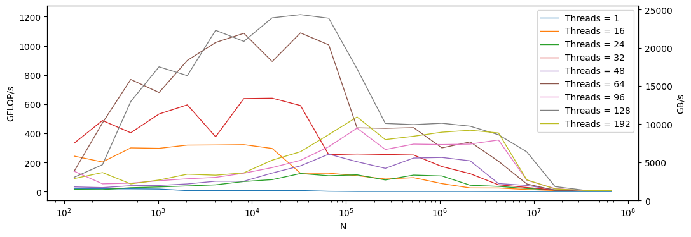
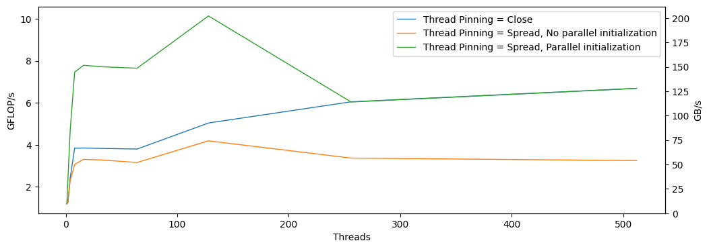

# Task 3 - Parallel Performance

We are working on the SAP3 system. It has 4 NUMA domains and 96 physical cores divided between 2 sockets with 2 hardware threads each. However of the 4 available NUMA nodes only 2 are used, which means that we effectively only have 2 NUMA domains.

## (a) Different thread counts in comparison to the vector length

### Observation

When testing the triad operation with different threads the maximum memory bandwidth was reached at 128 threads around a vector size of 32768 elements with 1214.32 GFLOPs or 24286.4 GB/s memory utilization.

- For 1 Thread declining performance with growing vector size
- For powers of 2 which are multiples of NUMA domain count (16, 32, 64, 128)
  - Overall best performance
  - For smaller vector sizes a smaller thread count can be preferable
  - As vector site increases higher thread counts have better performance
  - This scaling is most significant from 32 to 64 and slows down with 128
  - performance improvement decreases as vectors increase in size and plateau at 10⁴ for highest measured thread count
  - For lower thread counts this effect happens even earlier
  - Abrupt performance drop between 10⁴-10⁵ on all thread counts
  - For lower thread counts this drop again happens earlier
  - Beast performance is in general archived shortly before this drop (especially for higher thread counts)
  - After drop performance plateaus for all thread counts at this new level until around 10⁶-10⁷
  - Higher thread counts plateau at higher performance for this area
- For multiples of physical core count (24, 48, 96, 192)
  - Generally lower performance than power of I's equivalent
  - Especially for smaller vector sizes
  - Performance improves with increasing thread count in a similar fashion to powers of 2 (especially scaling from 48-96-192)
  - Performance increases gradually until vector size of 10⁵
  - Maximum performance is again reached shortly before this point
  - After that it generally plateaus at its maximum or a little bit worse
- Around 10⁶-10⁷ all thread counts approach single thread performance, while higher thread counts drop later

### Interpretation

When we look at the plots of the different thread numbers we can spot that powers of 2 can optimally utilize the memory bandwidth. This could be traced back to balanced distribution of threads across the 2 NUMA domains. In that case no NUMA domain would be under- or over-utilized as the thread can be distributed evenly. In addition, also divide up evenly on the number of available cores in the systems CPU.

When looking at the two drops at 10⁵ and 10⁷ we can also clearly observe the memory hierarchy in this system. Both drop happen due to the necessity of accessing a larger but substantially slower cache. This is caused by the increasing size of the vector which than doesn't fits entirely into the higher level cache anymore. Beyond a specific vector length around 10⁷ we can spot that the performance of all thread counts approach that of a single thread. This can be explained due to the memory link being fully utilized which means that independent of positioning all thread compete for the same bandwidth. The advantage we get through utilizing different NUMA domains and using local caches on the cores gets mitigated as to much data needs to be transferred to and from memory.

## (b) Strong scaling experiment

### Observation

- Spread thread pinning with parallel initialization has overall best performance
- Peak performance can be reached with 128 threads
- Using close thread pinning has a worse performance than parallel initialized spread thread pinning
- However beyond 256 both close and spread thread pinning have identical performance and spread thread pinning looses it advantage
- When the initialization is done sequentially performance is significantly worse on all thread counts
- The shape however is very similar to spread thread pinning with parallel initialization

An important discovery which is not represented in our data is that for thread counts which are not a power of 2 the performance is substantially worse in all cases. We decided to not plot this data in the graph as it would make it hard to see the relevant development of performance across the modifications.

### Interpretation

As the thread pinning is not used for the initialization of the vectors they get allocated in suboptimal ways. This is due to the first touch policy of NUMA aware memory allocations. In the case of sequential initialization all vectors get allocated in one single NUMA domain which is the NUMA Domain that corresponds the core that executes the main program. When the triad operation is now executed many cores have to access non-local memory when the task gets spread over many cores which leads to a notable decrease in performance. On the other hand, OpenMP uses a deterministic procedure to schedules threads. This means when the initialization is also executed in parallel, each vector is allocated in the same NUMA domain were the triad operation will be run. Thus the memory access times are shorter which will increase the performance of the operation.

We can also observe that after a specific threshold the performance of close or spread thread pinning become identical. This could be due to the memory bandwidth being fully saturated on all NUMA domains. After that point it would not matter that the thread could theoretically use different NUMA domains to spread the load as the bandwidth is already fully utilized.

## Conclusion

When optimizing the parallel performance of the triad operation on the SAP3 system the thread count with the highest performance is 128 threads. This applies across almost all vector sizes except except for small ones. At these sizes 32 threads can archive better performance ratings. It is also noteworthy that the performance increase between 64 and 128 threads is much more subtle in comparison to the step between 32 and 64.

For the triad operation spread thread pinning also has a clear advantage on our systems. But most importantly, it is critical to initialize the vectors in parallel to ensure they are allocated on local memory to archive the best performance.

In general it seems as the consideration of the NUMA domains when optimizing performance plays a critical role and can have significant impacts. This gets supported both by having best performance when choosing a power of two as the tread count and by the notable performance drop when not initializing the vectors in parallel. Both are directly correlated to optimizing the memory usage according to the NUMA domains.

## Improvements & further testing

During the testing we realized that performance could very substantially between runs, even when scheduled as a job. Although the general performance results were the same over all runs, we would like to perform the test multiple times and average out the individual results. This would give us a more robust base to argue on and could eliminate possible side effects even more.

In addition we would also like to explore other OMP settings like the pinning of threads to cores instead of hardware threads in more detail. Then we could maybe get a more in depth understanding on some of the anomies we discovered and could clear up open questions.