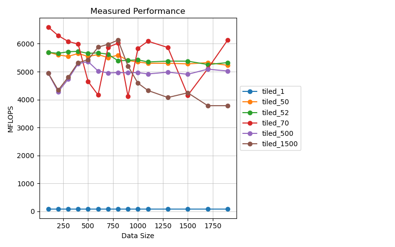
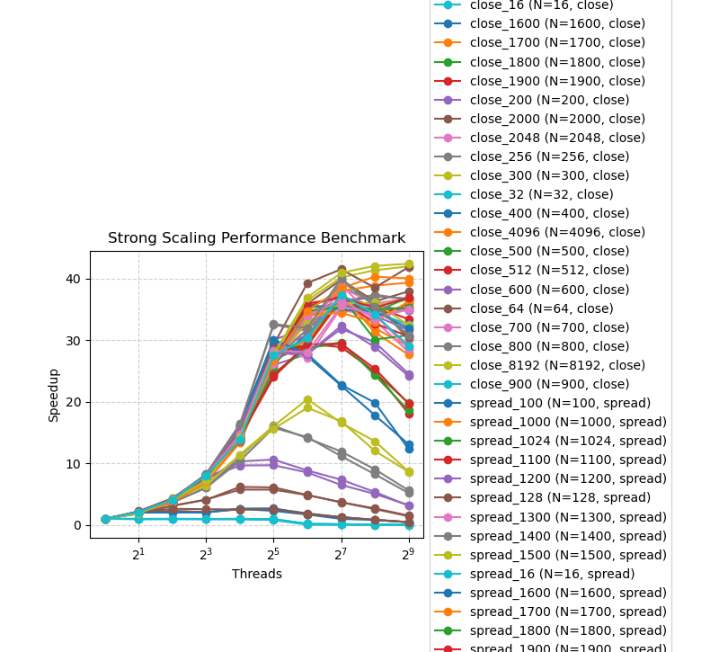
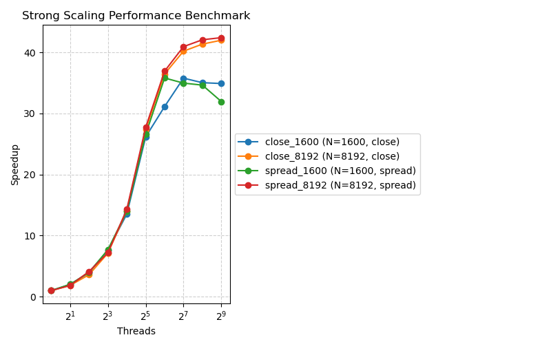

# Task 2 - Experiments and Measurements

## a)

After testing different compilers and compiler flags the fastest performance could be archived by far with the g++ (Spack GCC) 13.1.0 compiler.
In combination with the following flags we could reach a peak performance of around 2612 MFLOPs (N=100, unoptimized and sequential).

~~~
g++ -O3 -march=native -ffast-math -fstrict-aliasing -fopenmp -o assignment assignment.out
~~~

The same performance was gained when just complied with.

~~~
g++ -Ofast -march=native -fopenmp -o assignment assignment.out
~~~

The other clang c compiler was significantly slower. Also notably leaving out certain command arguments had an huge impact on performance.
Especially *-ffast-math* which improved our performance from 399 to 2612 MFLOPs

## b)

When taking a look at the disassembled object dump, you can the spot *FADDA* SVE vector instruction being used in the most inner loop.

~~~
  400e18:       a5e042a0        ld1d    {z0.d}, p0/z, [x21, x0, lsl #3]   ## load next vector
  400e1c:       04f0e3e0        incd    x0                ## Increase k
  400e20:       65d82001        fadda   d1, p0, d1, z0.d  ## Perform partial sum
  400e24:       25f40c00        whilelo p0.d, w0, w20     ## Checking loop cond
  400e28:       54ffff81        b.ne    400e18            ## Branching on loop cond
~~~

However we will see that through reordering the loops the compiler will be able to use vector instructions more often.
Thus more operations can be done on the same data leading to better performance.

## c)


When deciding which loop ordering would be beneficial for cache reusability we first took a look at the default ordering of *ijk*.
In that case *B* gets accessed sequentially in the innermost loop, while *A* in the second innermost loop. 
However we access a completely new row of *C* in each iteration of the innermost loop, which means that we potentially have to pull much more data. This is due to the matrix being saved as a one-dimensional array, leading to huge jumps when hooping between rows of a matrix.

To fix this problem we switch the ordering of *k* and *j*.
Now *C* gets accessed sequentially in the innermost loop and only requiring a row jump after a full iteration of the second innermost loop.
Additionally the access patterns of *A* and *B* just get flipped, which means that for this loop ordering all matrices get accessed in a cache-aware matter.

Applying our theoretical assumptions and comparing the results clearly shows, that this had an huge impact on performance:


In addition the reordering allowed the compiler to be able to use the fully vectorized *FMAD* vector instruction.
This essentially means that instead of just computing the partial sum for one element of the vector as a scalar result we now perform this operation on each element, directly updating the entire vector with one instruction.

~~~
  400d60:       a5e0a021        ld1d    {z1.d}, p0/z, [x1]
  400d64:       a5e04040        ld1d    {z0.d}, p0/z, [x2, x0, lsl #3]
  400d68:       65e18440        fmad    z0.d, p1/m, z2.d, z1.d  // use of FMAD instruction
  400d6c:       e5e0e020        st1d    {z0.d}, p0, [x1]
  400d70:       04f0e3e0        incd    x0
  400d74:       0430e3e1        incb    x1
  400d78:       25f30c00        whilelo p0.d, w0, w19
  400d7c:       54ffff21        b.ne    400d60 <_Z2mmiid+0x1c0>  // b.any
~~~

## d)

To circumvent the limitation that the TILE_SIZE must be a multiple of N we decided to pad the matrix to the next multiple.
This padding is implemented by just filling up the remaining rows and columns with zeros and has no effect on the result of the matrix multiplication.
However depending on the number of zero elements, this can have a significant impact on the overall execution time.
In general we have to compromise execution time for potentially better cache reusability by getting the possibility to make fine adjustments to the tile size.
During our testing we found out that having near zero overhead from padding is the best strategy.
In addition choosing a tile size that allows us to fit 3 tiles into the L1 cache seems to gain the best performance over different matrix sizes.


For a blocked matrix multiplication each thread must reuse one `t × t` tile of `A`, `B`, and `C` from the target cache level.  With double-precision elements (8 bytes) the footprint of such a tile trio is

```
3 · t² · 8 B = 24 · t² bytes.
```

- **L1D (64 KB per core):**  
  `24 · t² ≤ 64 · 1024` ⇒ `t² ≤ 2730.7` ⇒ `t ≤ 52.2`.  Allowing a safety margin for temporaries, we target `t ≈ 48–52` for the innermost micro-kernel that should stay resident in L1.
- **L2 (8 MB shared by 12 cores per CMG):**  
  In theory, occupying the whole 8 MB would give `t ≤ 592`, but multiple cores operate concurrently.  Budgeting roughly 512–768 KB per active core yields  
  `24 · t² ≤ 512 · 1024 … 768 · 1024` ⇒ `t ≤ 103 … 126`.  Thus we pick an outer blocking tile around `t ≈ 96–128` to fit comfortably in the CMG-local L2.
- **L3:**  
  A64FX has no separate L3; the 8 MB L2 is the last-level cache.  Beyond that size data streams from the on-package HBM2, so there is no additional cache-resident tile size to compute.

These bounds align with the measurements: inner tiles near 48 keep the compute kernel L1-resident, while grouping work into tiles around 100–128 maximises reuse before spilling to memory.


The following table shows the results of our measurements for different tile sizes


For better readability we extracted the following results:


Our calculations indicated that the best tilesize would be around 50 and whilst the actual measurements show that 52 is the best consistent tile size other tile sizes like 70 sometimes outperform this tile size however not consistently and they also underperform for certain sizes which is due to the overhead of the padding. The drop in performance corrolates to no padding needed so it can be seen that the padding improves the overall performance, we did not further investigate this phenomenom due to our group size limitation. Therefore we concentrate on tile size 52 as the best choice. 

## e)




## f)

For the Fujitsu A64FX we assume one 512-bit SVE FMA per vector unit and clock cycle. A 512-bit vector holds eight double elements and each FMA produces two floating-point operations per element, so one vector unit can issue `8 × 2 = 16` FLOPs every cycle. With two SVE units per core running at 1.8 GHz the theoretical peak is

- per core: `16 FLOPs/cycle × 2 units × 1.8·10⁹ cycles/s = 57.6 GFLOP/s`,
- per 48-core socket: `57.6 GFLOP/s × 48 = 2.76 TFLOP/s`.

Our best single-thread benchmark run (tiling with `t = 70`) delivers 6541 MFLOP/s for `N = 100` (`assignment02/src/mm/data/tiled/tiled_70.txt:1`), i.e. ≈6.54 GFLOP/s. Compared with the per-core peak this corresponds to about `6.54 / 57.6 ≈ 11.4 %`. Relative to the full-socket theoretical limit the same run reaches only `6.54 / 2764.8 ≈ 0.24 %`, which is expected because the code currently utilises just a single core. Achieving a larger share of the socket peak would require parallelising across cores and keeping all SVE pipelines busy.

> todo parallel stuff

# Acknowledgement
In the implementation of the python script used to generate the plots generative AI like ChatGPT and Visual Studio Code Copilot were used to speed up the coding process.

# Disclaimer
Due to our group size of only two members we decided to work on all tasks however not to dive in too deeply?
