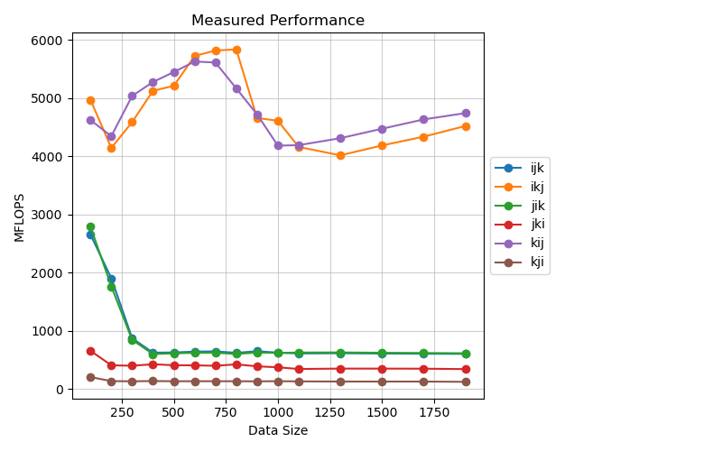
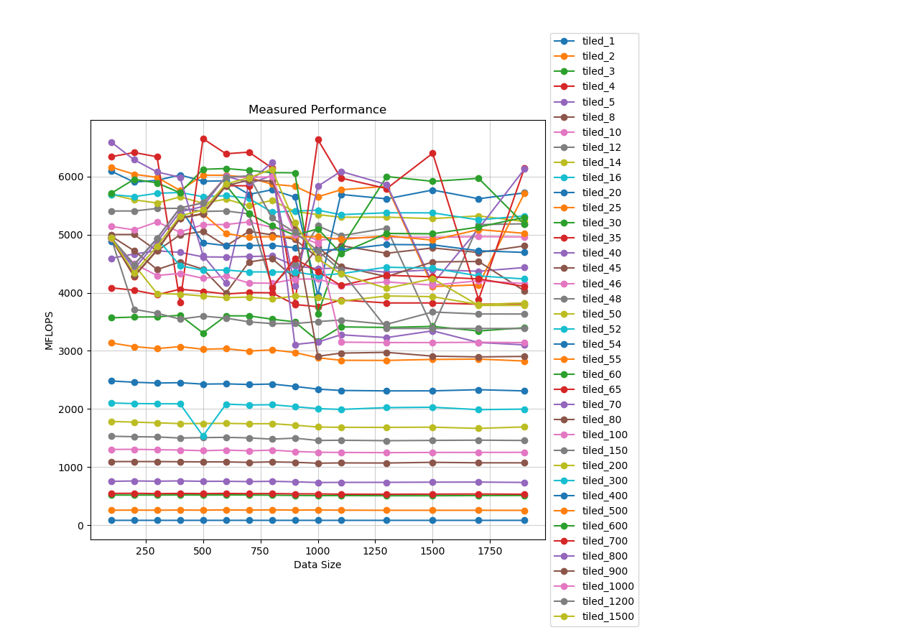
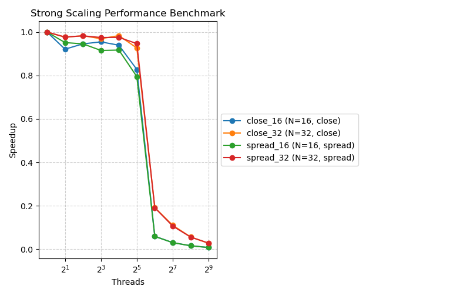

# Task 2 - Experiments and Measurements

## a)

After testing different compilers and compiler flags the fastest performance could be archived by far with the g++ (Spack GCC) 13.1.0 compiler.
In combination with the following flags we could reach a peak performance of around 2612 MFLOPs (N=100, unoptimized and sequential).

~~~
g++ -O3 -march=native -ffast-math -fstrict-aliasing -fopenmp -o assignment assignment.out
~~~

The same performance was gained when just complied with.

~~~
g++ -Ofast -march=native -fopenmp -o assignment assignment.out
~~~

The other clang c compiler was significantly slower. Also notably leaving out certain command arguments had an huge impact on performance.
Especially *-ffast-math* which improved our performance from 399 to 2612 MFLOPs

## b)

When taking a look at the disassembled object dump, you can the spot *FADDA* SVE vector instruction being used in the most inner loop.

~~~
  400e18:       a5e042a0        ld1d    {z0.d}, p0/z, [x21, x0, lsl #3]   ## load next vector
  400e1c:       04f0e3e0        incd    x0                ## Increase k
  400e20:       65d82001        fadda   d1, p0, d1, z0.d  ## Perform partial sum
  400e24:       25f40c00        whilelo p0.d, w0, w20     ## Checking loop cond
  400e28:       54ffff81        b.ne    400e18            ## Branching on loop cond
~~~

However, we will see that by reordering the loops the compiler will be able to use a more effective vector instructions instead.

## c)

When deciding which loop ordering would be beneficial for cache reusability we first took a look at the default ordering of *ijk*.
In that case *B* gets accessed sequentially in the innermost loop, while *A* in the second innermost loop. 
However we access a completely new row of *C* in each iteration of the innermost loop, which means that we potentially have to pull much more data. This is due to the matrix being saved as a one-dimensional array, leading to huge jumps when hooping between rows of a matrix.

To fix this problem we switch the ordering of *k* and *j*.
Now *C* gets accessed sequentially in the innermost loop and only requiring a row jump after a full iteration of the second innermost loop.
Additionally the access patterns of *A* and *B* just get flipped, which means that for this loop ordering all matrices get accessed in a cache-aware matter.

Applying our theoretical assumptions and comparing the results clearly shows, that this had an huge impact on performance:

In addition the reordering allowed the compiler to be able to use the fully vectorized *FMAD* vector instruction.
This essentially means that instead of just computing the partial sum for one element of the vector as a scalar result we now perform this operation on each element, directly updating the entire vector with one instruction.

~~~
  400d60:       a5e0a021        ld1d    {z1.d}, p0/z, [x1]
  400d64:       a5e04040        ld1d    {z0.d}, p0/z, [x2, x0, lsl #3]
  400d68:       65e18440        fmad    z0.d, p1/m, z2.d, z1.d  // use of FMAD instruction
  400d6c:       e5e0e020        st1d    {z0.d}, p0, [x1]
  400d70:       04f0e3e0        incd    x0
  400d74:       0430e3e1        incb    x1
  400d78:       25f30c00        whilelo p0.d, w0, w19
  400d7c:       54ffff21        b.ne    400d60 <_Z2mmiid+0x1c0>  // b.any
~~~

## d)

### Padding of matrices

To circumvent the limitation that the *TILE_SIZE t* must be a multiple of *N* we decided to pad the matrix to the next multiple.
This padding is implemented by just filling up the remaining rows and columns with zeros and has no effect on the result of the matrix multiplication.
However depending on the number of zero elements, this can have a significant impact on the overall execution time.
In general we have to compromise execution time for potentially better cache reusability by getting the possibility to make fine adjustments to the tile size.
During our testing we found out that having near zero overhead from padding is the best strategy.
In addition choosing a tile size that allows us to fit 3 tiles into the L1 cache seems to gain the best performance over different matrix sizes.

For a blocked matrix multiplication each thread must reuse one *t * t* tile of *A*, *B*, and *C* from the target cache level. With double-precision elements (8 bytes) the footprint of such a tile trio is

~~~
3 * t² * 8 bytes = 24 * t² bytes.
~~~

### L1D

The L1D cache consists of 64 KiB per core with that we get:

~~~
24 * t² <= 64 * 1024 ==> t² <= 2731 ==> t <= 52
~~~

When considering a safety overhead the tile size should be around 48-52 so 3 tiles can stay in the L1 cache for one full run of the innermost loop.

### L2

One unit of L2 cache gets shared among 12 cores where each holds 8 MiB of space.
When each of the 12 cores operate on the same L2 cache we get around 700 KiB of L2 cache per core, thus we get:

~~~
24 * t² <= 700 * 1024 ==> t² <= 29866 ==> t <= 172
~~~

Again, considering as safety margin we should choose the tile size to be 160-172 to fit all the tiles into the shared L2 cache.

### L3 
A64FX has no separate L3; the 8 MB L2 is the last-level cache before memory. Beyond that size data streams from the HBM2, so there is no additional tile size to compute.

### Measurement results

The following table shows the results of our measurements for different tile sizes

For better readability we extracted the following plots:

Our calculations indicated that the best tile size would be around 50 and whilst the actual measurements show that 52 is the best consistent tile size other tile sizes like 70 sometimes outperform this tile size however not consistently and they also underperform for certain sizes which is due to zero-padding of the matrices. The drop in performance always occurs when no padding is needed. One theory is that due to zero values being not as computationally expensive they could improve the throughput of operations and therefore increase the number of FLOPs. However as we are limited due to our group size limitation we didn't investigate this phenomenon further. Therefore we continued with a tile size of 52 in further measurements. 

## e)

After performing several strong scaling benchmarks with different matrix sizes we can clearly see a reoccurring behavior in almost all cases for larger matrix sizes. The speedup grows near exponentially until hitting a certain threshold. After this point the growth slows down until stagnating at max performance. Beyond this peak performance point the speedup degrades again.

>> **either add the new graph in addition or completely replace the old one, your call**

Noticeably the threshold point is delayed with growing matrix sizes and therefore the achievable speedup can get significantly higher. This also means that although we test for much higher thread counts as the system can provide physically, the scheduling can optimize the tiled matrix operation effectively which leads to an additional increased in performance. This behavior gets even more consistent as the matrices get very large.

>> **is last part true???**
>> **replace following plot**

Taking a closer look at very small matrix sizes shows a different scaling behavior. The overhead of the scheduling is much larger than the actual benefit and thus the single-core execution is faster then parallelization. While to a certain point it only has a minor effect on performance after the thread count exceeds 48 it drops to a fifth of the single-core performance. This could be explained as we now spawn more threads than actual cores exist and thus the overhead of OpenMP gets substantially high.

Finally, we could observer almost no difference in scaling between spread and close thread binding throughout all matrix sizes. This is due to the fact that the kernel is not memory-bound but instead compute-bound. Thus spreading the threads out to distribute the memory- and cache-use is not a deciding factor for performance, as the kernel operates on one tile continuously until finished and only needs to fetch it once while performing several operations.

## f)

### Theoretical peak

For the Fujitsu A64FX we assume one 512-bit SVE FMA per vector unit and clock cycle. A 512-bit vector holds eight double elements and each FMA produces two floating-point operations per element, so one vector unit can issue *8 * 2 = 16* FLOPs every cycle. With two SVE units per core running at 1.8 GHz the performance per core is:

~~~
16 FLOP/cycle * 2 units * 1,8 * 10⁹ cycles/s = 57,6 GFLOP/s
~~~

Now as the A64FX consist of 48 cores we get a theoretical peak performance of 2,76 TFLOP/s.

### Single-thread comparison 

Comparing this to our best single-thread benchmark run, which delivers 6541 MFLOP/s for a matrix size of N = 100 with a tile size of t = 70 we utilize only around 11% of the perak per-core performance. Relative to the full-socket theoretical limit the same run reaches only 0,24%:

~~~
6,54 / 57,6 = 11,4 % ==> 6,54 / 2764,8 = 0,24%
~~~

This performance is expected because the code currently utilizes just a single core. Achieving a larger share of the socket peak would require parallelizing across cores and keeping all SVE pipelines busy.

### Parallelization comparison

When looking at our parallelized performance we consider a tile size of 52 as previously mentioned. We archived a peak performance of **NNNNN** when running the benchmark with a matrix size of **NNNNN** and using **NNNN** Threads. This amounts to about PPPP% of the theoretically possible peak performance and has **SSSS** % speedup against the single-thread performance with identical parameters.

>> **Add values to parallel part**

# Acknowledgement
In the implementation of the python script used to generate the plots generative AI like ChatGPT and Visual Studio Code Copilot were used to speed up the coding process.

# Disclaimer
Due to our group size of only two members we decided to work on all tasks however not to dive in too deeply?
