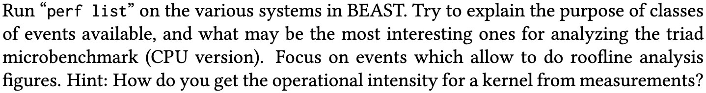
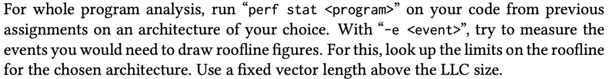
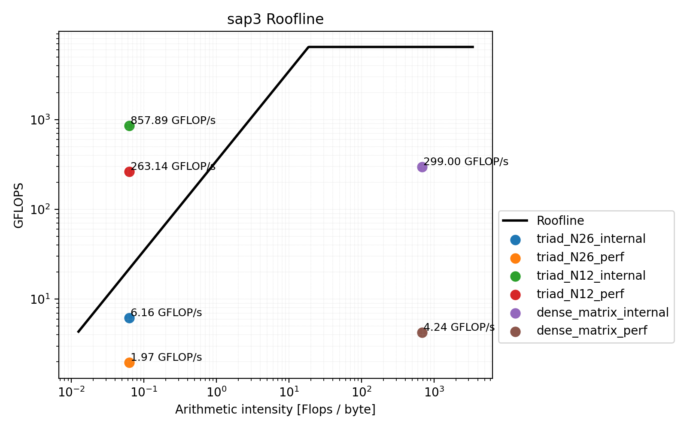
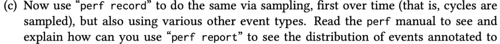
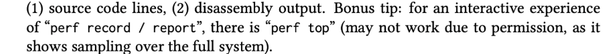
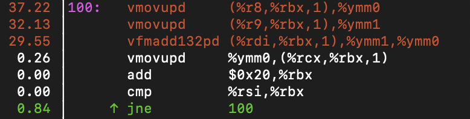
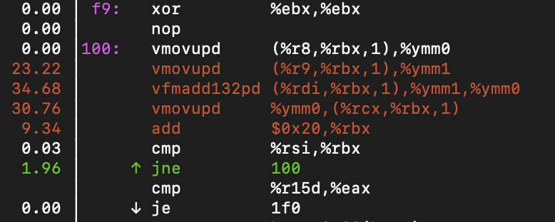
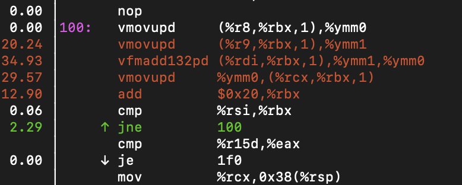
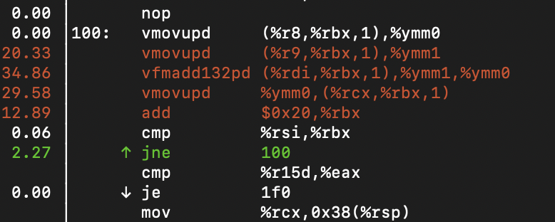

# Report on Task 1:
## a)
All four platforms share the same basic classes of predefined events such as:

| class | example of event |
|-------|------------------|
|Hardware event| branch-misses, cache-misses, cpu-cycles|
|Software event| page-faults, major-faults| 
|Tool event| duration_time|

Then the individual platforms differ in the number of predefined events they offer. The 'gh2' and 'cs2' for example have no further predefined event classes and all in all have the fewest predefined events. It is to be noted that both platforms are running on ARM architecture, while the other two platforms run on x86 architecture. The 'sap3' and 'milan2' platforms have more predefined event classes in common like `Kernel PMU events`, sap3 also lists the event class  `Hardware cache event` whilst milan2 then has dedicated lists for branch, cache, core, data fabric, floating point, and memory related events.

The three shared classes cover all the major components of a computer system: `Hardware event` lists events which are commonly implemented or related to hardware solutions like branch prediction, caching and cpu cycles. These events get updated directly by the hardware and the Kernel then just reads their value from dedicated register, whereas  `Software event` list context switches, page-faults and emulation faults, which are components typically implemented by Software, commonly in the OS itself which then is responsible for keeping track of the occurrences of these events. `Tool event` can be seen as meta events of perf and list rather few events like duration_time.

To do a roofline analysis of the triad benchmark, we need to measure the achieved performance of our run this can be done by measuring the execution time of our benchmark and calculating the floating point operations per second. This measurement can be done by using the Tool event `duration_time`.

## b)
The following measurements were taken on the sap3 platform using the perf tool. For the triad benchmark using 128 Threads and for the matrix multiplication benchmark using 512 Threads.

The values calculated by the perftool differ from those which are calculated internally due to overhead which is measured in perf but not internally like the initialization of the vectors and the verification of the results. All the points are underneath each other because the Arithmetic intensity is constant the points which are above the roofline ceiling fit complete inside the caches therefore they achieve higher performance than the roofline model predicts based on the main memory bandwidth.

## c)  
The following output of perf for the triad benchmark on the sap3 platform shows the measured event 

`cycles`:

`cach miss`:

`instructions`:

`branches`:
  
 
### Findings & interpretation

All samplings show that the most visited region is the inner loop of the triad benchmark. This is expected as this is where the data is fetched from memory and the main computations are performed. It is to be noted that appart from the two `vmovupd` which are vector load instruction the combined `vfmadd132pd` instruction also fetches data from memory and then performs a combined addition and multiplication operation. This means that a significant portion of the CPU cycles are dedicated to memory operations which is expected for a memory intensive benchmark like the triad benchmark.