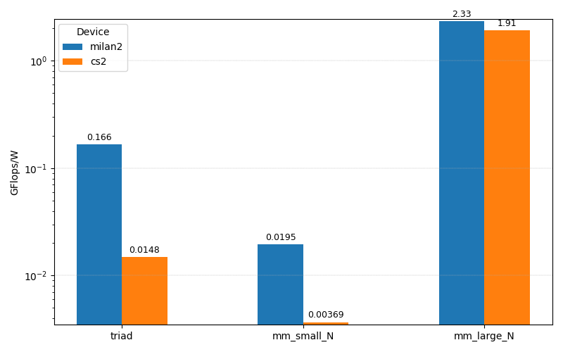

# Report on Task 4:

The idle power consumption of milan and cs (all cs n nodes) is  701W and  1158W respectively.

### Benchmark Power Consumption

#### Parameters of the runs (settings based on previous experiments)

| Benchmark    | Threads | N     | Tile Size |
|--------------|---------|-------|-----------|
| triad        | 128     | 26    | -         |
| mm small     | 1       | 32    | 52        |
| mm large     | 512     | 8192  | 52        |

#### Measurements: milan vs cs

| Benchmark    | milan Power avg. (W) | milan GFLOPs | cs Power avg. (W) | cs GFlops |
|--------------|------------------|--------------|---------------|------------|
| triad        | 827              | 137.44       | 1160          | 17.18      |
| mm small     | 879              | 17.18        | 1165          | 4.29       |
| mm large     | 953              | 2218.41      | 1159          | 2218.41    |

### Results and Interpretation

All in all the milan system requires less power both at idle and under load (Note: That all cs nodes are measured together, while milan is only one node). When comparing the different benchmarks it can be seen that on both machines the matrix multiplication with large N is the most efficent one, whilst for small N it is very inefficent. This can be explained by the fact that for small N the overhead of managing threads and cache effects play a much larger role than for large N where the compute intensity is much higher. The triad benchmark lies in between those two extremes.

### Further Findings
In the test runs on cs it is to be noted that the power consumtion barely increased from idle to full load. Which can be due to the fact that all cs nodes are connected to the same pdu.

The highest one time power measurement for the milan system was `1126W` during the large matrix multiplication run. And for the cs system it was `1173W` during the small matrix multiplication run.

