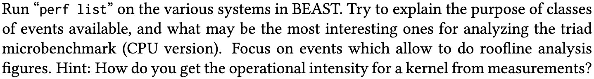
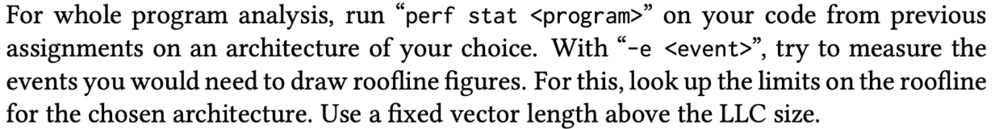
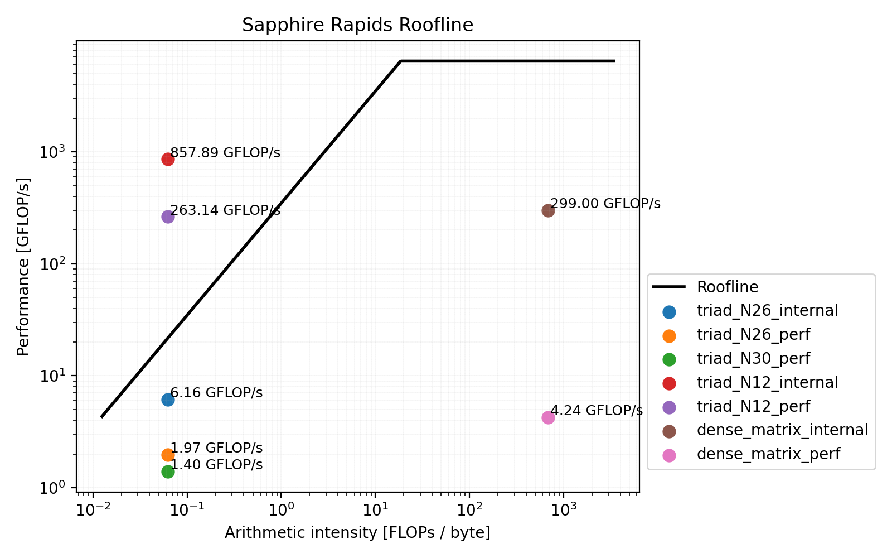

# Report on Task 1:
## a)
All four platform share the same basic classes of predefined events such as:

| class | example of event |
|-------|------------------|
|Hardware event| branch-misses, cache-misses, cpu-cycles|
|Software event| page-faults, major-faults| 
|Tool event| duration_time|

Then the individual platforms differ in the number of predefined events they offer. The 'gh2' and 'cs2' for example have no further predefined event classes and all in all have the fewest predefined events. It is to be noted that both platforms are running on ARM architecture, while the other two platforms run on x86 architecture. The 'sap3' and 'milan2' platforms have more predefined event classes in common like `Kernel PMU events`, sap3 also lists the event class  `Hardware cache event` whilst milan2 then has dedicated lists for branch, cache, core, data fabric, floating point, and memory related events.

The three shared classes cover all the major components of a computer system: `Hardware event` lists events which are commonly implemented or related to hardware solutions like branch prediction, caching and cpu cycles. These events get updated directly by the hardware and the Kernel then just reads their value from dedicated register, whereas  `Software event` list context switches, page-faults and emulation faults, which are components typically implemented by Software, commonly in the OS itself which then is responsible for keeping track of the accurances of these events. `Tool event` can be seen as meta events of perf and list rather few events like duration_time.

To do a roofline analysis of the triad benchmark, we need to measure the achieved performance of our run this can be done by measuring the execution time of our benchmark and calculating the floating point operations per second. This measurment can be done by uing the Tool event `duration_time`.

>> The cpu triad microbenchmark is a memory intensive benchmark, which stresses the memory subsystem of a computer system. Therefore, the most relevant events are cache related like cache-misses, cache-references, L1-dcache-load-misses, L1-dcache-loads, LLC-load-misses, LLC-loads and memory related events like bus-cycles and instructions. These events give insights into how well the memory hierarchy is performing during the benchmark run and how efficiently the CPU can access data from memory. Note that not all events are available on all platforms, e.g., L1-dcache-load-misses is not available on gh2 and cs2. 

>> would need to measure the floating point operations and the memory bandwidth. Therefore, floating point related events like FP_ARITH_INST_RETIRED and memory related events like MEM_UOPS_RETIRED.LOAD and MEM_UOPS_RETIRED.STORE would be relevant. However, not all platforms provide these specific events, so we would need to find equivalent events or use other methods to estimate these metrics.

## b)
The following measurements were taken on the sap3 platform using the perf tool. 

> TODO: rename axis, add calculations, throw away N30
> We used 128 Threads

The values calculated by the perftool differ from those which are calculated internally due to overhead which is measured in perf but not internally like the initialization of the vectors and the verification of the results. All the points are underneath each other because the Arithmetic intensity is constant the points which are above the roofline ceiling fit complete inside the caches therefore they achieve higher performance than the roofline model predicts based on the main memory bandwidth.