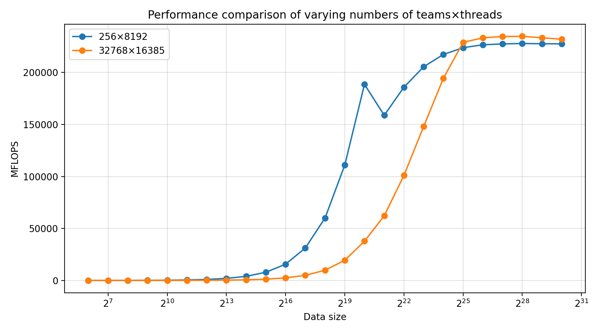

# Report on task 3
For a better result we combined task a) and b) and ran the benchmark with different number of threads and teams and analyzed the resulting performance.

## Measurement setup
The following configurations were used:
- as source file we used our modified version of the triad benchmark `./triad-gpu-offload_gpu-init.out` runing vector sized up to 2^30 elements
- as comiler we used `nvc++`with the flags -fopenmp -mp=gpu -O4 -fast

> To see an extensive list of our measured results please refer to the files in  `/task3-measurements`. They contain a sorted list of the different configurations we used and a sorted by maximum achieved MFLOPS, Median MFLOPS and Avgerage MFLOPS. Furthermore the combined file shows the configuration which performed the highest in every metric.

## Results and interpretation
We decided to continue our analysis with the configuration:
- Teams: 256
- Threads: 8192
  
This configuration is the best [combined](/assignment04/report/task3-measurements/combined.csv) configuration according to our measurements. Even though the highest MFLOPS were achieved by the combination [32768 Teams, 16384 Threads](/assignment04/report/task3-measurements/max.csv) its median and anverage MFLOPS for other vector sizes is significantly lower than the chosen configuration. This is because the high amount of Teams and Threads only pays off when there is enough work to be done. For smaller vector sizes the overhead of managing all the threads and teams is too high compared to the actual computation work that needs to be done.
The configuration we choose is the best compromise between high maximum MFLOPS and good median and average MFLOPS across all vector sizes. Our configuration has a peak MFLOP value which is less than 3% from the overall best MFLOP value whilst achieving much higher average and median results.

When ploting our chosen configuration against the configuration which achieves the highest MFLOPS we get the following graph:

It is clearly noticable that high number of Teams and Threads only pays off for large vector sizes. For smaller vector sizes the overhead of managing all the threads and teams is too high compared to the actual computation work that needs to be done.

## Intresting observation
An interesting observation is the drop in performance for a datasize of 2^21 this phenomenon appeared constantly across several measurements and even on other gh systems. A possible explanation for this could be that the datasize of 2^21 is large enough to not fit into certain caches anymore which causes a significant performance drop. Further investigation was not possible given the teamsize limitation.

## Appendix
all measurements can be found in this [folder](/assignment04/src/triad-gpu-openmp/tests/).