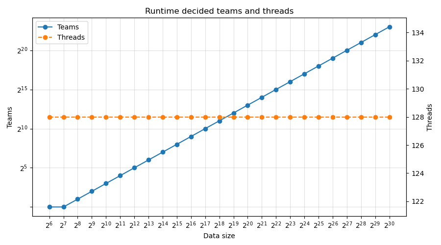
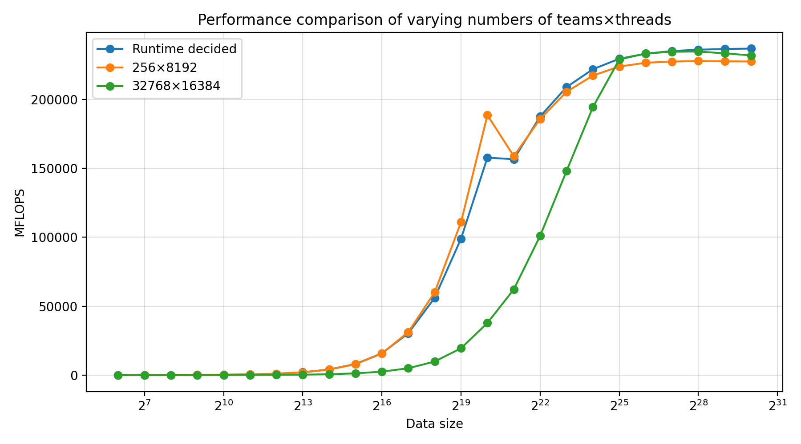

# Report on task 4
## Figures

The first figure shows the used number of Teams and Threads when using runtime decided teams and threads for different data sizes. 

The second figure shows the achieved performance when using runtime decided teams and threads compared to our previously chosen fixed Team and Thread configuration.

## Analysis
The runtime always uses 128 Threads and increases the number of Teams linearly with the data size. This results in a very high number of Teams for large data sizes which leads to high performance for large data sizes. And smaller number of Teams for small data sizes which leads to lower overhead and better performance for small data sizes. All in all the runtime decided configuration performs very similar to our fixed configuration but has the advantage of adapting to different data sizes which is why the fixed configuration that performs the highest max performance in our tries has similar peak performance to the runtime decided configuration but lower performance for small and medium data sizes.

## Comparing CPU to GPU triad with bandwidth calculation
In the comparison of the CPU and GPU versions of the triad benchmark a dataset of 2^29 was used. For this the best triad run achieved [10.14 GFLOPs](/assignment01/merge_black_hole/data_b/triad_mod_spread.csv) on the CPU and on the GPU the best run achieved [236,73582 GFLOPs](/assignment04/src/triad-gpu-openmp/tests/teams_256_8192.csv) using the runtime decided configuration. 

The achieved GPU bandwidth can be calculated as follows: Bandwidth = achieved GFLOPs/ arithmetic intensity. Which is [236,96967 GFLOPs](/assignment04/src/triad-gpu-openmp/task4b-results.csv) / (0.0625 * 10^-6) GFLOPs/Byte = 3,79 TB/s. The vendor given theoretical bandwidth for this system is [4TB/s](https://indico3-jsc.fz-juelich.de/event/203/sessions/123/attachments/210/318/GraceHopper.pdf). Which means that the benchmark achieved around 5% below the theoretical maximum bandwidth.

## Further Work
we also ran our test script for the new best performing value of 8388608x128 Teams x Threads and for low and medium data sizes it performed dreadful as can be seen in this [file](/assignment04/src/triad-gpu-openmp/tests/teams_8388608_128.csv).

## Appendix
all measurements can be found in this [folder](/assignment04/src/triad-gpu-openmp/tests/) and in the [file](/assignment04/src/triad-gpu-openmp/task4b-results.csv).