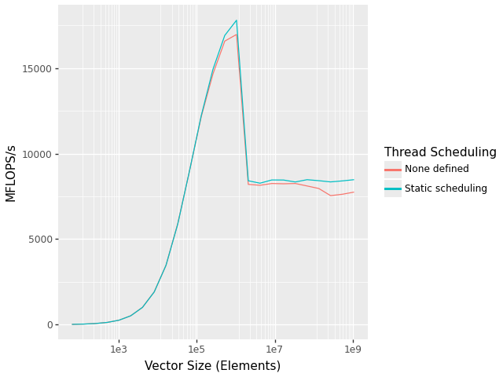

# Task 1 - GPU Utilization

## a) Offloading

To be able to offload computations to the GPU we have to use an appropriate compiler and flags to enable these features by OMP.
Flowing the instruction of the assignment we used the NVIDIA HPC C++ compiler nvhpc version 25.3

~~~
nvc++ 25.3-0 linuxarm64 target on aarch64 Linux -tp grace
~~~

In addition we used the following flags to enable GPU offloading via openMP and compiler optimizations for our program:

~~~
nvc++ -std=c++17 -fopenmp -mp=gpu -O4 -fast
~~~

To make sure we actually offload the desired regions to the GPU we made a simple test in the program. For that we used the omp routine `omp_is_initial_device` to check whether the GPU was used for computation of this routine.

~~~c++
int isInitialDevice = omp_is_initial_device();

#pragma omp target map(from:isInitialDevice)
{
    isInitialDevice = omp_is_initial_device();
}

// CPU = 1; GPU = 0
printf("%d\n", isInitialDevice)
~~~

If the instruction inside the `omp target`-clause would not execute we would expect to print `1` as only the CPU would have accessed the variable. Where as if the GPU also ran the routine we would expect `0` as the GPU is not the initial device of execution.
When testing the expected `0` was printed, thus the GPU was used for execution and the offloading worked.

Moreover we also tested the GPU utilization with `nvidia-smi` to verify that the GPU got utilized while running our test:

~~~
Tue Nov 11 17:32:12 2025       
+-----------------------------------------------------------------------------------------+
| NVIDIA-SMI 550.163.01             Driver Version: 550.163.01     CUDA Version: 12.4     |
|-----------------------------------------+------------------------+----------------------+
| GPU  Name                 Persistence-M | Bus-Id          Disp.A | Volatile Uncorr. ECC |
| Fan  Temp   Perf          Pwr:Usage/Cap |           Memory-Usage | GPU-Util  Compute M. |
|                                         |                        |               MIG M. |
|=========================================+========================+======================|
|   0  NVIDIA GH200 480GB             On  |   00000009:01:00.0 Off |                    0 |
| N/A   33C    P0            105W /  900W |    9320MiB /  97871MiB |      6%      Default |
|                                         |                        |             Disabled |
+-----------------------------------------+------------------------+----------------------+
                                                                                         
+-----------------------------------------------------------------------------------------+
| Processes:                                                                              |
|  GPU   GI   CI        PID   Type   Process name                              GPU Memory |
|        ID   ID                                                               Usage      |
|=========================================================================================|
|    0   N/A  N/A   2561629      C   ./triad-gpu-offload_gpu-init.out             8742MiB |
+-----------------------------------------------------------------------------------------+
~~~

Unfortunately the debug environment variable `LIBOMPTARGET_DEBUG` had no effect when set to `1`, but as we already verified the offloading we continued with our investigation.

## b) Workload Distribution

To be able to fully utilize the GPU we have to distribute the triad operation among teams and threads. This is done by using the `omp teams distribute` and `omp parallel for` clauses. The later one we already used for thread parallelization on the CPU. 
On the GPU we have the additional abstraction model of teams which can be distributed among streaming multiprocessors of the GPU, similar to the distribution of thread among cores.

In our program we used the following directives to allow OpenMP to parallelize the computation of the triad loop among teams and threads:

~~~c++
#pragma omp target teams distribute parallel for simd num_teams(numTeams) num_threads(numThreads)
for (size_t i = 0; i < N; ++i)
{
    a[i] = b[i] + c[i] * d[i];
}
~~~

In addition we provided a given team and thread count for later testing by using `num_teams` and ` num_threads` respectively.
Although according to the NVIDIA developer manual these are only suggestions and could be overwritten by the runtime if it sees fit.

We also decided to only initialize the teams and threads within a given repetition due to technical limitations of the OpenMP implementation.
This means that for every repetition we loose performance due to creation and termination of the given teams and threads.
This cannot be circumvented as team initialization and distribution is only possible directly after offloading a given region to the GPU via `omp target`.
Thus we would wrongly "distribute" the repetition loop among different teams which would not be in the spirit of the benchmark if we would use the following setup:

~~~c++
#pragma omp target data map(tofrom:a[0:N]) map(to:b[0:N],c[0:N],d[0:N])
{

    #pragma omp target teams distribute
    for (size_t j = 0; j < repetitions; ++j)
    {  
        #pragma omp parallel for simd num_teams(numTeams) num_threads(numThreads)
        for (size_t i = 0; i < N; ++i)
        {
            a[i] = b[i] + c[i] * d[i];
        }
    }

}
~~~

Finally to optimize necessary data transfers to and from the GPU we already enclosed the whole operation (including the repetition loop) inside a `omp target data` loop. However we will discuss this in more detail in task 2.

## c) Loop Scheduling Policy

While testing if using the `schedule(static, 1)` scheduling would improve performance we found out, that there is only a small impact when declaring static scheduling. This difference is only significant at very large vector sizes and at the performance peak:

This difference could be caused by enabling the GPU to better handle contiguous memory accesses. As the scheduling directive directly tells the GPU that only one iteration should be handled by each core they can perfectly access the array one by one. This leads to a better memory utilization in contrast to allowing multiple consecutive entries being loaded for one core.
