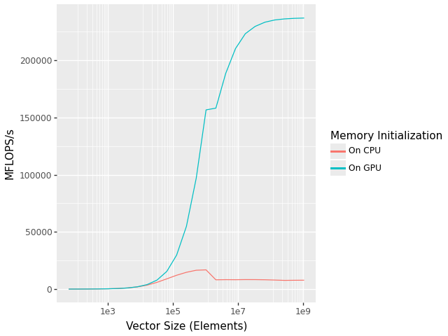

# Task 2 - Evaluating Data Transfer

## Setup

For the CPU

~~~
~~~

For the GPU

~~~
~~~

## Evaluation

### Observation

We can see an enormous performance improvement when initializing the vectors on the GPU instead of the CPU.
The performance for the CPU peaks at around 16481.01 MFLOPS at a size of 524288 elements per vector. Until this point we can see the same scaling curve to the GPU initialization however the increase is much flatter.
After the peak it drops significantly and settles at around 8000 MFLOPS decreasing slowly.

On the GPU side we can see that the scaling continues and doesn't get stopped like on the CPU. It saturates at around 1073741824 elements with a peak performance of 237008.73 MFLOPS.
Although the scaling may continue as we weren't able to test with larger vector sizes due to reaching memory limitations.
Noticeable we see a small plateau at the same vector size of 524288 for the GPU initialization were the CPU initialization did drop too.

### Explanation
