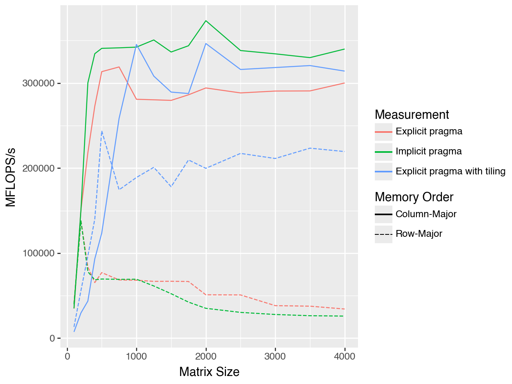

# Task 2 - Optimizations

## Optimizations

Our final version of the matrix multiplication kernel storing all matrices in row major order and not applying any tiling looked as follows:

~~~c++
#pragma omp target
#pragma omp teams num_teams(NUM_TEAMS)
#pragma omp distribute parallel for num_threads(NUM_THREADS) collapse(2) schedule(dynamic, 1)
for (int i = 0; i < N; ++i)
{
  for (int j = 0; j < N; ++j)
  {
    for (int k = 0; k < N; ++k)
    {
      a[IDX(i, j, N)] += b[IDX(i, k, N)] * c[IDX(j, k, N)];
    }
  }
}
~~~

We used teams and thread distribution on the two outer loops which don't have any data dependencies. To archive this we used the `collapse(2)`-clause.
Explicitly applying vectorization with the `simd` directive didn't had an impact on the kernels performance. However applying `dynamic` scheduling archived in this early form of optimization a notable increase in performance. But only in combination with `static` scheduling on the initialization code. Further detail were already mentioned in task 1.

Running the test with both 256 teams and thread archived overall good performance, which is why we ran all our measurements using these values. We also tried to assign the numbers already at compile time using the preprocessor to hopefully let the compiler make more informed decision. Additionally we though this might help getting a fixed number during execution which doesn't get overwritten by the runtime.
We will look into further details about different combinations of teams and threads in task 3.

When looking at the performance reached by explicitly or implicitly defining the OpenMP directives we can spot significant differences. While first they perform similarly for larger matrix sizes explicit work distribution seems to be more performant.
This could be due to the poor matrix layout of `C` which leads to jumps in memory for each inner loop iteration. The compiler might not be able to sufficiently predict the right amount of teams and threads so that all data for the inner loop would fit into a fast cache level. On the other hand, explicitly setting the teams and threads to a constant value which proofs to archive good overall performance for the kernel might be a safer and faster option for large matrices.

> IMAGE 

## Colum major order

Applying a column major order for the `C` matrix proofs to be an important optimization for the matrix multiplication. To archive this store order we simply transpose the access to the matrix by flipping rows and columns:

~~~c++
#define IDX_COL(row, col, height) ((row) + (col) * (height))
~~~

Because of this the innermost loop of the kernel streams subsequent cells in memory rather then jumping each instruction. This allows the compiler to use more optimal vectorized instruction among a whole iteration of the innermost loop.

> IMAGE

Additionally, We can see that performance will not decrease anymore with increasing matrix sizes. This we think can be also traced back to the fact that now access to the matrix `C` is continuous. For larger matrix sizes this would previously mean that due to the bad cache coherence rows would be swapped in and out of faster cache levels in the innermost loop as they don't fit into the small caches. Now as memory access to all matrices is coalesced we can use the smaller cache much more effectively and don't have to swap out rows anymore in every iteration. Instead they now get evicted if computation for this chunk is already finished and thus data is only loaded once.

## Tiling of matrices

> IMAGE

Unfortunately we had problems optimizing the code with implicit OpenMP directives and weren't able to get tiling to work with transparent clauses like `loop`. Thus we could not say if tiling would also improve performance while using these. In the future with more time we would like to investigate this possibility further as both seem to be promising optimizations and together could lead to even better performance measurements.

## Conclusion

## Further work