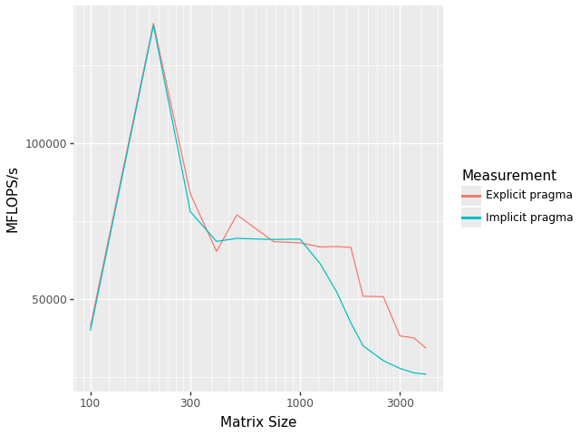
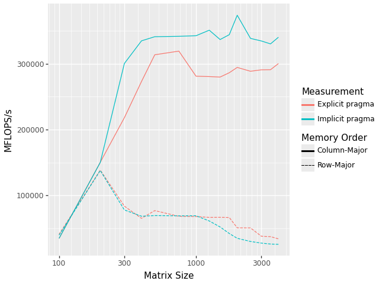
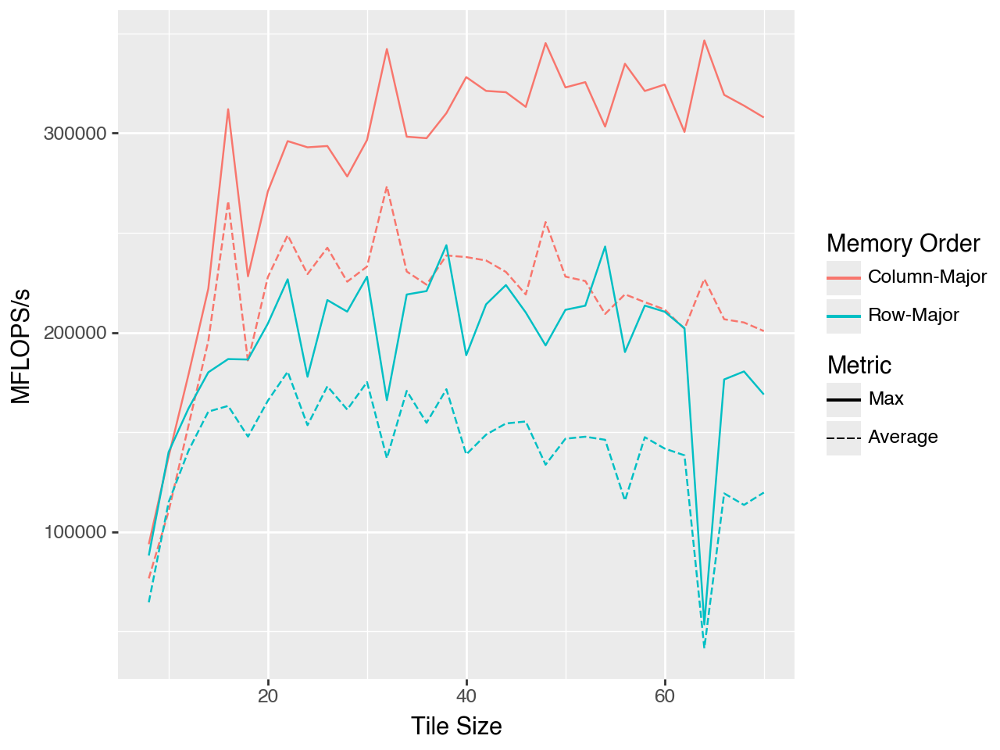

# Task 2 - Optimizations

## Optimizations

Our final version of the matrix multiplication kernel storing all matrices in row major order and not applying any tiling looked as follows:

~~~c++
#pragma omp target
#pragma omp teams num_teams(NUM_TEAMS)
#pragma omp distribute parallel for num_threads(NUM_THREADS) collapse(2) schedule(dynamic, 1)
for (int i = 0; i < N; ++i)
{
  for (int j = 0; j < N; ++j)
  {
    for (int k = 0; k < N; ++k)
    {
      a[IDX(i, j, N)] += b[IDX(i, k, N)] * c[IDX(j, k, N)];
    }
  }
}
~~~

We used teams and thread distribution on the two outer loops which don't have any data dependencies. To archive this we used the `collapse(2)`-clause.
Explicitly applying vectorization with the `simd` directive didn't had an impact on the kernels performance. However applying `dynamic` scheduling archived in this early form of optimization a notable increase in performance. But only in combination with `static` scheduling on the initialization code. Further detail were already mentioned in task 1.

Running the test with both 256 teams and thread archived overall good performance, which is why we ran all our measurements using these values. We also tried to assign the numbers already at compile time using the preprocessor to hopefully let the compiler make more informed decision. Additionally we though this might help getting a fixed number during execution which doesn't get overwritten by the runtime.
We will look into further details about different combinations of teams and threads in task 3.

When looking at the performance reached for larger matrices we can see that after the sizes increase beyond 200 the performance goes down continuously. We can clearly see the memory hierarchy drops in this graph which get even amplified as we take entire row jumps in every iteration for the innermost loop. This is due to the nature we currently access matrix `C` leading to many unnecessary cache evictions and data transfers. Thus beyond a matrix size of 200 we exceed the L1 cache of size 16 KiB and finally L2 with 8 MiB capacity after 1000 being completely memory bound.

By implicitly defining the OpenMP directives we can spot an even worse performance for larger matrices compared to explicit clauses. We think the compiler might even increase the effect of the inefficient memory layout of the matrix `C`.
He might not be able to sufficiently predict the right amount of teams and threads so that all data for the inner loop would fit into a fast cache level. When explicitly setting the teams and threads to a constant value overall might be a safer and faster option for large matrices.

## Colum major order

Applying a column major order for the `C` matrix proofs to be an important optimization for the matrix multiplication. To archive this store order we simply transpose the access to the matrix by flipping rows and columns:

~~~c++
#define IDX_COL(row, col, height) ((row) + (col) * (height))
~~~

Because of this the innermost loop of the kernel streams subsequent cells in memory rather then jumping each instruction. This allows the compiler to use more optimal vectorized instruction among a whole iteration of the innermost loop. This also finally leads to implicit OpenMP clauses outperforming the explicit directives substantially. As the compiler now is able to perfectly predict the matrix multiplication operation it can optimize the workload distribution more optimally than we could do manually.

We are now able to clearly see a initial ramp-up in performance for increasing matrix sizes. Previously as we were limited by strided loads from C beyond a matrix size of 200 we could only see the start of the trend. Now the ramp-up continues up to around a matrix size of 750.
This can be explained by the loop and work distribution overhead from OpenMP which gets mitigated as the matrix size increases and overall execution takes longer. So the ratio from overhead to raw computation gets shifted to the advantage of performance.

Additionally, We can see that performance will not decrease anymore with increasing matrix sizes. This we think can be also traced back to the fact that now access to the matrix `C` is continuous. For larger matrix sizes this would previously mean that due to the bad cache coherence rows would be swapped in and out of faster cache levels in the innermost loop as they don't fit into the small caches. Now as memory access to all matrices is coalesced we can use the smaller cache much more effectively and don't have to swap out rows anymore in every iteration. Instead they now get evicted if computation for this chunk is already finished and thus data is only loaded once.

## Tiling of matrices

To archive tiling of the matrices we first have to make sure we don't run into a buffer overflow. To prevent this we employ the same approach we used on the CPU: Padding the matrices to the next multiple of the tile size using zero entries. Thus the result still is valid and overhead from checking if we would overflow is mitigated completely.

~~~c++
#pragma omp target
#pragma omp teams num_teams(NUM_TEAMS)
#pragma omp distribute
for (int i = 0; i < padded_N; ++i)
{
  #pragma omp parallel num_threads(NUM_THREADS)
  #pragma omp for
  for (int j = 0; j < padded_N; ++j)
  {
    if (i < N && j < N) {
      a[IDX(i, j, padded_N)] = 0.0;
      b[IDX(i, j, padded_N)] = (i * j) / (N * 50);
      c[IDX_COL(i, j, padded_N)] = (i * j) / (N * 50);
  }
    else {
      a[IDX(i, j, padded_N)] = 0.0;
      b[IDX(i, j, padded_N)] = 0.0;
      c[IDX_COL(i, j, padded_N)] = 0.0;
    }
  }
}
~~~

In addition, we split up the distribution of teams and threads to archive an optimal work distribution. For that we distributed teams among the outer loops which split up the matrices into tiles and distributed threads to parallelize operations inside of one tile.
We again collapsed rows and columns into one in both team and thread distribution. 

~~~c++
#pragma omp target
#pragma omp teams num_teams(NUM_TEAMS)
#pragma omp distribute collapse(2)
for (int i = 0; i < N; i += TILE_SIZE)
{
  for (int j = 0; j < N; j += TILE_SIZE)
  {
    for (int k = 0; k < N; k += TILE_SIZE)
    {
      #pragma omp parallel num_threads(NUM_THREADS)
      #pragma omp for collapse(2)
      for (int ii = 0; ii < TILE_SIZE; ++ii)
      {
        for (int jj = 0; jj < TILE_SIZE; ++jj)
        {
          for (int kk = 0; kk < TILE_SIZE; ++kk)
          {
            a[IDX(i + ii, j + jj, padded_N)] += b[IDX(i + ii, k + kk, padded_N)] * c[IDX_COL(j + jj, k + kk,  padded_N)];
          }
        }
      }
    }
  }
}
~~~

Looking at the result we can clearly see that column and row major orders have different max values. However on average throughout all matrix sizes both perform best at around a tile size of 24-32. Max values may increase after that point but on average performance decreases, especially because of much lower performances for smaller matrix sizes.

Also noticeably the ramp-up for tiling is significantly higher and flats out much later compared to non-tiled version. This could be due to the loop overhead that comes from tiling. For smaller matrices tiling isn't that important as most of the rows still fit into the faster cache levels. However as size increases tiling overhead get mitigated by the advantage of having data always available locally.

Unfortunately we had problems optimizing the code with implicit OpenMP directives and weren't able to get tiling to work with transparent clauses like `loop`. Thus we could not say if tiling would also improve performance while using these. In the future with more time we would like to investigate this possibility further as both seem to be promising optimizations and together could lead to even better performance measurements.

## Conclusion

Looking at the peak values we can reach with 256 teams and threads and using implicit OpenMP directives at a matrices size of 2000 around *373360.53 MFLOPS/s*. When using tiling and explicit clauses we get for the same setup and matrices size *346514.07 MFLOPS/s* with a tile size of 64. Similar performance could be also reached at a matrix size of 1000 where explicit directives could even match the performance of implicit clauses.
While we can even archive a significant performance improvement with tiling  using row-major memory order all OpenMP clauses still outperform them with column-major order. And while tiling allowed explicit OpenMP clauses to be more effective they still fall short in comparison to the automatic optimization done by the compiler when using implicit directives like the `loop` construct.

Furthermore we discovered that a tile size of 32 has in general good performance for all matrix sizes and also isn't much slower as the maximum archived value using tiling. However as we only have tiling code for explicit directives and implicit directives can't be configured as broadly we will not consider implicit testing in our future investigation.  
As our explicit tiling code gets at least comparable performance we will therefor use this setup with a tile size of 32 to determine the best number of teams and threads going forward.

## Further work

For further investigation we would also like to compare our results to the CPU version of the matrix multiplication kernel. However as we were testing this on the Grace Hopper system, we didn't have time to adapt out CPU kernel for the Milan system.
