# Task 02 - Measuring Instruction Latency and Throughput

## a)

### i.)
The `CHAINS` parameter controls how many independent instruction chains exist. Therefor the innermost loop computes exactly `CHAINS` amount of partial results. This allows the CPU to pipeline `CHAINS` number of instruction as they don't have data dependencies between them anymore.

Looking at the assembly code for ARM64 with `CHAINS 1` we get the serial execution with one single instruction chain, were each `i`-iteration executes exactly one `OP`-instruction. Here an example for `OP +` (add):

~~~asm
add     x1, x1, 1
add     x20, x20, x19
mov     x19, 3
cmp     x21, x1
bne     .L3
~~~

The same holds for x86, however we choose ARM, as it is more clear to see that different source register get used. 

If we instead choose a larger `CHAINS` we get exactly `CHAINS` number of `OP`-instruction executed per `i`-loop iteration, as between these partial results no dependency exists. This technique is called loop unrolling, as we perform several iterations of the loop in parallel. To make sure the compiler will attempt to unroll the loop we additionally include the compiler pragma `#pragma GCC unroll 65534` which tells GCC to try to unroll the loop into 65534 iterations to one. As the compiler is only able to unroll `CHAINS` amount of instructions, due to the previously mentioned data dependencies, it will settle at exactly this `CHAINS` value for unrolling.

~~~asm
add     x21, x21, 1
add     x20, x20, x19
add     x0, x0, x19
add     x2, x2, x19
add     x1, x1, x19
add     x3, x3, x19
add     x4, x4, x19
add     x5, x5, x19
add     x7, x7, x19
add     x6, x6, x19
add     x10, x10, x19
add     x8, x8, x19
add     x13, x13, x19
add     x9, x9, x19
add     x15, x15, x19
add     x11, x11, x19
add     x16, x16, x19
add     x12, x12, x19
add     x17, x17, x19
add     x14, x14, x19
add     x18, x18, x19
mov     x19, 3
cmp     x21, x23
bne     .L10
cmp     x30, x21
bls     .L6
~~~

### ii)

Looking again at the last assembly code we can see that the add instructions for the `i`-loop are using different register operands. In `ARM64` the register `ADD`-operation uses three register operands. The first one sets the destination register, while the last two are the registers that hold the two addends of the addition.

We can see that the compiler uses different registers to store operands for the `ADD`-instruction.
The `x19` register is the constant `val2` which gets added to every register `x0`-`x19` that are used to save the individual partial sums of each independent `ADD`-chain. We can therefor deduce that at least `CHAINS` was set to 20, which indeed was the case.

If we instead use `CHAINS 5` we see that first off all only 5 additions appear and secondly for these additions only 5 different register get used as operands:

~~~asm
.L27:
add     x4, x4, 1       # Loop counter increment
add     x20, x20, x19   # Begin of add-instructions
add     x0, x0, x19
add     x2, x2, x19
add     x1, x1, x19
add     x3, x3, x19     # End of add-instructions
mov     x19, 3
cmp     x4, x6          # Comparison against condition of i-loop
bne     .L27
cmp     x7, x4
bls     .L6
~~~

For even more chains (e.g. `CHAINS 32`) we get:

~~~asm
.L5:
ldr     x1, [sp, 120]
add     x0, x0, 1
add     x20, x20, x19
add     x27, x27, x19
add     x1, x1, x19
str     x1, [sp, 120]
ldr     x1, [sp, 112]
add     x26, x26, x19
add     x25, x25, x19
add     x24, x24, x19
add     x1, x1, x19
str     x1, [sp, 112]
ldr     x1, [sp, 104]
add     x23, x23, x19
add     x22, x22, x19
add     x21, x21, x19
add     x1, x1, x19
str     x1, [sp, 104]
ldr     x1, [sp, 96]
add     x30, x30, x19
add     x18, x18, x19
add     x17, x17, x19
add     x1, x1, x19
str     x1, [sp, 96]
ldr     x1, [sp, 128]
add     x16, x16, x19
add     x15, x15, x19
add     x14, x14, x19
add     x1, x1, x19
str     x1, [sp, 128]
ldr     x1, [sp, 136]
add     x13, x13, x19
add     x12, x12, x19
add     x11, x11, x19
add     x10, x10, x19
add     x9, x9, x19
add     x8, x8, x19
add     x7, x7, x19
add     x6, x6, x19
add     x5, x5, x19
add     x28, x28, x19
add     x4, x4, x19
add     x3, x3, x19
add     x2, x2, x19
mov     x19, 3
cmp     x0, x1
bne     .L5
~~~

Now we can spot that our architectural register are fully used which means that the compiler outsources some of the partial sums to the memory. For that it uses the `str` (store register) and `ldr` (load register) memory instructions which we can see throughout the code snippet of one iteration. This ensures that the given number for unrolling the loop still gets reached and we make use of the larger number of independent add chains. We can also observe that the compiler executes these memory operations with a latency of three cycles each. We think the compiler tries to optimize for the out-of-order execution of the processor to effectively eliminate the three stall cycles of a L1 cache access to increase the throughput.

### iii.)

To measure the possible throughput of an operation we have to at least match the independent instructions chains with `CHAINS` and the number of available functional units dedicated to this instruction. If we chose a too small amount of `CHAINS`, we can get limited by the latency of the `OP`-instruction as the data dependency forbids the CPU to use further functional units. If instead we use a too large number for `CHAINS` we get limited by the latency of load and store operations. In that case we get the unwanted memory access latency which could slow down the measured IPC. Thus setting `CHAINS` to a sufficiently high number to saturate all functional units and is small enough so no spilling to the memory occurs is very important. Only than is the throughput of the functional units the sole limiting factor that tells us the actual throughput of the instruction.

## b)

To perform the throughput calculations we chose to use likwid to measure the average clock frequency while executing our test loop. We noticed that for every operation and on every system the performance reached almost the max boost clock frequency specified by the vendor. This is expected as we only utilize one core and therefor were not limited by power or thermals. We only utilize parallelism is on an instruction level depending on the amount of independent instruction chains.

### i.)

To compute the instruction latency and throughput we have to take a look at results of different numbers of `CHAINS`. Specifically for the instruction latency we have to make sure only a single instruction chain can get executed so we receive sequential results for execution time. And if we want to measure the instruction throughput we have to make sure that we utilize all available execution ports, while not spilling over registers to the memory, which would reduce throughput.

The latency can be calculated as we deduced in task 1.
In our case we had to convert the clock cycle frequency given in MHz to Hz by multiplying with `10^6`:

~~~
latency = exec_time [s] * clock_freq [MHz] * 1.e+6 / repetitions
        = exec_time [s] * clock_freq [Hz] / repetitions
~~~

To calculate the throughput of an operation we first looked at the execution times of different numbers of independent instruction chains. That way we tried to get the optimal throughput by choosing `CHAINS` so that it minimizes the execution time. After that we computed the throughput (instructions per cycle) with the best performing `CHAIN`-values by using the following formular:

~~~
throughput = rep / (exec_time [s] * clock_freq [MHz] * 1.e+6)
~~~

Again we had to multiply by `10^6` to convert the MHz to Hz. Notably, we normally would have to divide by the number of independent execution chains to get the throughput per instruction chain which represent the real throughput of an instruction. However, as this is already done in the benchmark code we don't have to adjust our formular.

### iii.)

To compare the optimal number of independent instruction chains to match the throughput we consider the Milan2 system with a 32 bit integer addition. According to this document the latency of such an instruction would be one cycle and the throughput 0.25 CPI. This would suggest that there are 4 parallel execution units handling 32 bit integer addition. According to our formular this would mean optimal throughput for this operation would be reached at `n * m = 1 * 4 = 4` independent instruction chains. However this is not the case according to our measurements. Depending on the test run we got a execution time of around 0.10 to 0.14 seconds (we notice that the variance between runs can be very significant) for `CHAINS` set to 4. However the minimum execution time measured around 0.08 seconds was archived with 14.

In general throughout all systems it seems like the optimal number of independent instruction chains is much higher then our simple `n * m` model suggests. We think this is due to other factors limiting throughput and thus having to increase the number of independent instruction chains to fully utilize all possible execution units. For example the loop logic itself has some overhead therefore to allow the out-of-order execution to fully hide the latency of such overhead more independent instructions are needed. Similar in todays processor pipelines in specific for CISC architectures operation can get translated to multiple micro-operations. These micro-operations could compete for the same execution unit even if the ISA instructions are not the same. All these factors could bottleneck the execution if to little instructions are given that can be reordered to hide possibly latency. Thus a higher number of independent instruction chains is important to ensure full saturation especially in modern out-of-order processors that make extensive use of instruction level parallelism.

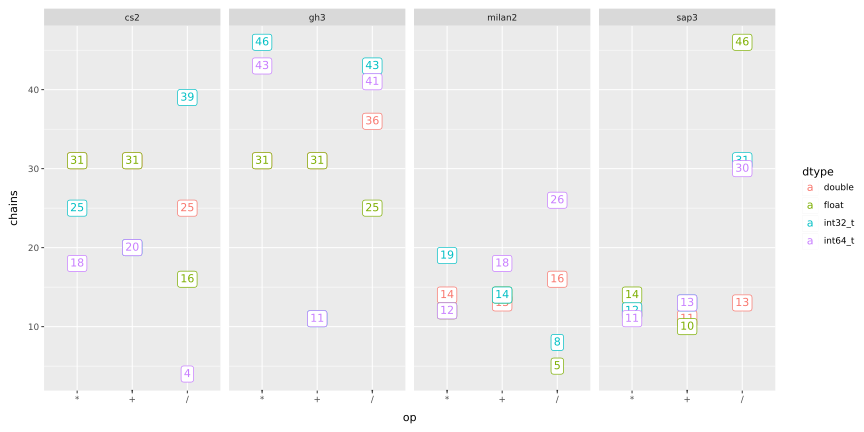

### Results and interpretation of ii.) and iv.)

In the following we will first discuss the latency and afterwards the CPI of the measured instructions. We will first take look at differences between instruction on the same system and afterwards draw a conclusion between systems.

#### CS2

For the CS2 system we can see that integer addition perform us the primary strength of the system with an throughput of 0.08 cycles per instructions and a latency of around 4 cycles. Multiplication is significantly slower using integer numbers and for division the performance is massively reduced, reaching a latency of 69 cycles. Looking at floating point operation the performances gets even worse with addition and multiplication sharing the same latency of 70 cycles and exploding for division up to 1300 cycles. Interestingly for integer number as well as for floating point numbers the bit size or precision of the used operand did not make any difference, this could indicate that for different sizes the same execution units get used. For example a 32 bit integer gets upcasted by the processor and than processed by the 64 bit addition unit. An exception to that is only visible for the floating point division, where double precision is slower in comparison to single precision. Another interesting observation is that floating point addition and multiplication both have the same latency of 69 cycles. This again indicates that they are using the same floating point units for both operations.

One thing we cannot explain is, why the latencies are such large numbers. Taking a look at [reference material](https://mediatum.ub.tum.de/doc/1657424/gbv9g0ozk9fwu9nvszhm03q2u.pdf) shows us that the expected latency should only be around 9 cycles. One reason for that could be that the loop produces overhead that influences our measurements. However due to out limited time budget we didn't investigate this further.

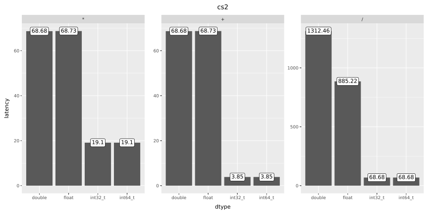
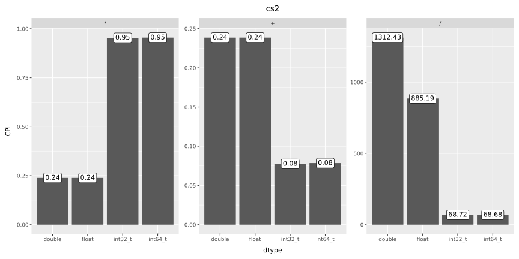

#### GH3

In the CH3 system we can again see that there is no differentiation between single and double precision floating point numbers, except for division were single precision have a higher throughput. This suggest that there are additional execution units for single precision division to compensate for the large latencies division typically cause. The same scheme is observable between floating point multiplication and addition. While the latency for multiplication is higher this gets compensated by using more execution units so the throughput of both operations are kept equal. We can also observe that the latency for operation on integer numbers are overall smaller, reaching a minimal latency of 0.5 cycles for integer addition (we will talk about this in the upcoming paragraph). However in the case of division there are much less execution units offered to integer numbers which results in a decreased throughput of only 9 CPI when compared to floating point numbers of less than one.

However we cannot explain why we get a latency of 0.5 cycles, as this should not be possible. We verified the measurements by repeating and got a result within the error margin of measurements. At least the floating point latencies reported by [this article](https://chipsandcheese.com/p/arms-neoverse-v2-in-awss-graviton-4) seems to match our measured two cycles for addition and three cycles for multiplication.

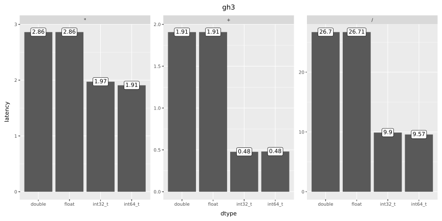
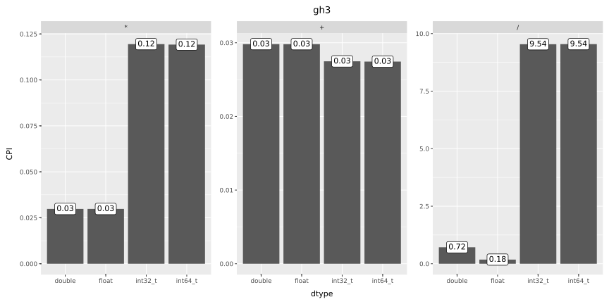

#### Milan2

For the Milan2 system we can observe that latencies across different types for addition and multiplication are the same. Comparing these values to specification listed in [this document](https://www.agner.org/optimize/instruction_tables.pdf) seem to suggest that our throughput is much higher than expected. The latencies for integer operations seem to match up with our measurements, however we again seem to observe an impossible instruction latency of 0.5 for addition. Floating point operation seem to diverge even more form th values stated in the document. Unfortunately we couldn't investigate this further as running multiple benchmarks to at least verify that our raw measurements are correct due to our limited group size.

However the measured throughput of the instruction seem to be at least feasible, as addition is the fastest followed by multiplication and with a significant gap division being last. We also seem to measure the latencies of floating point divisions being higher again in comparison to integer numbers. Then similar to previous systems the throughput is instead increased potentially by using a larger set of execution units.

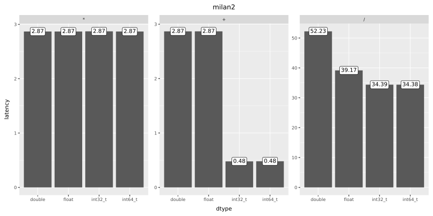
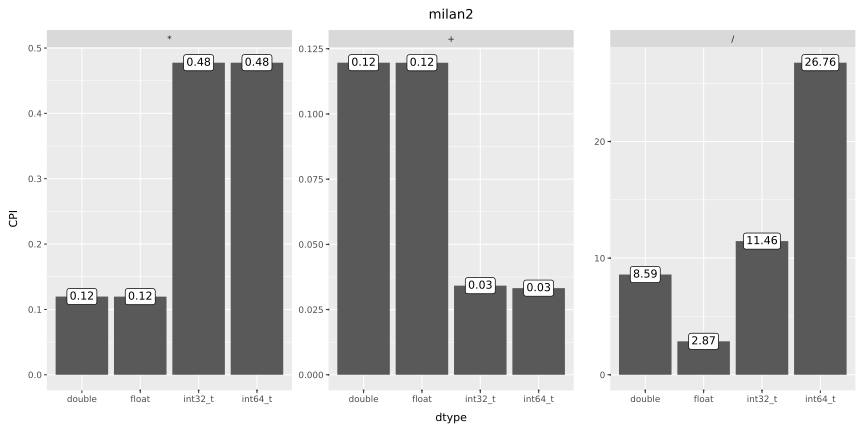

#### SAP3

Looking at the SAP3 system we see again the typical trend of addition being the fastest followed by multiplication and division being last. However our measurements show significantly higher latencies for floating point operation. While using single and double precision makes no difference in the measured latencies (or only a small one for division), integer number seem to vary a lot more for addition and division. In addition we see that multiplication and addition share both latency and throughout both single and double precision data types.

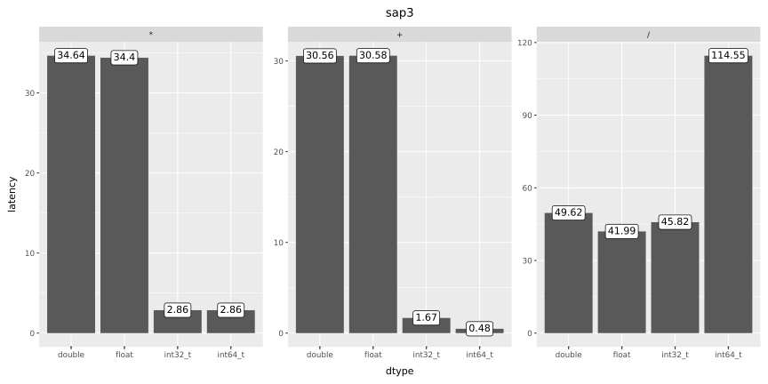
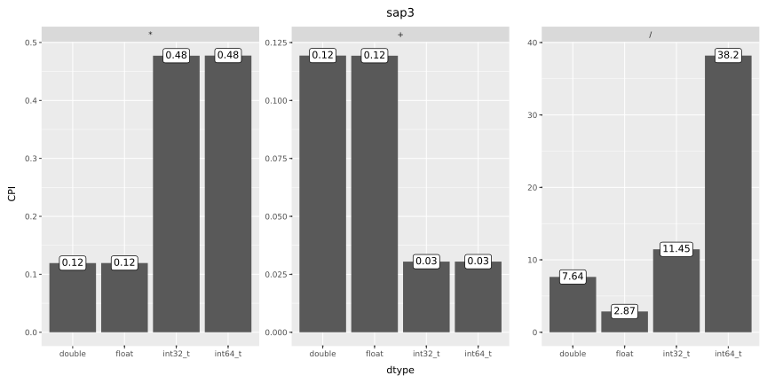

#### Comparison between systems

One immediate fact we observe is that CS2 is overall the slowest system in terms of latency independent form measures operation or used data types for operands. Especially floating point division is exceptionally slow in comparison to other systems. Looking at integer division instead shows much more comparable results even surpassing SAP3. In terms of throughput CS2 gets even worse in division and can't compete with any data type.

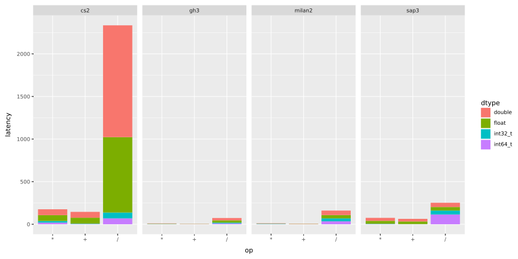
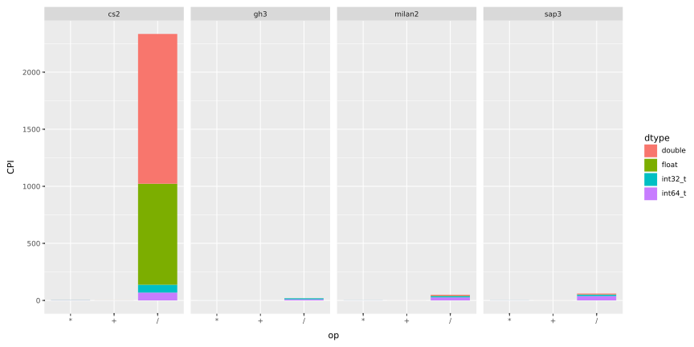

Taking a look at the latencies and throughput of other operation we can see that CS2 falls behind again. However the values reached by CS2 are much closer to other systems, especially for the floating point operations of the SAP3 system.

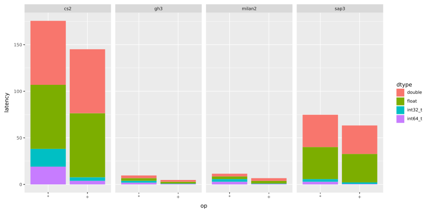
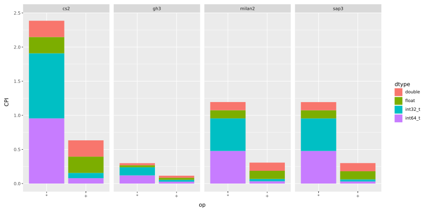

To make the comparison easier we will continue without further representation of the CS2 system.

Observing the other systems shows us that SAP3 has the second-most slowest latencies for floating point division, which is clearly behind the two other systems. Also 64 bit integer division is much larger. However the throughput of divisions compares much more closely to the Milan2 system and almost matches its performance for every data type except 64 bit integers. We can also see that GH3 sees much improvement over Milan2 in floating point division and 64 bit integer division. This is also true for the latencies of all data types where GH3 has the shortest ones overall and only the single precision floating point division from the other systems can come close to the performance of GH3.

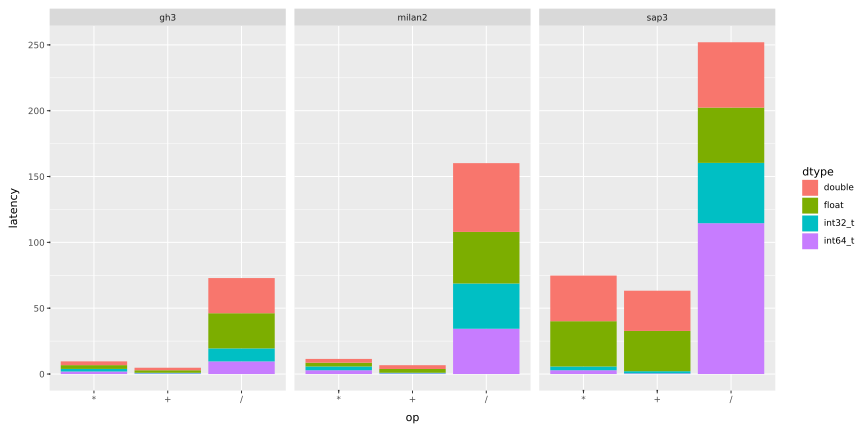
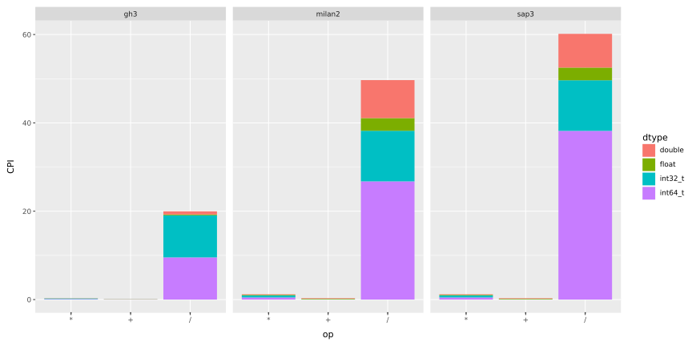

Finally looking at the remaining multiplication and addition operations on SAP3, GH3 and Milan2 shows that SAP3 really falls behind for latencies in terms of floating point operations. How like stated before this gets potentially compensated by using more execution units for these data types as throughput closely matches Milan2 in every remaining category. Looking at GH3 and Milan2 we can see that latency-wise Milan2 can almost match the values from GH3 but still falls behind by a small amount. In particular for integer multiplication and floating point addition. GH3 seems to be the overall winner in terms of latency. This is definitely also the case for throughput, where Milan2 falls behind substantially to more closely match the throughput of SAP3. Floating point addition and multiplication seem to be faster for GH3 compared to SAP3 and Milan2 and especially integer division marks GH3 clear winner when looking at throughput.

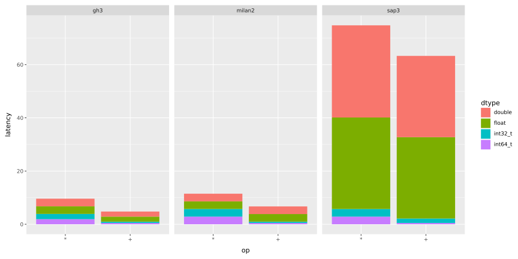
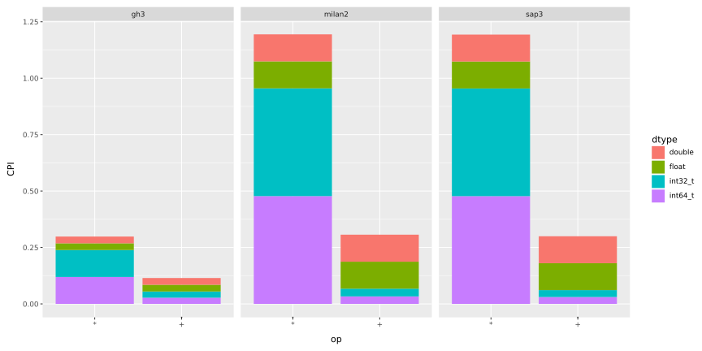

## Future Work

We think the dissimilarities to expected values come either from a falsely reported clock frequency while running the test or that measuring the clock frequency with likwid disturbs the actual benchmark by making it perform worse. However the last option would not explain why we get latencies around 0,5 cycles. In the future we would try to measure the number of cycles during execution and check if we arrive at similar values.
