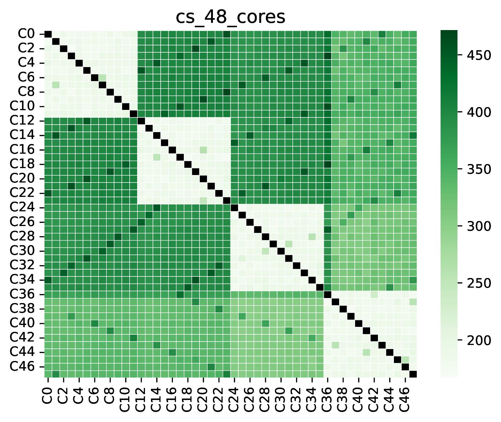
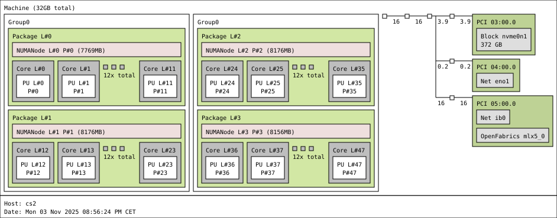
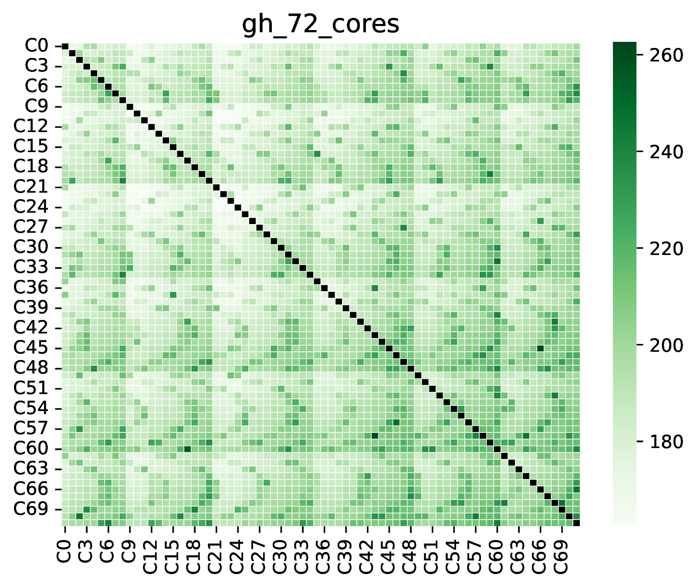
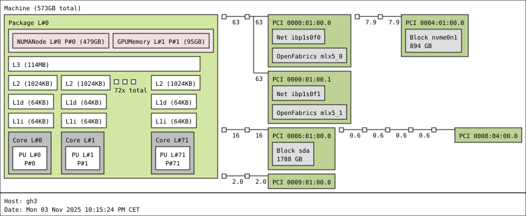
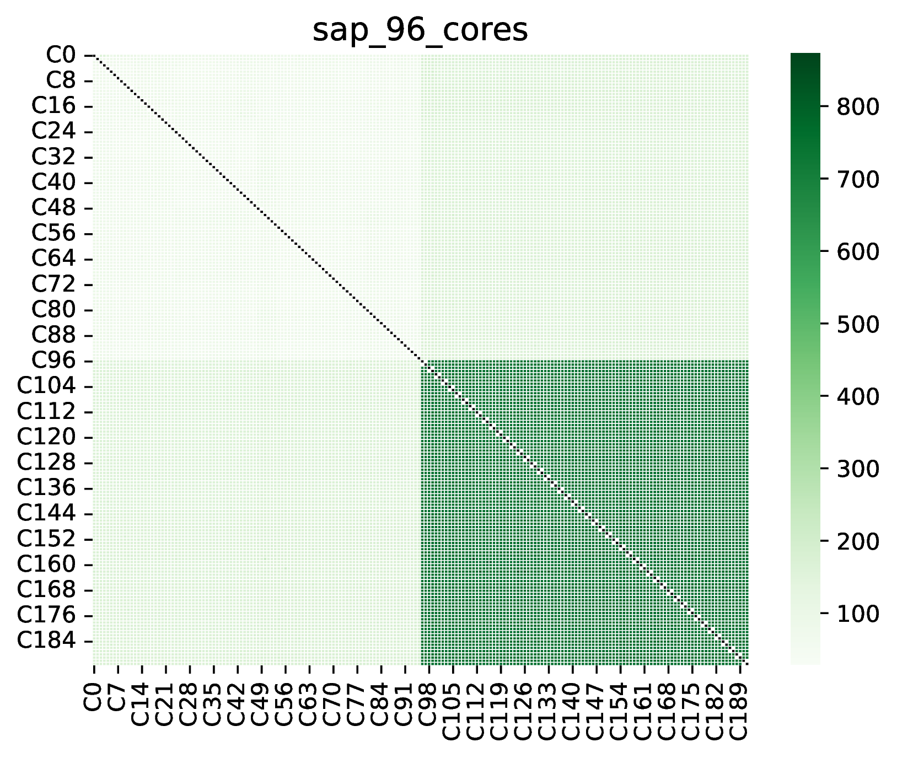
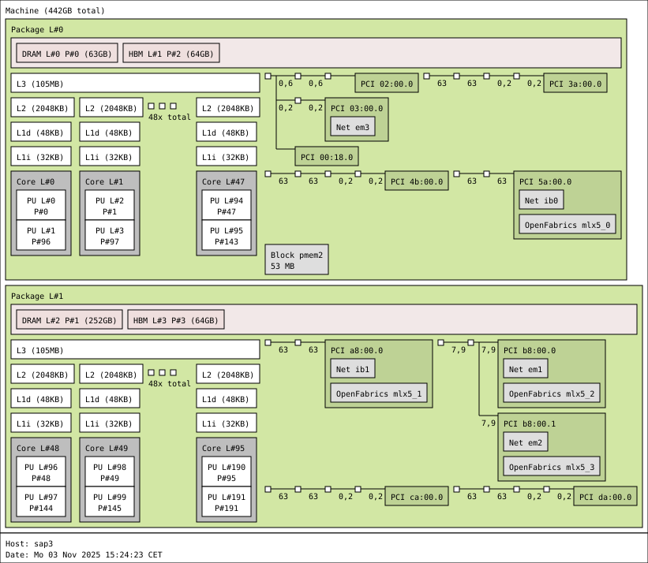
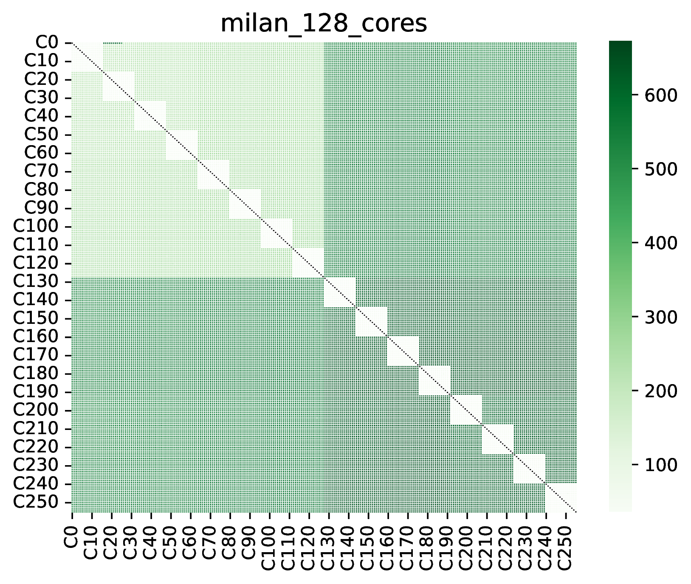
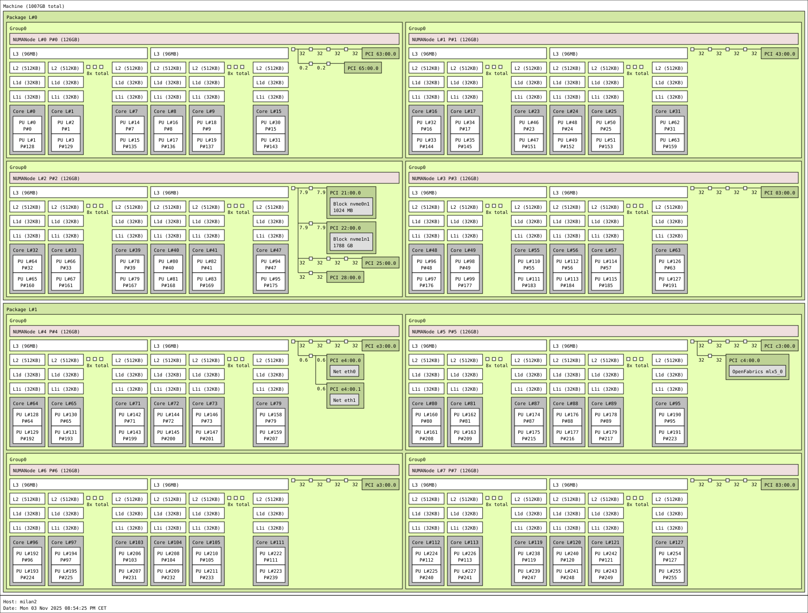

Report on Task 3
=== 
# a)
  Amount of cores for each system:
  - GH: 72 cores (1 socket)
  - SAP: 96 (48 cores per socket, 2 sockets)
  - MILAN: 128 (64 Cores per socket, 2 sockets)
  - cs2: 48 (12 cores per socket, 4 sockets)
   
Useful env variables: 
  - `OMP_PLACES=cores`
    - cores: one place per core (all SMT siblings together).
  - `OMP_PROC_BIND=true`
    - OMP_PROC_BIND controls whether threads are pinned to those places and how they spread:
- `GOMP_CPU_AFFINITY` 
  - can be used to choose specific cores for threads like: GOMP_CPU_AFFINITY="0 1" for core 0 and 1

# b)
|                             | GH                                                                                                                                                                                      | SAP                                                                                                                                                                                   | MILAN                                                                                                                                                                                  | CS                                                                                                                                                                                     |
|-----------------------------|-----------------------------------------------------------------------------------------------------------------------------------------------------------------------------------------|---------------------------------------------------------------------------------------------------------------------------------------------------------------------------------------|----------------------------------------------------------------------------------------------------------------------------------------------------------------------------------------|----------------------------------------------------------------------------------------------------------------------------------------------------------------------------------------|
| near side                   | X                                                                                                                                                                                       | using Core 0, 1: Threads: 2, Base addr: 0x203f380    Pair ( 0, 1):     **Min: 158.0 ns (max: 236.7 ns, avg: 187.5 ns)**    Pair ( 1, 0):     **Min: 158.0 ns (max: 237.4 ns, avg: 187.5 ns)** | using Core 0, 1: Threads: 2, Base addr: 0x22f53a0    Pair ( 0, 1):     **Min: 25.2 ns (max: 51.5 ns, avg: 41.3 ns)**    Pair ( 1, 0):     **Min: 24.3 ns (max: 51.4 ns, avg: 41.4 ns)**        | using Core 0, 1: Threads: 2, Base addr: 0x1de0360    Pair ( 0, 1):     **Min: 143.3 ns (max: 188.8 ns, avg: 170.2 ns)**    Pair ( 1, 0):     **Min: 164.5 ns (max: 188.7 ns, avg: 172.3 ns)**  |
| cores different socket      | using Core 0, 71: Threads: 2, Base addr: 0x35d30370    Pair ( 0, 1):     **Min: 172.2 ns (max: 204.6 ns, avg: 196.4 ns)**    Pair ( 1, 0):     **Min: 172.2 ns (max: 204.5 ns, avg: 196.4 ns)** | using Core 0, 97: Threads: 2, Base addr: 0xb94380    Pair ( 0, 1):     **Min: 113.5 ns (max: 238.3 ns, avg: 188.9 ns)**    Pair ( 1, 0):     **Min: 113.5 ns (max: 239.5 ns, avg: 189.6 ns)** | using Core 0, 127: Threads: 2, Base addr: 0xbfa3a0    Pair ( 0, 1):     **Min: 535.7 ns (max: 554.5 ns, avg: 545.0 ns)**    Pair ( 1, 0):     **Min: 534.9 ns (max: 556.3 ns, avg: 545.9 ns)** | using Core 0, 36:Threads: 2, Base addr: 0x20f0360    Pair ( 0, 1):     **Min: 354.1 ns (max: 451.5 ns, avg: 410.6 ns)**    Pair ( 1, 0):     **Min: 355.2 ns (max: 377.5 ns, avg: 364.5 ns)**  |
| same socket not sharing LLC | X                                                                                                                                                                                       | X                                                                                                                                                                                     | using Core 0, 47: Threads: 2, Base addr: 0x7db3a0    Pair ( 0, 1):     **Min: 505.8 ns (max: 633.2 ns, avg: 576.5 ns)**    Pair ( 1, 0):     **Min: 501.1 ns (max: 632.4 ns, avg: 575.9 ns)**  | using Core 0, 12: Threads: 2, Base addr: 0x9570360    Pair ( 0, 1):     **Min: 381.6 ns (max: 400.6 ns, avg: 391.3 ns)**    Pair ( 1, 0):     **Min: 381.6 ns (max: 400.6 ns, avg: 391.3 ns)** |
|                             |                                                                                                                                                                                         |                                                                                                                                                                                       |                                                                                                                                                                                        |                                                                                                                                                                                        |
# c) 
The warmup phase is important to ensure that caches, tlb's and branch predictors are populated with relevant information before measurements are taken. Without a warmup phase, the initial accesses may result in misses, leading to higher latency measurements for te first accesses that do not accurately reflect the typical performance of the system. The 20ms per thread pair is rather genous, the measurement time already is in lign with the actual measurement times for all four systems and all types of accesses.

# d)
## SAP
```
    Pair ( 1,91):
    Addr 0x9f1da0, warm: 111.4 ns
    Addr 0x9f1da0, warm: 111.8 ns
    Addr 0x9f1da0, warm: 112.6 ns
    Addr 0x9f1da0, warm: 111.0 ns
    Addr 0x9f1da0, warm: 112.2 ns
    Addr 0x9f1da0, warm: 111.4 ns
    Addr 0x9f1da0, warm: 111.6 ns
    Addr 0x9f1da0, warm: 111.7 ns
    Addr 0x9f1da0, warm: 111.8 ns
    Addr 0x9f1da0: 112.6 ns
    Addr 0x9f1db0: 111.4 ns
    Addr 0x9f1dc0: 74.9 ns
    Addr 0x9f1dd0: 86.7 ns
    Addr 0x9f1de0: 74.4 ns
    Addr 0x9f1df0: 75.9 ns
    Addr 0x9f1e00: 83.7 ns
    Addr 0x9f1e10: 83.1 ns
    Addr 0x9f1e20: 83.1 ns
    Addr 0x9f1e30: 83.6 ns
    Min: 74.4 ns (max: 112.6 ns, avg: 87.0 ns)
   Pair ( 1,92):
    Addr 0x9f1da0, warm: 105.8 ns
    Addr 0x9f1da0, warm: 106.5 ns
    Addr 0x9f1da0, warm: 106.3 ns
    Addr 0x9f1da0, warm: 106.5 ns
    Addr 0x9f1da0, warm: 105.3 ns
    Addr 0x9f1da0, warm: 106.2 ns
    Addr 0x9f1da0, warm: 106.0 ns
    Addr 0x9f1da0, warm: 106.4 ns
    Addr 0x9f1da0, warm: 105.9 ns
    Addr 0x9f1da0, warm: 106.0 ns
    Addr 0x9f1da0: 106.3 ns
    Addr 0x9f1db0: 106.0 ns
    Addr 0x9f1dc0: 74.0 ns
    Addr 0x9f1dd0: 74.8 ns
    Addr 0x9f1de0: 74.8 ns
    Addr 0x9f1df0: 74.3 ns
    Addr 0x9f1e00: 91.5 ns
    Addr 0x9f1e10: 91.7 ns
    Addr 0x9f1e20: 91.6 ns
    Addr 0x9f1e30: 91.6 ns
    Min: 74.0 ns (max: 106.3 ns, avg: 87.7 ns)

```
    Pair ( 1,98):
    Addr 0x1cc1da0, warm: 160.1 ns
    Addr 0x1cc1da0, warm: 161.2 ns
    Addr 0x1cc1da0, warm: 162.1 ns
    Addr 0x1cc1da0, warm: 160.3 ns
    Addr 0x1cc1da0, warm: 161.3 ns
    Addr 0x1cc1da0, warm: 161.0 ns
    Addr 0x1cc1da0, warm: 185.0 ns
    Addr 0x1cc1da0: 358.5 ns
    Addr 0x1cc1db0: 161.2 ns
    Addr 0x1cc1dc0: 189.9 ns
    Addr 0x1cc1dd0: 190.2 ns
    Addr 0x1cc1de0: 190.2 ns
    Addr 0x1cc1df0: 189.8 ns
    Addr 0x1cc1e00: 172.5 ns
    Addr 0x1cc1e10: 172.3 ns
    Addr 0x1cc1e20: 173.0 ns
    Addr 0x1cc1e30: 174.0 ns
    Min: 161.2 ns (max: 358.5 ns, avg: 197.2 ns)
    Pair ( 1,99):
    Addr 0x1cc1da0, warm: 160.1 ns
    Addr 0x1cc1da0, warm: 162.4 ns
    Addr 0x1cc1da0, warm: 160.7 ns
    Addr 0x1cc1da0, warm: 161.0 ns
    Addr 0x1cc1da0, warm: 161.4 ns
    Addr 0x1cc1da0, warm: 161.3 ns
    Addr 0x1cc1da0, warm: 162.1 ns
    Addr 0x1cc1da0: 159.8 ns
    Addr 0x1cc1db0: 160.7 ns
    Addr 0x1cc1dc0: 190.7 ns
    Addr 0x1cc1dd0: 189.9 ns
    Addr 0x1cc1de0: 190.4 ns
    Addr 0x1cc1df0: 190.9 ns
    Addr 0x1cc1e00: 172.8 ns
    Addr 0x1cc1e10: 172.3 ns
    Addr 0x1cc1e20: 173.5 ns
    Addr 0x1cc1e30: 172.9 ns
    Min: 159.8 ns (max: 190.9 ns, avg: 177.4 ns)


## milan
``` 
    Pair ( 2,82):
    Addr 0x4c5db0, warm: 645.4 ns
    Addr 0x4c5db0, warm: 646.6 ns
    Addr 0x4c5db0: 644.9 ns
    Addr 0x4c5dc0: 636.6 ns
    Addr 0x4c5dd0: 636.5 ns
    Addr 0x4c5de0: 635.3 ns
    Addr 0x4c5df0: 638.3 ns
    Addr 0x4c5e00: 620.9 ns
    Addr 0x4c5e10: 626.6 ns
    Addr 0x4c5e20: 623.6 ns
    Addr 0x4c5e30: 622.4 ns
    Addr 0x4c5e40: 616.8 ns
    Min: 616.8 ns (max: 644.9 ns, avg: 630.2 ns)
    Pair ( 2,83):
    Addr 0x4c5db0, warm: 645.7 ns
    Addr 0x4c5db0, warm: 645.4 ns
    Addr 0x4c5db0: 641.3 ns
    Addr 0x4c5dc0: 635.9 ns
    Addr 0x4c5dd0: 636.0 ns
    Addr 0x4c5de0: 630.1 ns
    Addr 0x4c5df0: 636.2 ns
    Addr 0x4c5e00: 624.5 ns
    Addr 0x4c5e10: 624.8 ns
    Addr 0x4c5e20: 620.5 ns
    Addr 0x4c5e30: 617.3 ns
    Addr 0x4c5e40: 615.3 ns
    Min: 615.3 ns (max: 641.3 ns, avg: 628.2 ns
```
```
 Pair ( 0,82):
    Addr 0x406db0, warm: 256.8 ns
    Addr 0x406db0, warm: 262.4 ns
    Addr 0x406db0, warm: 263.1 ns
    Addr 0x406db0, warm: 260.1 ns
    Addr 0x406db0: 261.5 ns
    Addr 0x406dc0: 262.5 ns
    Addr 0x406dd0: 263.0 ns
    Addr 0x406de0: 262.8 ns
    Addr 0x406df0: 259.5 ns
    Addr 0x406e00: 241.8 ns
    Addr 0x406e10: 243.0 ns
    Addr 0x406e20: 242.8 ns
    Addr 0x406e30: 238.3 ns
    Addr 0x406e40: 243.7 ns
    Min: 238.3 ns (max: 263.0 ns, avg: 251.9 ns)
   Pair ( 0,83):
    Addr 0x406db0, warm: 260.9 ns
    Addr 0x406db0, warm: 259.6 ns
    Addr 0x406db0, warm: 262.8 ns
    Addr 0x406db0, warm: 262.0 ns
    Addr 0x406db0: 261.4 ns
    Addr 0x406dc0: 261.4 ns
    Addr 0x406dd0: 262.5 ns
    Addr 0x406de0: 262.2 ns
    Addr 0x406df0: 262.0 ns
    Addr 0x406e00: 241.4 ns
    Addr 0x406e10: 242.9 ns
    Addr 0x406e20: 242.4 ns
    Addr 0x406e30: 242.6 ns
    Addr 0x406e40: 243.8 ns
    Min: 241.4 ns (max: 262.5 ns, avg: 252.3 ns)
```
## GH
```
Pair ( 1,14):
    Addr 0xaaacd2e10bf0, warm: 204.0 ns
    Addr 0xaaacd2e10bf0, warm: 205.0 ns
    Addr 0xaaacd2e10bf0, warm: 204.0 ns
    Addr 0xaaacd2e10bf0, warm: 203.1 ns
    Addr 0xaaacd2e10bf0, warm: 203.8 ns
    Addr 0xaaacd2e10bf0: 203.8 ns
    Addr 0xaaacd2e10c00: 183.4 ns
    Addr 0xaaacd2e10c10: 183.4 ns
    Addr 0xaaacd2e10c20: 183.5 ns
    Addr 0xaaacd2e10c30: 183.5 ns
    Addr 0xaaacd2e10c40: 168.2 ns
    Addr 0xaaacd2e10c50: 168.3 ns
    Addr 0xaaacd2e10c60: 168.3 ns
    Addr 0xaaacd2e10c70: 168.3 ns
    Addr 0xaaacd2e10c80: 182.6 ns
    Min: 168.2 ns (max: 203.8 ns, avg: 179.3 ns)
   Pair ( 1,15):
    Addr 0xaaacd2e10bf0, warm: 204.1 ns
    Addr 0xaaacd2e10bf0, warm: 204.0 ns
    Addr 0xaaacd2e10bf0, warm: 204.0 ns
    Addr 0xaaacd2e10bf0, warm: 204.1 ns
    Addr 0xaaacd2e10bf0, warm: 204.2 ns
    Addr 0xaaacd2e10bf0: 204.0 ns
    Addr 0xaaacd2e10c00: 183.6 ns
    Addr 0xaaacd2e10c10: 183.6 ns
    Addr 0xaaacd2e10c20: 183.7 ns
    Addr 0xaaacd2e10c30: 183.5 ns
    Addr 0xaaacd2e10c40: 168.4 ns
    Addr 0xaaacd2e10c50: 169.1 ns
    Addr 0xaaacd2e10c60: 168.1 ns
    Addr 0xaaacd2e10c70: 168.3 ns
    Addr 0xaaacd2e10c80: 182.5 ns
    Min: 168.1 ns (max: 204.0 ns, avg: 179.5 ns)
```

```
Pair ( 0,69):
    Addr 0xaaacd2e10bf0, warm: 213.1 ns
    Addr 0xaaacd2e10bf0, warm: 203.2 ns
    Addr 0xaaacd2e10bf0, warm: 241.1 ns
    Addr 0xaaacd2e10bf0, warm: 202.9 ns
    Addr 0xaaacd2e10bf0, warm: 202.9 ns
    Addr 0xaaacd2e10bf0: 202.9 ns
    Addr 0xaaacd2e10c00: 209.1 ns
    Addr 0xaaacd2e10c10: 290.5 ns
    Addr 0xaaacd2e10c20: 208.9 ns
    Addr 0xaaacd2e10c30: 209.9 ns
    Addr 0xaaacd2e10c40: 185.0 ns
    Addr 0xaaacd2e10c50: 185.0 ns
    Addr 0xaaacd2e10c60: 184.9 ns
    Addr 0xaaacd2e10c70: 185.1 ns
    Addr 0xaaacd2e10c80: 207.3 ns
    Min: 184.9 ns (max: 290.5 ns, avg: 206.9 ns)
   Pair ( 1, 4):
    Addr 0xaaacd2e10bf0, warm: 209.5 ns
    Addr 0xaaacd2e10bf0, warm: 207.1 ns
    Addr 0xaaacd2e10bf0, warm: 208.7 ns
    Addr 0xaaacd2e10bf0, warm: 207.8 ns
    Addr 0xaaacd2e10bf0, warm: 208.2 ns
    Addr 0xaaacd2e10bf0: 207.6 ns
    Addr 0xaaacd2e10c00: 196.2 ns
    Addr 0xaaacd2e10c10: 196.1 ns
    Addr 0xaaacd2e10c20: 363.9 ns
    Addr 0xaaacd2e10c30: 195.9 ns
    Addr 0xaaacd2e10c40: 155.9 ns
    Addr 0xaaacd2e10c50: 156.2 ns
    Addr 0xaaacd2e10c60: 156.2 ns
    Addr 0xaaacd2e10c70: 156.0 ns
    Addr 0xaaacd2e10c80: 265.1 ns
    Min: 155.9 ns (max: 363.9 ns, avg: 204.9 ns)
```

## Analysis
The verbose data shows that different memory addresses yield different latencies even when accessed from the same core pairs. Those different latencys are rather consistent for close paris eg. Pair `0,82` and  `0,83` have similar timings and Pair `1,82` and `1,83` (on MILAN but as can be seen also holds for SAP and GH) also have the same but they differ from the first two Pairs. We expected to see timing differences especially when comparing cross socket and same socket accesses but the timing differences were also noticable when comparing different memory addresses for the same socket. This shows that the memory system is more complex than just socket and core locality. We expect that this is due to the complex mapping of physical addresses to memory controllers and channels. Different addresses might be mapped to different memory channels or controllers, leading to varying access latencies.

# e)

## CS


The heatmap sows a 4x4 grid with internal 12x12 blocks. Each of the four big blocks represents one socket. Inside each socket the 12x12 blocks represent the cores inside the socket. The diagonal of each big block is very fast because those are the accesses within one socket. 


from numactl we get 

| node | 0  | 1  | 2  | 3  |
|-----:|---:|---:|---:|---:|
| **0** | 10 | 20 | 30 | 30 |
| **1** | 20 | 10 | 30 | 30 |
| **2** | 30 | 30 | 10 | 20 |
| **3** | 30 | 30 | 20 | 10 |

This partly explains the heatmap for cross core communication latenzy differences. However the differences could also be explained by the same phenomenon as in SAP and MILAN (explained down below) however we were unable to verify our theory on this system.




Grace hopper has only one socket so we would asume a uniform heatmp howerver this is not the case we can see a repetitive pattern in the heatmap. Our theory is that this is caused by the complex cache structure of grace hopper. The total timing within these blocks is very small compared to those of other systems. In the case of gh the differernce between the absolute lowest and highest measuremet is 100ns. Therefore it is possible that this difference is due to internal wireing or cach layout.  However we were unable to verify this theory.


## SAP


The heat map shows three distinct parts top left is a fast block(**S0**), bottom left and top right(**S01**) a slower block and bottom right a slow block(**S1**). The **S0** and **S1** correspond to socket on which the individual cores reside. The **S01** block represents cross socket communication. The inresting part is that **S1** is much slower than **S0** even though all cores reside on the same socket enabling fast communication because all cores share one L3 cache. However due to the benchmark the data is linked with the socket 0 so accessing data from socket 1 causes additional latency. In the case of **S01** the latency is lower than **S1** because one thread of the pair has direct access to the data in socket 0 as it resides there, whereass the other thread has to access the data cross socket. By pining the used memory to one socket we could verify this theory. 
>**Note:** SAP (and MILAN) have two hardware threads per core. Those are the white lines in the heatmap. Theses are obvioulsy faster than communication between two different cores.

## MILAN


The heat map is nearly identiccal to the one of sap there a just a few differences. For one on the diagonal one can see that there is always a. very fast block this is because milan only share L3 cach among 8 cores therefore those groups are especialyl fast. The rest is similar which to sap and can be explained the same way and was verified by pinning the memory to one socket.

