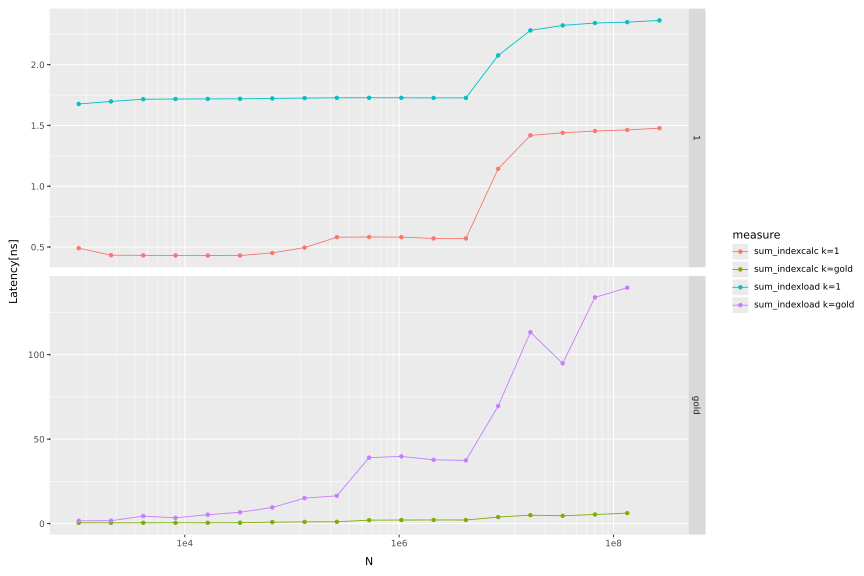

# Task 1 - Linked List Traversal

## a)

## b)

To analyze the measurement results we will first take a closer look at the `SAP2` system which represents the other systems very well. Afterwards, for completion we show the remaining differences that occurred on the other systems.




As expected `k` has a significant impact on both the overall dimension of the latency and the general behavior with increasing `N`. Looking at the `k=1` case we see that the behaviour of both functions is almost the same, only that indexload is slower in comparison to indexcalc. This can be explained when we look at the disassembly of both functions:

For `indexload` we can see that the calculation of the next entry value fully depends on the current next value. Thus the loop has dependencies between iteration which limits the possible optimizations from the CPU.

```asm
mov     rax, qword ptr [rbp - 80]    # Loading A
mov     rcx, qword ptr [rbp - 104]   # Loading next
shl     rcx, 4
add     rax, rcx
mov     rax, qword ptr [rax + 8]     # Loading A[next].next
mov     qword ptr [rbp - 104], rax   # Storing to next
```

On the other hand in the `indexcalc` function we notice that the calculation of the next entry value is purely arithmetic. Thus we don't have to wait for any value from memory. This allows the CPU to optimize the execution over several iterations as there exist only dependencies within one iteration of the loop. As a result the execution of the `indexcalc` function is faster in comparison.

```asm
mov     rax, qword ptr [rbp - 16]    # Loading k
mov     rcx, qword ptr [rbp - 112]   # Loading i
add     rcx, 1                     
imul    rax, rcx
and     rax, qword ptr [rbp - 72]    # Calculating (k * (i + 1)) & mask
mov     qword ptr [rbp - 104], rax   # Storing to next
```


## c)

## d)

## e)

## f)

## g)

Using the `numactl -H` flag shows us information about the available nodes on the system. This also includes the desired distances between different node. Looking at `SAP3` for example we get the following table:

```
node distances:
node   0   1   2   3
  0:  10  21  13  23
  1:  21  10  23  13
  2:  13  23  10  23
  3:  23  13  23  10
```

This table is fetched from the SLIT (System Locality Information Table) table which contains information about relative distances between system localities which can also be numa proximity domains. They are configured by the firmware and saved in the Generic Initiator Affinity Structure which is provided to the os at system startup.

The rows and column indexes represent the different proximity domains and assign to each pair a distance value.
E.g. the distance between domain 2 and 3 can be found in the second column and third row.
Higher values mean larger distance. In `SAP3` for example node 0 and 2 as well as 1 and 3 are closest to each other.
However these values don't amount to any specific real or physical distance between domains and can be freely chosen. They may only represent distance in a abstract sense where optimally the smallest distance should be chosen. Only the distance value of 10 is actually predefined for specifically representing the in-domain distance, which is why all diagonal entries where row and column match are equal to 10.

Based on articles from the internet there are certain schemas for the distance values: For example they correspond to the relative difference in access latencies ([here](https://www.codeblueprint.co.uk/2019/07/12/what-are-slit-tables.html)) or a distance value of 255 means that there exists no connection between the two domains ([here](https://stackoverflow.com/a/49356204)). But these schemas are not specified in the section of the standard and the article also states that the values can be easily overwritten and often represent very pessimistic results.

In this case the distances between two domains are always symmetric, which is also the case for all systems.
However in the SLIT table each individual entry is saved, so it would be possible to define asymmetric distances between two domains.

To correspond the distances to our measurements from subtask d) we first assume that the os will use local memory for allocation as this would be optimal strategy. Now, because we only execute sequential code using one core and additionally pinned the execution to a specific core we should only communicate within numa domain. This means the diagonal entries of the distance table which represent by definition the internal distance of one domain correspond to the measurements in subtask d). As we already explained in the last paragraph these are standardized to be 10.

For `GH3` we see an interesting pattern were only numa domain 0 and 1 can reach every other domain.
Domain 2 to 8 are set to 255 which means that they are unreachable. In addition they also report to having no size at all. This makes sense as the GH200 super-chip only has two domains: one for both CPU and GPU. These we can also identify by the reported domain size of 96GB VRAM and ~480GB RAM for GPU and CPU respectively.

```
GH3 node distances:
node   0   1   2   3   4   5   6   7   8
  0:  10  80  80  80  80  80  80  80  80
  1:  80  10  255  255  255  255  255  255  255
  2:  80  255  10  255  255  255  255  255  255
  3:  80  255  255  10  255  255  255  255  255
  4:  80  255  255  255  10  255  255  255  255
  5:  80  255  255  255  255  10  255  255  255
  6:  80  255  255  255  255  255  10  255  255
  7:  80  255  255  255  255  255  255  10  255
  8:  80  255  255  255  255  255  255  255  10
```

```
node 0 size: 490307 MB
node 0 free: 467245 MB
node 1 cpus:
node 1 size: 96768 MB
node 1 free: 96745 MB
node 2 cpus:
node 2 size: 0 MB
node 2 free: 0 MB
node 3 cpus:
node 3 size: 0 MB
node 3 free: 0 MB
...
```

For the other systems we see expected distance tables:

```
MILAN2 node distances:
node   0   1   2   3   4   5   6   7
  0:  10  12  12  12  32  32  32  32
  1:  12  10  12  12  32  32  32  32
  2:  12  12  10  12  32  32  32  32
  3:  12  12  12  10  32  32  32  32
  4:  32  32  32  32  10  12  12  12
  5:  32  32  32  32  12  10  12  12
  6:  32  32  32  32  12  12  10  12
  7:  32  32  32  32  12  12  12  10
```

```
CS2 node distances:
node   0   1   2   3
  0:  10  20  30  30
  1:  20  10  30  30
  2:  30  30  10  20
  3:  30  30  20  10
```

## h)