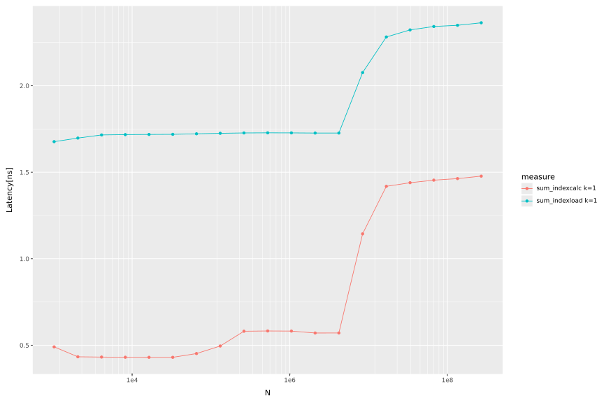
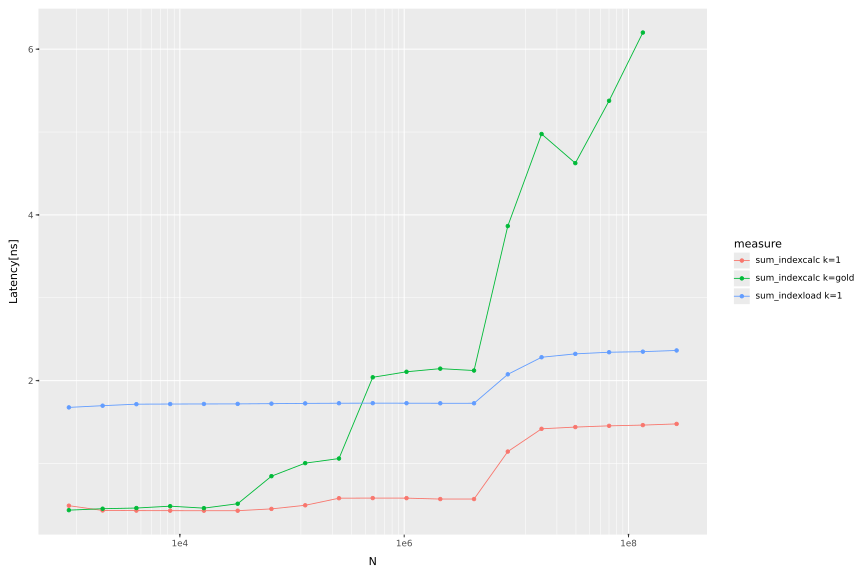
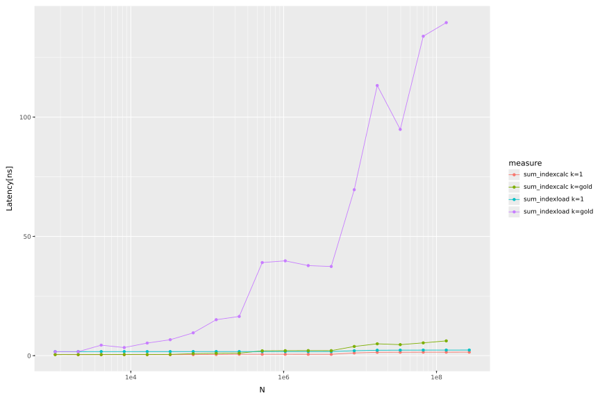
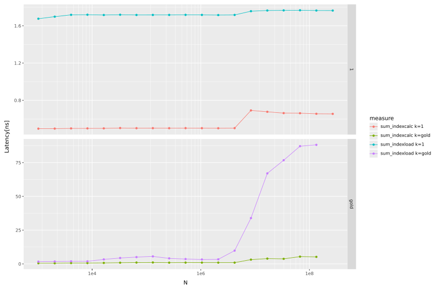
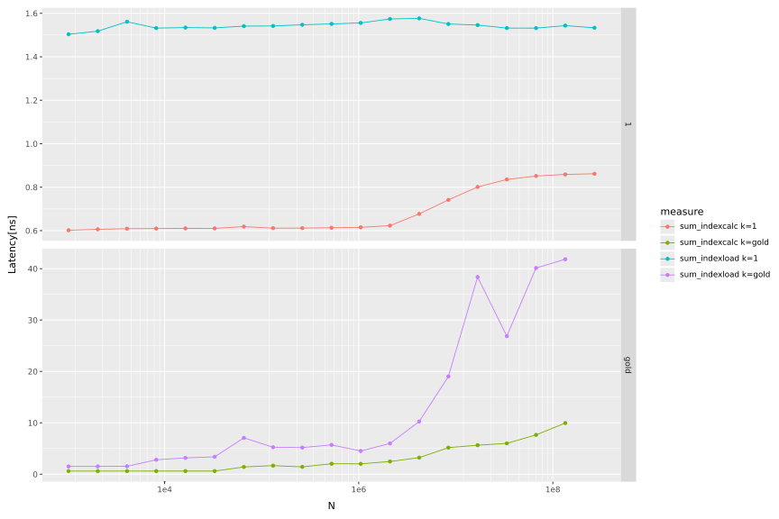
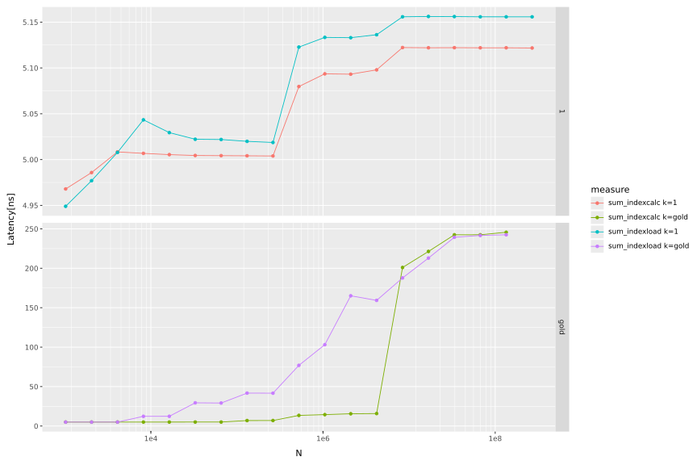

# Task 1 - Linked List Traversal

## a)

## b)

To analyze the measurement results we will first take a closer look at the `SAP3` system which represents the other systems very well. Afterwards, for completion we show the remaining differences that occurred on the other systems.

### Case: K=1



As expected `k` has a significant impact on both the overall dimension of the latency and the general behavior with increasing `N`. Looking at the `k=1` case we see that the behaviour of both functions is almost the same, only that indexload is slower in comparison to indexcalc. This can be explained when we look at the disassembly of both functions:

For `indexload` we can see that the calculation of the next entry value fully depends on the current next value. Thus the loop has dependencies between iteration which limits the possible optimizations from the CPU.

```asm
mov     rax, qword ptr [rbp - 80]    # Loading A
mov     rcx, qword ptr [rbp - 104]   # Loading next
shl     rcx, 4
add     rax, rcx
mov     rax, qword ptr [rax + 8]     # Loading A[next].next
mov     qword ptr [rbp - 104], rax   # Storing to next
```

On the other hand in the `indexcalc` function we notice that the calculation of the next entry value is purely arithmetic. Thus we don't have to wait for any value from memory. This allows the CPU to optimize the execution over several iterations as there exist only dependencies within one iteration of the loop. As a result the execution of the `indexcalc` function is faster in comparison.

```asm
mov     rax, qword ptr [rbp - 16]    # Loading k
mov     rcx, qword ptr [rbp - 112]   # Loading i
add     rcx, 1                     
imul    rax, rcx
and     rax, qword ptr [rbp - 72]    # Calculating (k * (i + 1)) & mask
mov     qword ptr [rbp - 104], rax   # Storing to next
```

We also notice this sudden increase in latency around `N=22` in both indexcalc and index load. This can be explained by the size of the list exceeding the LLC cache and thus falling back to main memory. If we report the LLC load misses using Perf we can notice that indeed this is the case and while they seem stable until that point the misses suddenly explode after that.

| N               | 18    | 19     | 20     | 21     | 22      | 23         | 24         | 25         | 26         |
|-----------------|-------|--------|--------|--------|---------|------------|------------|------------|------------|
| LLC Load Misses | 6.000 | 11.000 | 30.000 | 69.000 | 203.000 | 14.647.000 | 13.027.000 | 30.204.000 | 20.635.000 |

To understand why this causes the increase in latency we first take a look at the access pattern to the list for the case `k=1`:
With that value for `k` in each iteration we just look at the exact next value in memory `(k * (i + 1)) => (i + 1)`. While indexcalc uses this formular directly for indexload this formular gets used during the initialization of the individual list entries.
In addition we access each element of the list exactly one time, this means we get a cold miss for every first entry that falls into a new memory block and wasn't already fetched with the last cache line.

We now think that prefetching is able to circumvent most of these misses and thus thanks to our linear access is able to fit the entire list into the several cache levels. As we see only a slight increase in the latency for the `indexcalc` function we assume prefetching is so effective to almost completely hide the necessary accesses to higher level caches in all other cases with increasing list size. However when the entire list doesn't fit in any cache anymore as main memory is so much slower even prefetching isn't able to hide the accesses. Thus we experience the increase in latency at this point.

### Case: K=Random (golden ratio)



This also explains the behavior of the latency increase with larger list for a pseudorandom access order. If we set `k=golden` to a approximation of the golden ratio we suddenly access memory in a completely suboptimal way. We completely miss out on both reuse of values from one cache line and the possibility of prefetching.

Thus we should be able to clearly see the different cache levels of the memory hierarchy, which is indeed the case. We see similar performance for small list sizes as they still fit completely into level one cache thus achieving the same performance as prefetching doese all the way to main memory sizes. Now the random access pattern sees the first increase between 10^4 - 10^5 where not all parts of the list fit into the L1 cache anymore. The next step is between 10^5 - 10^6 where we exceed the limit of the L2 cache and finally at around 10^7 we overflow to the main memory causing huge latencies.

As the size keeps increases and we have to access more main memory the latency also further increases instead of being a clear step like we have seen before with the different cache levels. We think this further increase can be explained by main memory not being so uniform as caches, thus accessing larger areas of the main memory can cause even larger latencies due to nonuniform designs.



Now when we take into consideration the `indexload` we see the same overall shape of the plot as we would expect from a pseudorandom access order. However the overall latency is much higher. While we see at the beginning similar performance to the sequential access `indexload` function we quickly fall behind it.

This increase can be explained by the additional load dependency which is characteristic for the `indexload` function. While before the loop didn't have any dependencies in between iterations the CPU could wait for multiple loads in parallel. With that a large part of the memory access latency could be hidden. Now as each next value depends on the last next value directly through a memory access they can no longer be issued in parallel.
We now access the worst case scenario of memory accesses where each load has to be sequentially executed and no predictable access pattern can be used to do prefetching. If we wouldn't load the data into the caches beforehand with the warmup phase, each access to the next list entry would have to pay the full penalty of a main memory access. This we see here only for large list sizes as smaller ones are already loaded entirely into one cache level.

### Other systems

Looking at the `MILAN1` system we see very similar results to `SAP3`. For the linear access the increase is not as much when the list sizes gets larger then the last level cache. Also the increase is much more subtle for `indexload` and we get an almost completely constant performance. This could be due to larger caches or better prefetching capabilities. Overall the latencies are also faster in comparison to `SAP3`. 

This also applies for the pseudo random accesses where even `indexload` is still significantly faster. We also notice that the cache level steps are only visible for the `indexcalc` function and are much more gradual. There even is a substantial dip in between 10^5 and 10^7, which we can not explain directly. *We think that the smoother steps could be explained by the more extensive distribution of caches in the `MILAN1` system which would spread out the areas where both caches store partial parts of the list. This leads to the gradual increase as some accesses miss on the lower levels while other hit.*



Examining `GH3` shows even better overall latencies and again very similar behavior with increasing list sizes to the `SAP3` system. For linear access we see a much more substantial increase just above the 10^6 mark in comparison to `MILAN1` where `GH3` seems more similar ti `SAP3`. However the is increase smooth and not a sudden step which may be because of the same reason we proposed for the `MILAN1` system. In addition the `indexload` function latency doesn't change similar to the `MILAN1` system, as the processor may be again more effective in hiding the increase in latency due to fetching multiple list entries from memory in parallel.

For the pseudo random accesses we can see the increases in latency according to the different levels of the memory hierarchy, although they are again much more smooth in comparison to the `SAP 3` system. What is also noticeable is that the difference between `indexcalc` and `indexload` is much small then for other system. This could be due to the much faster main memory of `GH3` where the differences between cache and DRAM is not as significant.



Taking a look at our last system `CS7` we see the most severe divergence from the established behavior. Here we can observe cleat steps even for the linear access pattern. Maybe the prefetching isn't as optimized as on other systems so it cant hide the accesses to higher level caches as well. In addition `indexcalc` seems to be slower for very small list sizes in comparison to `indexload` which is a pattern we never saw before. 

For the pseudo random accesses pattern we can see that the `indexcalc` function matches the `indexload` functions. This implies that the CPU isn't able to fetch multiple entries from memory in parallel when access to the main memory is required. The `indexload` function also behaves differently to other systems, where the increase is much more consistent and not like a concrete step. Overall the `CS7` system also has the highest latencies in every category being significantly slower in comparison.



## c)

The random access pattern also makes it impossible for any cache hits to occur by already loaded entries within one cache line or prefetching. Additionally large vectors only fit into main memory thus filling the caches in the warm up phase also doesn't reliably work. Given that we have dependencies in between iterations we can only ever load one list entry from memory at the time. This is the case if we use the `indexload` function as we have to know the previous next value to be able to load the address of the next entry. Our bandwidth utilization therefor only depends on the size of a list entry and how many loads can be performed in a given time. We can approximate this by using the measured latency and the number of elements of the list together with the size of one entry. To calculate the size we look at the entry struct and quickly see that it is 16 bytes long without any padding necessary:

```c
struct entry {
    double v;                // 8 Byte
    volatile uint64_t next;  // 8 Byte
};
```
However we have to mind that we only ever load at least one entire cache line from memory. Assuming that the array are aligned to the cache line boundaries, which they should be as they are a multiple, and the individual entries are smaller than a cache line exactly one line gets loaded from memory. Factoring in the repetitions we get the following formular for the memory bandwidth utilization:

```
mem_bandwidth [bytes/s] = cache_line_size [bytes] * N * rep / lat [s]
```

Or if we have the access latency given for a single element in ns we can instead use:

```
mem_bandwidth [bytes/s] = cache_line_size [bytes] / (time_per_element [ns] * 1.e-9 [s/ns])
```

Using `getconf` we can read out the line sizes for each system and calculate the memory bandwidth utilization with a vector size `N=30` which is way larger than the LLC on every system and compute the following utilizations:

| System | Cache Line Size | Latency per Element | Memory bandwidth utilization |
|--------|-----------------|---------------------|------------------------------|
| SAP2   | 64 B            | 139.616625 ns       | 4.58e8 B/s = 0.46 GB/s       |
| MILAN1 | 64 B            | 88.152659 ns        | 7.26e8 B/s = 0.73 GB/s       |
| GH3    | 64 B            | 41.830499 ns        | 1.53e9 B/s = 1.53 GB/s       |
| CS7    | 256 B           | 242.502391 ns       | 1.06e9 B/s = 1.06 GB/s       |

If we instead look at the `indexcalc` function the dependencies between iteration disappears. This would mean that multiple entries can be fetched simultaneously by the CPU. We would therefore expect a significantly higher memory bandwidth utilization which for the measurements would mean a lower latency per element. If we take a look at our results our assumptions gets confirmed:

| System | Cache Line Size | Latency per Element | Memory bandwidth utilization |
|--------|-----------------|---------------------|------------------------------|
| SAP2   | 64 B            | 6.200622 ns         | 1.03e10 B/s = 10.3 GB/s      |
| MILAN1 | 64 B            | 5.206658 ns         | 1.23e10 B/s = 12.3 GB/s      |
| GH3    | 64 B            | 9.957564 ns         | 6.43e9 B/s = 6.4 GB/s        |
| CS7    | 256 B           | 245.684702 ns       | 1.04e9 B/s = 1.04 GB/s       |

However these values are still far behind the maximal stated memory bandwidth of the systems. This can be explained by the fact that although we are capable of issuing multiple loads at once we still only go along the one single memory stream of the list. Accessing only a single list cannot fully utilize the available memory bandwidth and we would need far more accesses per iteration to be able to reach a bandwidth limitation.

One thing we noticed too was that maybe our initial guess that CS7 can't fetch multiple list entries isn't the reason for the similar latencies of both `indecalc` and `indexload`. Instead the 256 cache line size might be the reason we get higher latencies in comparison to other systems. As larger cache lines don't help with our pseudo random access pattern we are loading much more unnecessary data from main memory which should increases the access time. 

## d)

To be able to extract the main memory latency we can use the setup to archive the stated necessary criterions:

 - Choose a `N` large enough that the list doesn't fit in its entirety into any cache level and we therefor have to access the main memory e.g. `N > 25` to be safe
 - Choose the pseudo random access pattern to eliminate the possibility for prefetching being effective because of spatial locality. This can be achieved by using `k=golden` to simulate random access pattern
 - Choose the `indexload` function so the CPU can't use any memory parallelism, as every iteration depends on the last one.

Now the measured latency per element basically reports the main memory access latency if we use the assumption that secondary accesses to the same memory block are negligible. We also assume that we only access local memory within a numa domain as we pinned the measurements to a specific core and presume that memory gets allocated optimally for that core. We chose the largest measured value `N=30` for the list size as most systems are already saturated at this point.

| System | Main memory access latency |
|--------|----------------------------|
| SAP2   | 139.616625 ns              |
| MILAN1 | 88.152659 ns               |
| GH3    | 41.830499 ns               |
| CS7    | 242.502391 ns              |

## e)

We can extract the latencies for different cache levels by adjusting the list size to closely fit the cache size of one level. As we make sure every entry of the list should be loaded into this cache by running a warmup we're expecting to only fetch data from this cache level. Thus we can derive the cache latency by looking at the per element latency for the specific `N` that fits this cache level but no smaller one.

First we have to find a suitable `N` the fit the individual cache levels, for that we use `lscpu` to get the cache sizes for the different systems:

| System | L1                   | L2                      | L3                      |
|--------|----------------------|-------------------------|-------------------------|
| SAP2   | 48 kB / 16 B = 3000  | 2048 kB / 16 B = 128000 | 105 MB / 16 B = 6562500 |
| MILAN1 | 32 kB / 16 B = 2000  | 512 kB / 16 B = 32000   | 96 MB / 16 B = 6000000  |
| GH3    | 64 kB / 16 B = 4000  | 1024 kB / 16 B = 64000  | 114 MB / 16 B = 7125000 |
| CS7    | 64 kiB / 16 B = 4000 | 8 MB / 16 B = 500000    |                         |

We now look at values that are at most as large as the numbers we calculated in the table to make sure the list fits in its entirety into the desired cache level. With this setup we gained the following `N` values:

**SAP2**:
 - L1: 2048
 - L2: 121072
 - L3: 4194304

**MILAN1**:
 - L1: 1024
 - L2: 16384
 - L3: 4194304

**GH3**:
 - L1: 2048
 - L2: 32768
 - L3: 4194304

**CS7**:
 - L1: 2048
 - L2: 262144

Note that for CS7 the last level cache before main memory is the L2 cache.
Looking at the latencies for these `N`-values in our measurements reveal the following access latencies for the different cache sizes:

| System | L1 access latency | L2 access latency | L3 access latency | Memory access latency |
|--------|-------------------|-------------------|-------------------|-----------------------|
| SAP3   | 1.697743 ns       | 9.567669 ns       | 37.391673 ns      | 139.616625 ns         |
| MILAN1 | 1.675693 ns       | 3.326702 ns       | 9.829455 ns       | 88.152659 ns          |
| GH3    | 1.521333 ns       | 3.384762 ns       | 10.253689 ns      | 41.830499 ns          |
| CS7    | 4.987112 ns       | 41.627935 ns      |                   | 242.502391 ns         |


## f)

Comparing our calculated latencies for the CS7 to the specifications given by the manufacture we can see substantial differences. Specifically our results seem to be much slower than anticipated.

For the L1 data cache the specifications state a latency of 5 cycles. Assuming the processor operates at 1.8 GHz clock rate (cycles per ns) this would mean we would expect a latency of:

```
5 cycles / 1.8 GHz = 2.777777777777778 ns
```
However our results measure a latency close ti double the amount.
The same holds for the L2 access latency were we also would expect slightly faster performance than actually measured

```
56 cycles / 1.8 GHz = 31.11111111111111 ns
```

These expected values should also be taken with caution as we assume the clock frequency of the processor is 1.8 GHz which we didn't actually measured during execution. A more robust way to calculate the latencies would be to calculate the necessary cycles needed until the data could be used. For that we in addition have to measure the clock frequency during the execution of the list traversal. 

The greatest absolute difference between specification and measured values, however, is present for the memory latency where the specification states a latency of `135.5 ns` at a core frequency of `2.0 GHz`. We on the other side measure a latency of around `242 ns`.

We think these deviations could be caused by the additional instruction executed during the loop iteration or the loop overhead itself. In addition the benchmark bases its latency calculation per entry solely on software timing measurements which do not include any presumable factors that could disrupt the measurements e.g. other processes or the OS.

## g)

Using the `numactl -H` flag shows us information about the available nodes on the system. This also includes the desired distances between different node. Looking at `SAP3` for example we get the following table:

```
node distances:
node   0   1   2   3
  0:  10  21  13  23
  1:  21  10  23  13
  2:  13  23  10  23
  3:  23  13  23  10
```

This table is fetched from the SLIT (System Locality Information Table) table which contains information about relative distances between system localities which can also be numa proximity domains. They are configured by the firmware and saved in the Generic Initiator Affinity Structure which is provided to the os at system startup.

The rows and column indexes represent the different proximity domains and assign to each pair a distance value.
E.g. the distance between domain 2 and 3 can be found in the second column and third row.
Higher values mean larger distance. In `SAP3` for example node 0 and 2 as well as 1 and 3 are closest to each other.
However these values don't amount to any specific real or physical distance between domains and can be freely chosen. They may only represent distance in a abstract sense where optimally the smallest distance should be chosen. Only the distance value of 10 is actually predefined for specifically representing the in-domain distance, which is why all diagonal entries where row and column match are equal to 10.

Based on articles from the internet there are certain schemas for the distance values: For example they correspond to the relative difference in access latencies ([here](https://www.codeblueprint.co.uk/2019/07/12/what-are-slit-tables.html)) or a distance value of 255 means that there exists no connection between the two domains ([here](https://stackoverflow.com/a/49356204)). But these schemas are not specified in the section of the standard and the article also states that the values can be easily overwritten and often represent very pessimistic results.

In this case the distances between two domains are always symmetric, which is also the case for all systems.
However in the SLIT table each individual entry is saved, so it would be possible to define asymmetric distances between two domains.

To correspond the distances to our measurements from subtask d) we first assume that the os will use local memory for allocation as this would be optimal strategy. Now, because we only execute sequential code using one core and additionally pinned the execution to a specific core we should only communicate within numa domain. This means the diagonal entries of the distance table which represent by definition the internal distance of one domain correspond to the measurements in subtask d). As we already explained in the last paragraph these are standardized to be 10.

For `GH3` we see an interesting pattern were only numa domain 0 and 1 can reach every other domain.
Domain 2 to 8 are set to 255 which means that they are unreachable. In addition they also report to having no size at all. This makes sense as the GH200 super-chip only has two domains: one for both CPU and GPU. These we can also identify by the reported domain size of 96GB VRAM and ~480GB RAM for GPU and CPU respectively.

```
GH3 node distances:
node   0   1   2   3   4   5   6   7   8
  0:  10  80  80  80  80  80  80  80  80
  1:  80  10  255  255  255  255  255  255  255
  2:  80  255  10  255  255  255  255  255  255
  3:  80  255  255  10  255  255  255  255  255
  4:  80  255  255  255  10  255  255  255  255
  5:  80  255  255  255  255  10  255  255  255
  6:  80  255  255  255  255  255  10  255  255
  7:  80  255  255  255  255  255  255  10  255
  8:  80  255  255  255  255  255  255  255  10
```

```
node 0 size: 490307 MB
node 0 free: 467245 MB
node 1 cpus:
node 1 size: 96768 MB
node 1 free: 96745 MB
node 2 cpus:
node 2 size: 0 MB
node 2 free: 0 MB
node 3 cpus:
node 3 size: 0 MB
node 3 free: 0 MB
...
```

For the other systems we see expected distance tables:

```
MILAN2 node distances:
node   0   1   2   3   4   5   6   7
  0:  10  12  12  12  32  32  32  32
  1:  12  10  12  12  32  32  32  32
  2:  12  12  10  12  32  32  32  32
  3:  12  12  12  10  32  32  32  32
  4:  32  32  32  32  10  12  12  12
  5:  32  32  32  32  12  10  12  12
  6:  32  32  32  32  12  12  10  12
  7:  32  32  32  32  12  12  12  10
```

```
CS2 node distances:
node   0   1   2   3
  0:  10  20  30  30
  1:  20  10  30  30
  2:  30  30  10  20
  3:  30  30  20  10
```

## h)

To be able to force memory to be allocated remotely we used the `numactl` command line tool. We then used the following command to execute the benchmark:

```sh
numactl -a -C 0 -m 2 ./bench.out 26
```

The `-a` flag removes any inherited CPU pinning while `-C 0` flag will explicitly pin the benchmark thread to the the core 0 which lays in the numa domain 0 for all systems.
To make sure no local memory can get used for allocation we specified with the `-m 2` flag that we instead have to allocate memory from the numa domain 2. This number had to be adjusted based on the given numa domains for each system. For that we decided to always use a numa domain that is furthest away according to the SLIT table. We ran the benchmark with a `N=26` vector size to ensure we actually have to access the main memory but still fit entirely into the remote numa domain. After running every benchmark we got the following results:

| System | Local latency per Element | Remote latency per Element | Slow down     |
|--------|---------------------------|----------------------------|---------------|
| SAP3   | 116.349815 ns             | 224.605182 ns              | 1.93043007417 |
| MILAN2 | 87.438492 ns              | 280.162142 ns              | 3.20410537272 |
| GH3    | 22.077212 ns              |                            |               |
| CS2    | 242.502391 ns             | 242.502391 ns              |               |

If we compare these results to the distance table we see that these represent almost the slow down we measured for accessing the list remotely.
For `MILAN2` we get a perfect match while for `SAP3` the slow down is not as bad as the specified `23`. So we can conclude that at least for out systems the distance values actually have a semantic meaning and show the (maximal) expected slowdown for accessing remote memory in comparison to local communication.
