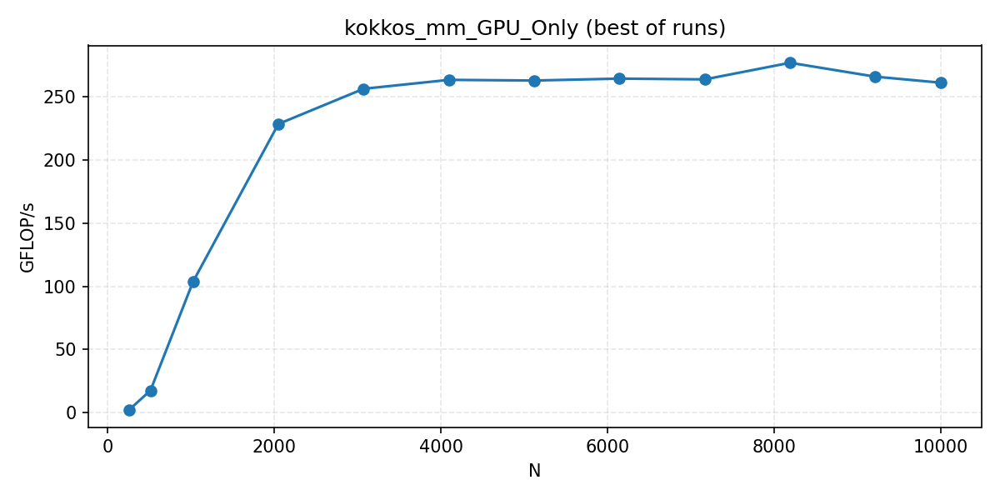
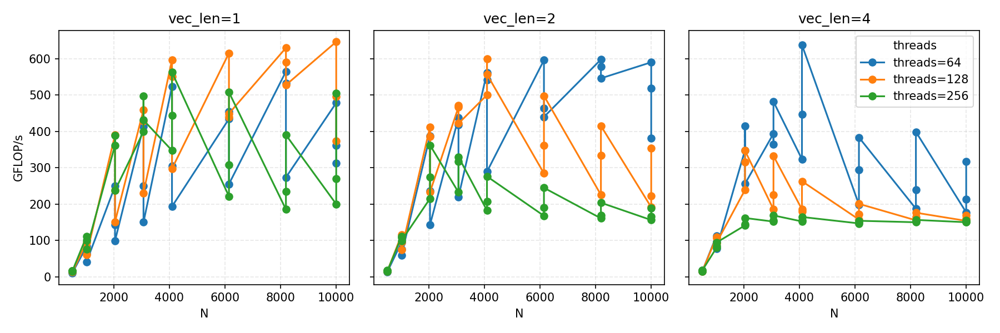
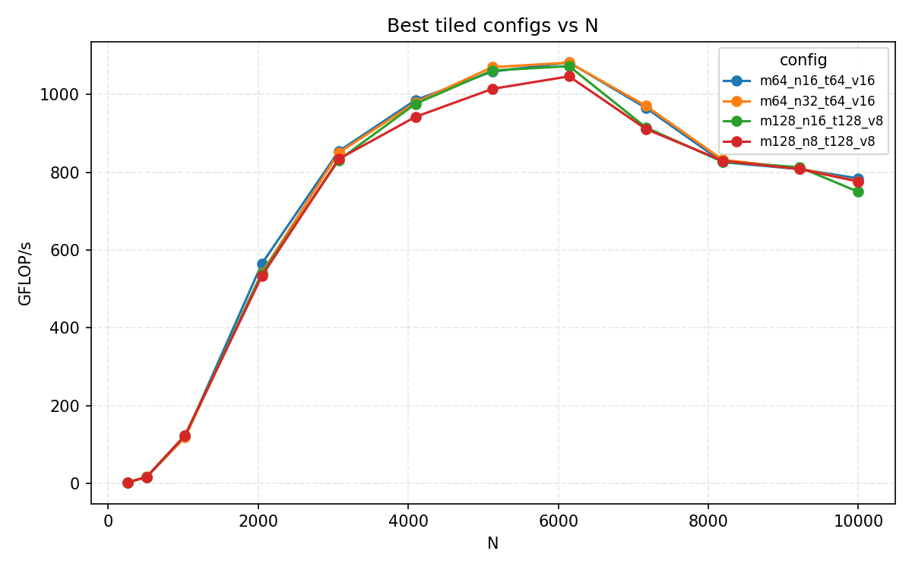

# Task 01

## a)

For compilation we used `icpx` version `2023.1.0` with the C++ toolchain provided by `GCC 13.2.0`.
Additionally to the specified modules in the README we had to load the latest GCC version and also explicitly used the latest module tags to always use the newest versions of the compiler and tools.
We also had to manually specify the GCC root so the newer `libstdc++` provided by the gcc module was linked instead of the old system installation under `/usr/lib64`.


## b)

For execution of the various executables we used the suggested OMP flags from Kokkos. As the environment implements OpenMP 4.5 these would be:

```sh
OMP_PROC_BIND=spread
OMP_PLACES=threads
```
Note: in many test runs these environment variables had negligable impact on the performance, however we still used them for consistency.

We ran the following benchmarks without any repetition logic because we focused more on the larger matrix sizes, where this would not impact the results. However for smaller matrix sizes this could effect the result, as the CPU would first have to windup the clock from idle frequency. 

In addition to combat per-run variance and eliminate any side effects from OS we ran the benchmark for each matrix size 5 times and took the average as our measurement of comparison (or if stated otherwiese we used the best result of 6 exeutions if the variance was little), for completeness we also included minimum and maximum values in our datasets.

## c)

When executing `kokkos_device_props_sycl` we get the following output:

```
Device Name: Intel(R) Data Center GPU Max 1550
Vendor: Intel(R) Corporation
Max Compute Units: 1024
Local Memory: 131072 bytes
Max Work Group Size: 1024
```

## d)



### Bandwidth Calculation

Data transferred = 3 * N * N * 8 Bytes

| N    | time_s  | GFLOP/s | GB/s |
|-----:|-------:|--------:|-----:|
| 256  | 0.01530 | 2.192   | 0.103 |
| 512  | 0.01536 | 17.479  | 0.410 |
| 1024 | 0.02070 | 103.723 | 1.216 |
| `2048` | 0.07519 | 228.493 | `1.339` |
| 3072 | 0.22616 | 256.372 | 1.001 |
| 4096 | 0.52173 | 263.431 | 0.772 |
| 5120 | 1.02108 | 262.895 | 0.616 |
| 6144 | 1.75421 | 264.424 | 0.516 |
| 7168 | 2.79211 | 263.810 | 0.442 |
| `8192` | 3.96987 | `276.964` | 0.406 |
| 9216 | 5.88655 | 265.948 | 0.346 |

The highest bandwidth is achieved for N=2048 with 1.339 GB/s. Which is far below the theoretical maximum Bandwidth for HBM (~1.5 TB/s). Refelcting that this is a compute bound problem and not memory bound.

> The highest Bandwidth utilization we could achieve in Task 1 is around 3.3 GB/s. Still far below the theoretical peak.

## e)

### row wise distribution (Disregard this approach tiled is better)
>There are three parameters to tune: Number of Teams, Team size and Vector Length.
>For Vector Length it is important that Team size x vector length must be smaler than 1024 (max work group size).
>In our tests we found that vector length AUTO gave the best results.
>To parallelize the workload we went with an row wise distribution of the resulting matrix to the teams.
>For N=6144 the best configuration is 6114 Teams and 128 Threads per Team.
>With this configuration every Team calculates a row of the resulting matrix. Every other combination of Teams and Threads per Team resulted in longer execution times.
>With this configuration we achieved the following results:
``` 
[GPU] Time:       0.761619 s
[GPU] GFLOP/s:    609.04
[GPU] Checksum:   5.91474e+14
```

>Although this configuration dosnt alightn with the device properties of max work group size of 1024, it seems to be the optimal configuration for this problem size on this hardware. Simply due to overhead minimization by not splitting the work whilst still having enough threads to cover memory latency.

### tiling approach
Params:
- N=6144
- tile_m= row size
- tile_n= column size
- Amount of Teams = Amount of tiles (so for m = 64 and n = 16: 36,864 Teams)
- team_size: number of threads per team
- vec_len= how many lanes run in parallel for the inner loop with `team_size * vec_len ≤ 1024` (note: the `AUTO` feature of Kokkos didn't yield the best results here)
  

Top 10 configs by GFLOP/s ([for all measurements](../src/mm-gpu-kokkos/tiled_results_6144.txt)):

| tile_m | tile_n | team_size | vec_len| time_s | gflops  |
|-------:|-------:|-----:|----:|-------:|-------:|
| 64     | 16     | 64   | 16  | 0.428381 | 1082.81 |
| 64     | 32     | 64   | 16  | 0.429695 | 1079.50 |
| 128    | 16     | 128  | 8   | 0.432968 | 1071.34 |
| 128    | 8      | 128  | 8   | 0.441872 | 1049.75 |
| 64     | 16     | 64   | 4   | 0.450051 | 1030.67 |
| 128    | 8      | 64   | 4   | 0.451067 | 1028.35 |
| 64     | 8      | 64   | 4   | 0.451477 | 1027.42 |
| 64     | 8      | 64   | 8   | 0.453284 | 1023.32 |
| 128    | 16     | 64   | 4   | 0.456087 | 1017.04 |
| 84     | 8      | 84   | 8   | 0.456897 | 1015.23 |

#### Analysis
For the best four results team size * vector length = 1024 which is the max work group size of the device.
The best performances were achieved for rectangular tiles with tile_m > tile_n.
The tiled aproach
When runing those tiling configurations against N we got the following plot:



All configurations behave very similar and for N around 6144 they all achive over 1 TFLOP/s. 

## f)
Disregard row-wise approach, tiled is better

Params for Row-wise: `N=6144`, `teams=6144`, `threads_per_team=128`, `vec_len=AUTO (-1)`

Params for Tiled: `N=6144`, `tile_m=64`, `tile_n=16`, `teams=64`, `vec_len=16`

| Layout | Row-wise GFLOP/s | Row-wise Time [s] | Tiled GFLOP/s | Tiled Time [s] |
| --- | ---: | ---: | ---: | ---: |
| RRR | **608.27** | 0.763 | 1079.94 | 0.429522 |
| RRL | ***648.45*** | 0.715 | 1087.55 | 0.426515 |
| RLR | 348.36 | 1.332 | `1705.97` | 0.271902 |
| RLL | 306.99 | 1.511 | `1707.13` | 0.271718 |
| LRR | 375.31 | 1.236 | 929.21 | 0.499195 |
| LRL | 351.24 | 1.321 | 932.62 | 0.497371 |
| LLR | 209.40 | 2.215 | 811.23 | 0.571792 |
| LLL | 210.37 | 2.205 | 816.12 | 0.568366 |

> The results are taken from the best of six consecutive runs for each configuration. No immense variance was observed between runs.

**Notes:**
In theory the best layout should be Matrix A row-major, Matrix B column-major and Matrix C row-major (RLR) to ensure best memory access for all three matrices during the innermost loop. For the tiled approach this is almost the case (RLL outperforms this by a tiny margin). However, for the row-wise approach RLR performs significantly worse than RRL and RRR. This could be due to cache effects or other hardware-specific optimizations that favor certain memory access patterns over others.

## g)

To implement dual views we first defined the different Kokkos views as follows:

```cpp
using scalar_t = double;
using ExecSpace = Kokkos::DefaultExecutionSpace;
using DualA = Kokkos::DualView<scalar_t**, Kokkos::LayoutRight, ExecSpace>;
using DualB = Kokkos::DualView<scalar_t**, Kokkos::LayoutLeft, ExecSpace>;
using DualC = Kokkos::DualView<scalar_t**, Kokkos::LayoutRight, ExecSpace>;
using HostViewA = DualA::t_host;
using HostViewB = DualB::t_host;
using HostViewC = DualC::t_host;
using DevViewA  = DualA::t_dev;
using DevViewB  = DualB::t_dev;
using DevViewC  = DualC::t_dev;
```

When executing the benchmark we transfer the data between Host and Device using the `sync` function on the dual view:

```cpp
/* Sync data between Host and Device after matrix init */
dv_A.sync<ExecSpace>();
dv_B.sync<ExecSpace>();

/* Run benchmark */
Kokkos::Timer gpu_timer;
device_matmul(d_A, d_B, d_C, N, tile_m, tile_n, threads_per_team, vec_len);
double gpu_time   = gpu_timer.seconds();
double gpu_gflops = total_flops / (gpu_time * 1e9);

/* Tell that the data was updated during computation and sync again */
dv_C.modify<ExecSpace>();
dv_C.sync<Kokkos::HostSpace>();
```

Using the theoretically best layout from f) (RLR) and the best configuration from e) we got we got no significant performance difference in comparison to the other implementations:

```
[GPU] Time:       0.273946 s
[GPU] GFLOP/s:    1693.24
[GPU] Checksum:   5.91474e+14
```

## i)


First of we want to state that the measured data wasn't performed on one system but instead the CPU offload results where captured on the `CS2` system and the GPU offload results on the `MILAN2` system. Thus the following comparison has to be taken cautiously, as the underlying hardware specifications are different.
Also we only have limited data point for the OpenMP datasets as we only tested within the range given by the assignments.

Comparing the OpenMP implementations with our own Kokkos implementation shows that for larger matrix sizes beyond `2600` Kokkos is way smarter and only saturates for much larger matrix sizes. We also observer that the CPU implementation is slower in comparison to the GPU OpenMP implementation, which gets already outperformed by the Kokkos implementation at matrix sizes larger than `2200`.

However looking at smaller matrix sizes before that point shows that both OpenMP implementations result in better performance compared to our Kokkos implementation. This is due to their much faster ramp up at the beginning. Important to know is that this could also be due to the clock ramp up which would only be mitigated when using repetition, which we didn't use for our Kokkos implementation. Another explanation could be that our chosen parameters for league, thread and vector size are specifically tuned for larger matrix sizes and could lead to unnecessary overhead for smaller matrix sizes due to initialization. 

| Peak Performance: | Matrix Size | MFLOPS      | System |
|-------------------|-------------|-------------|--------|
| OpenMP CPU        | 800         | 148.296941  | CS2    |
| OpenMP GPU        | 2000        | 373.360530  | MILAN2 |
| Kokkos GPU        | 9200        | 1512.466000 | SAP4   |
