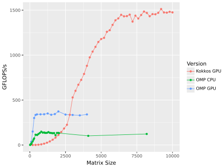

# Task 01

## a)

For compilation we used `icpx` version `2023.1.0` with the C++ toolchain provided by `GCC 13.2.0`.
Additionally to the specified modules in the README we had to load the latest GCC version and also explicitly used the latest module tags to always use the newest versions of the compiler and tools.
We also had to manually specify the GCC root so the newer `libstdc++` provided by the gcc module was linked instead of the old system installation under `/usr/lib64`.


## b)

For execution of the various executables we used the suggested OMP flags from Kokkos. As the environment implements OpenMP 4.5 these would be:

```sh
OMP_PROC_BIND=spread
OMP_PLACES=threads
```

## c)

When executing `kokkos_device_props_sycl` we get the following output:

```
Device Name: Intel(R) Data Center GPU Max 1550
Vendor: Intel(R) Corporation
Max Compute Units: 1024
Local Memory: 131072 bytes
Max Work Group Size: 1024
```

## i)



First of we want to state that the measured data wasn't performed on one system but instead the CPU offload results where captured on the `CS2` system and the GPU offload results on the `MILAN2` system. Thus the following comparison has to be taken cautiously, as the underlying hardware specifications are different.
Also we only have limited data point for the OpenMP datasets as we only tested within the range given by the assignments.

Comparing the OpenMP implementations with our own Kokkos implementation shows that for larger matrix sizes beyond `2600` Kokkos is way smarter and only saturates for much larger matrix sizes. We also observer that the CPU implementation is slower in comparison to the GPU OpenMP implementation, which gets already outperformed by the Kokkos implementation at matrix sizes larger than `2200`.

However looking at smaller matrix sizes before that point shows that both OpenMP implementations result in better performance compared to our Kokkos implementation. This is due to their much faster ramp up at the beginning. Important to know is that this could also be due to the clock ramp up which would only be mitigated when using repetition, which we didn't use for our Kokkos implementation. Another explanation could be that our chosen parameters for league, thread and vector size are specifically tuned for larger matrix sizes and could lead to unnecessary overhead for smaller matrix sizes due to initialization. 

| Peak Performance: | Matrix Size | MFLOPS      | System |
|-------------------|-------------|-------------|--------|
| OpenMP CPU        | 800         | 148.296941  | CS2    |
| OpenMP GPU        | 2000        | 373.360530  | MILAN2 |
| Kokkos GPU        | 9200        | 1512.466000 | SAP4   |
