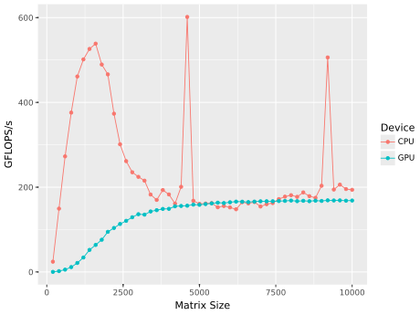
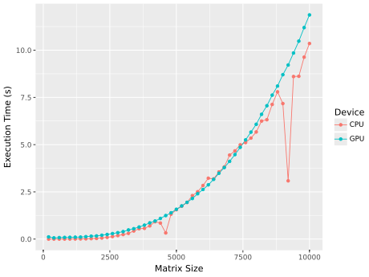
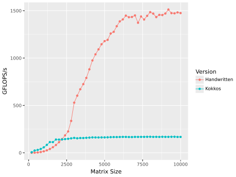
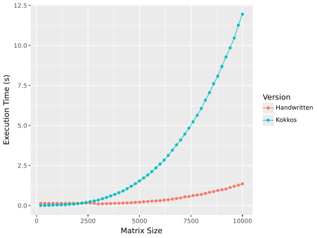
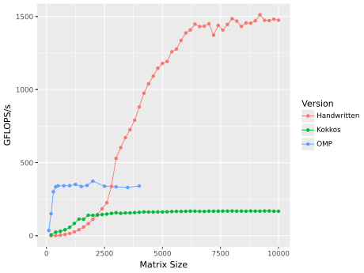

# Task 02

## Project and benchmark setup

For compilation of the kokkos kernels we used the same compiler setup from task 1. This task is also the reason why we used `gcc 13.2.0` instead of the newest `gcc` version, as there exists a incapability between `ipx` and the newest version of `gcc`. This only gets triggered from the compilation of the kernels library. 

We choose to build upon our best performing source file with RRL layout and updated the code by replacing the kernel functions for both CPU and GPU with the call to a predefined kokkos kernel. We selected the `gemm`-kernel from the Blas API, which gives us several options for multiplying two matrices:

```cpp
// C = beta * C + alpha * A * B
gemm(char transA, char transB, double alpha, View A, View B, double beta, View C)
```

For our benchmark we are only leveraging the simple `A * B` part without transforming any of the input matrices. Thus we set the scaling parameters to `1.0` and transA/B to `N`.

However this kernel doesn't hook into the vendor specific implementation which is in case of Intel *oneMKL*. Instead it uses the Kokkos specific implementation of the `gemm` kernel

## Running the benchmark

To validate that the kokkos kernel returns correct results we verified each checksum against the checksum of our best-performing handwritten kernel. As they matched exactly on every case we assume that the calculations done by the kokkos kernel is correct. In addition we also performed several difference checks between the result matrices and found no deviations at all. Thus all calculated matrix norms were also the same (e.g. euclidean norm).

We decided to not use any repetition logic for the execution as these would only affect the results of very small matrix sizes anyway. Instead we chose to run the benchmark multiple times (in our case 5 runs per matrix size) to eliminate side effects and run variances by averaging the resulting measurements. For completeness we also recorded minimum and maximum values.

We also used the recommended flags `OMP_PROC_BIND=spread` and `OMP_PLACES=threads` from Kokkos for every execution of the benchmark binary.

## Benchmark Results Kokkos kernel




Looking at the performance results of the Kokkos implementation we don't see any spectacular performance. Instead it is quite slow and doesn't perform well. We think this manly is because of the indomitability between the Kokkos Kernel Blis API and the vendor provided oneMKL API. Thus Kokkos can not leverage any significant performance advantage of the vendor platform and thus has to rely on its own implementation that is probably very generalized and doesn't apply any vendor specific tuning.

Interestingly for small matrix sizes the Kokkos implementation runs significantly faster on the CPU. Maybe because on the Host side Kokkos has to rely much more on its own implementation and thus it leads to faster results. 
In addition we can see two prominent spikes in performance for very specific matrix sizes, where the execution time was way smaller than for any surrounding values. We think these can be justified by the proximity of the matrix sizes to a power of 2. Which we saw in previous assignments has almost always a positive effect on the performance.

## Comparison to handwritten Kokkos GPU kernel




Comparing the precomputed Kokkos kernel to our best performing handwritten kernel we can see that for larger matrix sizes the Kokkos kernel cannot compete with our tuned version. While for very small matrix sizes the Kokkos implementation outperfroms our handwritten version it gets quickly outrun after the matrix size grows beyond 2000. At this point our own implementation still increases in performance while the Kokkos kernel already reached its saturation point.

We think this clearly show an important tradeoff scheme. While using generalized methods often leads to passable results very quickly, tuning a program by hand can lead to significantly better performance. But this tuning comes at the cost of time and generality. We can observe that for small matrix sizes which we did not optimize for our tuned size parameters for leagues, threads and vectors are worse compared to the Kokkos implementation. Only for the special case of large matrix sizes our tuned kernel outperforms the Kokkos implementation. Additionally to find parameters that result in good performance took much effort and time, and we are still pretty sure that there might be a configuration that leads to even better performances in certain cases. On the other hand, calling the Kokkos implementation is very easy and took a single line of code. It also didn't require any previous knowledge about implementing matrix multiplication which is also a significant time investment when trying to optimize or create a certain kernel by hand.

In conclusion we can say that we always have to check whether optimization is worth the time it takes.

## Comparison to OpenMP kernel



Before going into the analysis we first want to mention that the recorded OmpenMP performance used the implicit `for`-construction and no tiling saving the B matrix in column-major order. The data was recorded on the `MILAN2` system and therefore has to be taken with caution as the underlying hardware specification differ severely from the current Implementations using Kokkos. Finally we only recorded data for OpenMP in the predefined range given by the assignment which goes up to a matrix size of `4000`.

We can see that the OpenMP offloading implementation has significantly better performance for smaller matrix sizes but also reaches its saturation point much quicker. Noticeably the Kokkos kernel implementation cannot compete for any measured matrix size, while our own Kokkos implementation will outperform the OpenMP one for matrix sizes larger than `2800`. 

We think one of the main reasons why our Kokkos implementation gets a much higher performance is due to the more developer friendly API Kokkos supplies. In OpenMP it was much harder to understand what specific impact a pragam flag had on the overall generated kernel. Thus we were not able to easily test and refine parameters to better tune the kernel for our system. This especially holds true for the implicit `for`-construct which gets used here for comparison as it archived the fastest results. It abstracts many aspect of the construction of the kernel and obfuscates necessary details for tuning. But even when using the explicit construction of OpenMP we didn't archive the same performance using tiling and various other optimization also applied in our Kokkos kernel implementation. It was even worse than the implicit OpenMP implementation but got very close to it.

Again this shows that while abstraction may help to simply complex task and shorten development time, it also takes away optimization capabilities or at least obfuscates them so it is harder to work with them if necessary.

## Further work

It would be interesting to investigate the vendor specific oneMLK `gemm` kernel implementation and compare it against our own tuned variant. Especially because Kokkos won't use this backend and it would be interesting to see if the vendor library with much less work could archive similar performance to our own implementation.

In addition comparing our OpenMP implementation on the same system would probably also allow a more detailed assessment of the different methods and extending our OpenMP implementation to support correct tiling even for the implicit constructions could also be an interesting aspect for comparison.
