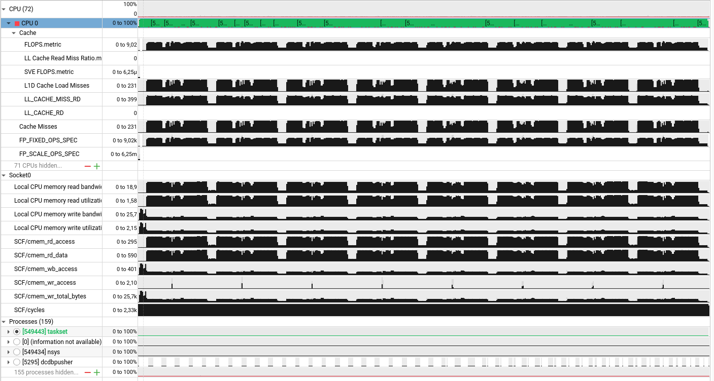

# Report on the Project optimizing a Multigrid Kernel 

## Project Setup and Building

To start optimization of the provided kernel we first had to understand the basic structure and methodology of the code. We also started searching for general optimization guides of the given Grace Hopper architecture to understand the available toolset. We quickly found several resources which provided good instruction on how to tune programs for the Grace Hopper CPUs. We though initially it would be safest to follow the [official tuning guide](https://docs.nvidia.com/dccpu/grace-perf-tuning-guide/index.html) provided by NVIDIA. It gave us a great overview over the system specifics and showed entry points to different development tools.

### Compiler

The first decision we had to make was which compiler to use for the compilation of our multigrid executable. As previous assignments showed that vendor specific compiler were in almost all cases the better choice when it comes to performance we chose the NVIDIA HPC compiler for C++ `nvc++`, which comes preinstalled on the Grace Hopper system via the NVIDIA HPC SDK. As other compilers often target for portability, which we don't need in our case, according to NVIDIA [(*)](https://docs.nvidia.com/dccpu/grace-perf-tuning-guide/compilers.html#nvidia-hpc-compilers) the NVHPC compiler directly targets system specific optimizations. This principle in addition to the fact that both compiler and architecture were build by NVIDIA simplifies the building process as `nvc++` automatically optimizes for the Grace Hopper architecture for recent versions.

To access the NVIDIA HPC SDK and the `nvc++` compiler we can load the module with `module load nvhpc` which automatically fetches version `25.3`:

```
$nvc++ --version
nvc++ 25.3-0 linuxarm64 target on aarch64 Linux -tp grace 
NVIDIA Compilers and Tools
Copyright (c) 2025, NVIDIA CORPORATION & AFFILIATES.  All rights reserved.

```

As we see it automatically picks up that our target platform will be `grace`.

### Compiler setting and flags

The next decision was to pick initial compiler optimization flags that allows us to on one side approximate the real performance of the executable and on the other side use profiling tools effectively. For that we used the following official [User Guide](https://docs.nvidia.com/hpc-sdk/compilers/hpc-compilers-user-guide/index.html) for the NVIDIA HPC Compilers. It provides detailed information about compiler flags and common options useful for optimizing multi-core CPU performance. In addition it has an section that details usage of the OpenMP framework with the `nvc++` compiler which could come in handy latter on when we integrate OpenMP parallelism into the kernel.

To start off we used the following flags:

- `fast`: Enable common options that optimize the multi-core CPU execution (loop unrolling, use of SIMD instructions)
- `O4`: Enable various code optimizations (similar to -Ofast for GNU)
- `Minfo`: Enable printing information about the vectorization of specific functions
- `Mnoautoinline`: Disable automatic function inlining for better profiling capabilities
- `Mnoinline`: Disable inlining of annotated function for better profiling capabilities
- `mp=multicore`: Enable OpenMP support for mulit-core CPU target
- `gopt`: Enable debugging information without disabling compiler optimizations

## Profiling tools

### Nsight Systems

#### Basic profiling setup and settings

In addition to Linux perf we also used the NVIDIA Nsight Systems profiling tools. It gives a graphical interface for analyzing reports created by running the executable with the `nsys` CLI tool. The profiler can record several cpu metrics and events and in addition provide similar data for different offloading APIs. However in our case we will focus on the capabilities that it includes for CPU profiling. 

To record the necessary report we had to run the executable via the `nsys` CLI tool. Additionally we fixed execution to CPU core 0 that we can easily identify recorded events from our multigrid executable:

```sh
nsys profile --cuda-event-trace=false --sampling-period=214312 --event-sample=system-wide --cpu-core-metrics=6,8%18%25,32 --cpu-socket-metrics=0,1,6,10 --cpu-core-events=3,10 taskset -c 0 ./multigrid 4 6 14 8
```

To select interesting events and metrics to record we took a look at the provided documentation for these and selected the following:

**CPU Metrics:**
- `6`: SVE FLOPS (any SVE instruction)
- `8`: FLOPS (any precision)
- `18`: SIMD percentage (ratio of SVE and advanced SIMD operations to total number of operations)
- `25`: L1D cache miss ratio
- `32`: Last level cache read miss ratio

**Socket Metrics:**
- `0`: Local CPU memory write bandwidth
- `1`: Local CPU memory read bandwidth
- `6`: Local CPU memory write utilization percentage
- `10`: Local CPU memory read utilization percentage

**CPU Events:**
- `3`: Cache Misses (Last level cache misses)
- `10`: L1D Cache Load Misses (L1 Data Cache Load Misses)

Running this profiler gives us the following overview:



We can clearly see the 8 iterations of the multigrid smoother but beyond that it is hard to tell what part corresponds to which part of the program.

#### Code annotation using NVTX

To be able to differentiate the pre- from post-smoothing and the different multigrid levels we have to do additional annotations using the provided tools by `NVTX`. For that we had to adjust the compilation by including the `nvtx3` library. After that we could define events that should be visible in the report using ranges and markers. As the installed CUDA API only included the `C` header files we had to relay on the less abstracted API, which is why we defined the following macros:

```cpp
#define NVTX_RANGE_START(_rangeIdVar, _argbColor, _msgCstr)                 \
    nvtxRangeId_t _rangeIdVar = 0;                                          \
    do {                                                                    \
        nvtxEventAttributes_t _nvtx_evt = {0};                              \
        _nvtx_evt.version = NVTX_VERSION;                                   \
        _nvtx_evt.size = NVTX_EVENT_ATTRIB_STRUCT_SIZE;                     \
        _nvtx_evt.colorType = NVTX_COLOR_ARGB;                              \
        _nvtx_evt.color = (uint32_t)(_argbColor);                           \
        _nvtx_evt.messageType = NVTX_MESSAGE_TYPE_ASCII;                    \
        _nvtx_evt.message.ascii = (_msgCstr);                               \
        (_rangeIdVar) = nvtxRangeStartEx(&_nvtx_evt);                       \
    } while (0)

#define NVTX_RANGE_END(_rangeIdVar)                                         \
    do {                                                                    \
        nvtxRangeEnd((_rangeIdVar));                                        \
    } while (0)
```

With these we both annotated the calls to `solve`-methode on each Multigrid instance including the level of that instance and even provided ranges to differentiate between pre- and post-smoothing. Now the measured events and metrics could be associated with the correct multigrid level and the performed action:


**TODO: Add reference to NVTX branch**

### Linux Perf