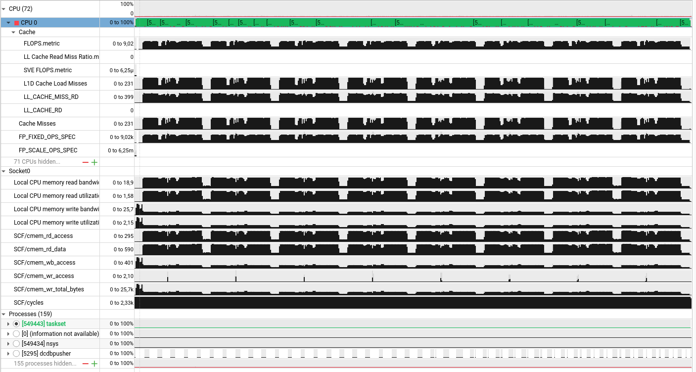
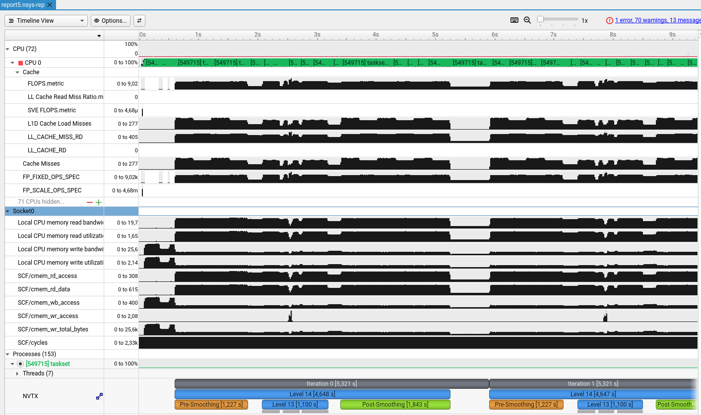

# Task 2a - Preparation for profiling

## Project Setup and Building

To start optimization of the provided kernel we first had to understand the basic structure and methodology of the code. We also started searching for general optimization guides of the given Grace Hopper architecture to understand the available toolset. We quickly found several resources which provided good instruction on how to tune programs for the Grace Hopper CPUs. We though initially it would be safest to follow the [official tuning guide](https://docs.nvidia.com/dccpu/grace-perf-tuning-guide/index.html) provided by NVIDIA. It gave us a great overview over the system specifics and showed entry points to different development tools.

### Compiler

The first decision we had to make was which compiler to use for the compilation of our multigrid executable. As previous assignments showed that vendor specific compiler were in almost all cases the better choice when it comes to performance we chose the NVIDIA HPC compiler for C++ `nvc++`, which comes preinstalled on the Grace Hopper system via the NVIDIA HPC SDK. As other compilers often target for portability, which we don't need in our case, according to NVIDIA [(*)](https://docs.nvidia.com/dccpu/grace-perf-tuning-guide/compilers.html#nvidia-hpc-compilers) the NVHPC compiler directly targets system specific optimizations. This principle in addition to the fact that both compiler and architecture were build by NVIDIA simplifies the building process as `nvc++` automatically optimizes for the Grace Hopper architecture for recent versions.

To access the NVIDIA HPC SDK and the `nvc++` compiler we can load the module with `module load nvhpc` which automatically fetches version `25.3`:

```
$nvc++ --version
nvc++ 25.3-0 linuxarm64 target on aarch64 Linux -tp grace 
NVIDIA Compilers and Tools
Copyright (c) 2025, NVIDIA CORPORATION & AFFILIATES.  All rights reserved.

```

As we see it automatically picks up that our target platform will be `grace`.

### Compiler setting and flags

The next decision was to pick initial compiler optimization flags that allows us to on one side approximate the real performance of the executable and on the other side use profiling tools effectively. For that we used the following official [User Guide](https://docs.nvidia.com/hpc-sdk/compilers/hpc-compilers-user-guide/index.html) for the NVIDIA HPC Compilers. It provides detailed information about compiler flags and common options useful for optimizing multi-core CPU performance. In addition it has an section that details usage of the OpenMP framework with the `nvc++` compiler which could come in handy latter on when we integrate OpenMP parallelism into the kernel.

To start off we used the following flags:

- `fast`: Enable common options that optimize the multi-core CPU execution (loop unrolling, use of SIMD instructions)
- `O4`: Enable various code optimizations (similar to -Ofast for GNU)
- `Minfo`: Enable printing information about the vectorization of specific functions
- `mp=multicore`: Enable OpenMP support for mulit-core CPU target
- `gopt`: Enable debugging information without disabling compiler optimizations

## Profiling tools

### Nsight Systems

#### Basic profiling setup and settings

In addition to Linux perf we also used the NVIDIA Nsight Systems profiling tools. It gives a graphical interface for analyzing reports created by running the executable with the `nsys` CLI tool. The profiler can record several cpu metrics and events and in addition provide similar data for different offloading APIs. However in our case we will focus on the capabilities that it includes for CPU profiling. 

To record the necessary report we had to run the executable via the `nsys` CLI tool. Additionally we fixed execution to CPU core 0 that we can easily identify recorded events from our multigrid executable:

```sh
nsys profile --cuda-event-trace=false --sampling-period=214312 --event-sample=system-wide --cpu-core-metrics=6,8%18%25,32 --cpu-socket-metrics=0,1,6,10 --cpu-core-events=3,10 taskset -c 0 ./multigrid 4 6 14 8
```

To select interesting events and metrics to record we took a look at the provided documentation for these and selected the following:

**CPU Metrics:**
- `6`: SVE FLOPS (any SVE instruction)
- `8`: FLOPS (any precision)
- `18`: SIMD percentage (ratio of SVE and advanced SIMD operations to total number of operations)
- `25`: L1D cache miss ratio
- `32`: Last level cache read miss ratio

**Socket Metrics:**
- `0`: Local CPU memory write bandwidth
- `1`: Local CPU memory read bandwidth
- `6`: Local CPU memory write utilization percentage
- `10`: Local CPU memory read utilization percentage

**CPU Events:**
- `3`: Cache Misses (Last level cache misses)
- `10`: L1D Cache Load Misses (L1 Data Cache Load Misses)

Running this profiler gives us the following overview:



We can clearly see the 8 iterations of the multigrid smoother but beyond that it is hard to tell what part corresponds to which part of the program.

#### Code annotation using NVTX

To be able to differentiate the pre- from post-smoothing and the different multigrid levels we have to do additional annotations using the provided tools by `NVTX`. For that we had to adjust the compilation by including the `nvtx3` library. After that we could define events that should be visible in the report using ranges and markers. As the installed CUDA API only included the `C` header files we had to relay on the less abstracted API, which is why we defined the following macros:

```cpp
#define NVTX_RANGE_START(_rangeIdVar, _argbColor, _msgCstr)                 \
    nvtxRangeId_t _rangeIdVar = 0;                                          \
    do {                                                                    \
        nvtxEventAttributes_t _nvtx_evt = {0};                              \
        _nvtx_evt.version = NVTX_VERSION;                                   \
        _nvtx_evt.size = NVTX_EVENT_ATTRIB_STRUCT_SIZE;                     \
        _nvtx_evt.colorType = NVTX_COLOR_ARGB;                              \
        _nvtx_evt.color = (uint32_t)(_argbColor);                           \
        _nvtx_evt.messageType = NVTX_MESSAGE_TYPE_ASCII;                    \
        _nvtx_evt.message.ascii = (_msgCstr);                               \
        (_rangeIdVar) = nvtxRangeStartEx(&_nvtx_evt);                       \
    } while (0)

#define NVTX_RANGE_END(_rangeIdVar)                                         \
    do {                                                                    \
        nvtxRangeEnd((_rangeIdVar));                                        \
    } while (0)
```

With these we both annotated the calls to `solve`-methode on each Multigrid instance including the level of that instance and even provided ranges to differentiate between pre- and post-smoothing. Now the measured events and metrics could be associated with the correct multigrid level and the performed action:



We can immediately see that the longest time is spend on the fine level grids and it gets progressively shorter as the grid get coarser. With that we see that the number of last level cache misses decreases which would be one reason for the increased smoothing times for the Jacobi iterator. This could be one thing to look into when trying to optimize the multigrid kernel.

One limitation of the Nsight profiler is the limited sample rate. This makes it impossible to get precise measurements of metrics and event counts for the coarser levels. However as these are not the most immediate concern looking at the overall time distribution, we still think that it was worth it to investigate our program with the Nsight profiler. 

**TODO: Add reference to NVTX branch**


### Linux Perf

#### Basic profiling setup

To analyze the performance of our multigrid implementation on the Grace Hopper system, we also utilized the preinstalled Linux Perf profiling tool. The perf profiling measurements cna be found in the [src directory](../src/perf_data).

For profiling we used two approaches: First we used `perf` to record cache-misses during the execution of the multigrid program. The command used is as follows:

```bash 
perf record -o perf.cache.4_6 -e cache-misses -g --call-graph dwarf ./multigrid 4 6 14 8
```

Additionally, we also recorded CPU cycles to get a broader view of where the CPU spends most of its time during execution. The command for recording CPU cycles is:

```bash
perf record -o perf.cycles.4_6 -e cycles -g --call-graph dwarf ./multigrid 4 6 14 8
```

When using `perf` to profile the unmodified multigrid code (and Makefile), we were unable to get useful results. Because the perf report only gave pointers and no function names, and used inline code which made it impossible to identify the functions being called.

Testing the profiling on the unmodified version of the multigrid kernel showed us almost no useful information. Similar to Nsight the whole execution was unified into one which made it impossible to differentiate the multigrid levels. In addition the `nvc++` compiler automatically inlines functions making the symbol based `perf` profiling almost impossible.

#### Optimizing code for Linux Perf

First to solve the issue of automatic function inlining we added additional command line options to the compiling process:

- `Mnoautoinline`: Disable automatic function inlining for better profiling capabilities
- `Mnoinline`: Disable inlining of annotated function for better profiling capabilities

Now we were able to see the symbols of every function call. However as the function calls were still all the same for each `Multigrid::solve` and `Jacobi::iterate` it was still impossible to differentiate the individual levels.

To solve this problem we used template classes and functions to generate unique symbols for each `Multigrid` class instance and `Jacobi::iterate` function call. This was done by adding templating variables acting as labels at compile time:

```cpp
template<unsigned int Level>
class Multigrid { ... }
```

```cpp
enum JacobiType {
  PreSmoothing,
  PostSmoothing,
  LowestLevel
};

template<unsigned int Level, JacobiType JacobiType>
void Jacobi::iterate(const FLOAT *const readField, FLOAT *const writeField, const FLOAT *const rhs) const {}
```

We initialized the first instance for `Multigrid` with Level 0 in the `main` function using the finest grid resolution given by CLI parameters:

```cpp
Multigrid::Multigrid<0> multigrid(nx, nx);
```

In the constructor of the `Multigrid` class we then used the following expression to recursively increase the Level template variable:

```cpp
_multigrid(_callRecursion ? new Multigrid<Level + 1>(_nxCoarseGrid, _nyCoarseGrid) : NULL),
```

As this would create new symbols indefinitely during compilation we also added a dummy class which stopped generating symbols after a certain Level. We could have chosen 4 as we are instructed to only report on results for that specific CLI argument, but for testing purposes we increased the number to be sufficient.

Within the `Multigrid::solve` method we called `Jacobi::iterate` with the according Level of the calling `Multigrid` instance and the Enum type that corresponds to the pre- or post-smoothing:

```cpp
// if we are on the coarsest level, just do Jacobi iterations and return (do swapping of read- and write fields correspondingly)
_jacobi.iterate<Level, LowestLevel>(readField, writeField, fineGridRhs);

// pre-smoothing
_jacobi.iterate<Level, PreSmoothing>(readField, writeField, fineGridRhs);

// post-smoothing
_jacobi.iterate<Level, PostSmoothing>(readField, writeField, fineGridRhs);
```

With these changes we were able to generate distinct symbols for each level and also differentiate between pre- and post-smoothing jacobi iterations:

> **TODO: Insert image of function trace**

#### Evaluation of profiling results from Linux Perf

##### perf cycle report

``` 
# Children      Self  Command    Shared Object          Symbol                                 
# ........  ........  .........  .....................  .......................................
#
   100.00%     0.00%  multigrid  multigrid              [.] _start
            |
            ---_start
               __libc_start_main
               |          
                --99.93%--0xfffbbf4673fb
                          main
                          |          
                          |--87.12%--Multigrid<0u>::solve
                          |          |          
                          |          |--35.58%--Jacobi::iterate<0u, (JacobiType)1>
                          |          |          
                          |          |--21.50%--Multigrid<1u>::solve
                          |          |          |          
                          |          |          |--8.46%--Jacobi::iterate<1u, (JacobiType)1>
                          |          |          |          
                          |          |          |--5.68%--Jacobi::iterate<1u, (JacobiType)0>
                          |          |          |          
                          |          |          |--5.05%--Multigrid<2u>::solve
                          |          |          |          |          
                          |          |          |          |--2.06%--Jacobi::iterate<2u, (JacobiType)1>
                          |          |          |          |          
                          |          |          |          |--1.38%--Jacobi::iterate<2u, (JacobiType)0>
                          |          |          |          |          
                          |          |          |           --1.03%--Multigrid<3u>::solve
                          |          |          |          
                          |          |          |--1.23%--Restriction::injection
                          |          |          |          
                          |          |           --1.08%--Prolongation::interpolation
                          |          |          
                          |          |--20.83%--Jacobi::iterate<0u, (JacobiType)0>
                          |          |          
                          |          |--4.84%--Restriction::injection
                          |          |          
                          |           --4.37%--Prolongation::interpolation
                          |          
                          |--11.55%--ComputeError::computePointwiseError
                          |          
                           --0.54%--0xfffbbf4d90d0
                                     |          
                                      --0.53%--0xffffa08120f71e14
                                                0xffffa0812236b330
                                                |          
                                                 --0.51%--0xffffa0812236a608
                                                           |          
                                                            --0.51%--0xffffa08120fa7020
                                                                      0xffffa08122380184
```

##### perf cache-miss report

```
# Children      Self  Command    Shared Object          Symbol                                 
# ........  ........  .........  .....................  .......................................
#
   100.00%     0.00%  multigrid  multigrid              [.] _start
            |
            ---_start
               __libc_start_main
               |          
                --99.99%--0xfffebff473fb
                          main
                          |          
                          |--99.43%--Multigrid<0u>::solve
                          |          |          
                          |          |--44.33%--Jacobi::iterate<0u, (JacobiType)1>
                          |          |          
                          |          |--25.84%--Jacobi::iterate<0u, (JacobiType)0>
                          |          |          
                          |          |--24.12%--Multigrid<1u>::solve
                          |          |          |          
                          |          |          |--10.42%--Jacobi::iterate<1u, (JacobiType)1>
                          |          |          |          
                          |          |          |--6.92%--Jacobi::iterate<1u, (JacobiType)0>
                          |          |          |          
                          |          |          |--5.41%--Multigrid<2u>::solve
                          |          |          |          |          
                          |          |          |          |--2.35%--Jacobi::iterate<2u, (JacobiType)1>
                          |          |          |          |          
                          |          |          |          |--1.56%--Jacobi::iterate<2u, (JacobiType)0>
                          |          |          |          |          
                          |          |          |           --1.12%--Multigrid<3u>::solve
                          |          |          |                     |          
                          |          |          |                      --0.52%--Jacobi::iterate<3u, (JacobiType)1>
                          |          |          |          
                          |          |          |--0.73%--Prolongation::interpolation
                          |          |          |          
                          |          |           --0.64%--Restriction::injection
                          |          |          
                          |          |--2.94%--Prolongation::interpolation
                          |          |          
                          |           --2.20%--Restriction::injection
                          |          
                           --0.51%--ComputeError::computePointwiseError
```

##### Further Profiling Experiments

We also ran:

```
perf stat -e cycles,instructions,cache-misses,branches,branch-misses ./multigrid 4 6 14 8
```

This gave us the following results:

```
 Performance counter stats for './multigrid 4 6 14 8':

   138,578,247,220      cycles                                                                
   364,135,905,679      instructions                     #    2.63  insn per cycle            
     7,340,510,492      cache-misses                                                          
   <not supported>      branches                                                              
         3,594,502      branch-misses                    #    0.00% of all branches           

      42.278985709 seconds time elapsed

      41.894570000 seconds user
       0.379987000 seconds sys
```

##### Conclusions

From the profiling results, we can draw several conclusions about the performance of our multigrid implementation:

1. **Dominant Functions**: The `Multigrid<0u>::solve` function is the most time-consuming part of the code, accounting for a significant portion of both CPU cycles and cache misses. This indicates that optimizations should primarily focus on this function.
2. **Jacobi Iterations**: The `Jacobi::iterate<0*, (JacobiType)1>` function is the post smoothing step and (as expected given the cli parameters 4 and 6) takes up more time than the pre smoothing step `Jacobi::iterate<0*, (JacobiType)0>`. However we noticed that when running with the cli paramters `4 4 14 8` we would expect that both functions take up roughly the same amount of time, but still the post smoothing step takes up significantly more time (over 10%). However `perf`isn`t very precise so this might be just noise. Nevertheless this difference was consistent.
3. **No iterate for <3u>**: When looking at the profiling results we noticed that there are no Jacobi iterations called for the coarsest level `Multigrid<3u>::solve`. This is likely due to the small time spend on this level compared to the other levels, therefore there are no recorded cache misses or cpu cycles for this function (even though they most surely also happen).
4. **Memory Bottleneck**: The high number of cache misses suggests that memory access patterns could be improved. Optimizing data locality and reducing cache misses could lead to significant performance gains.
