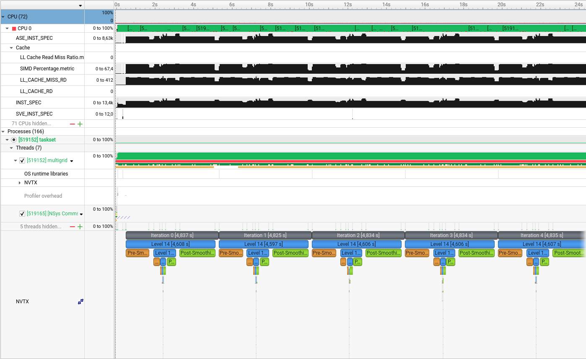
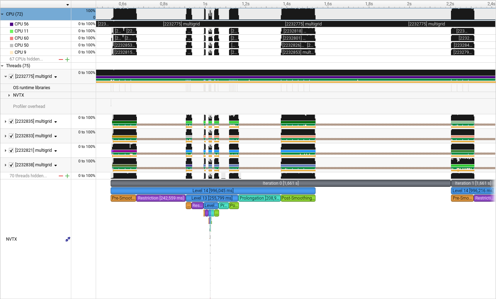
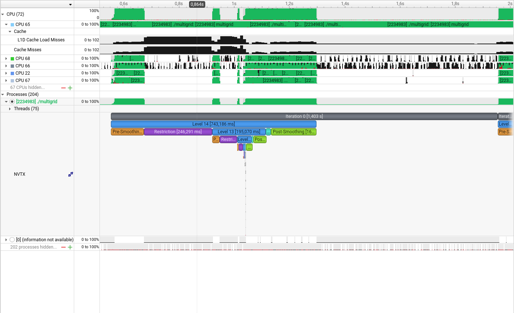
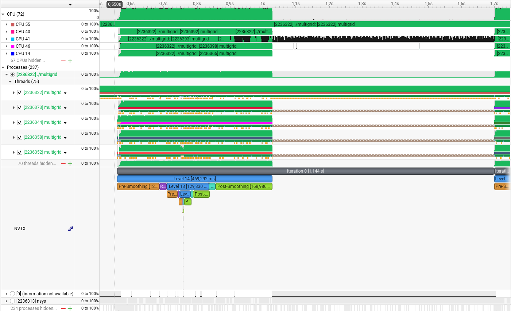
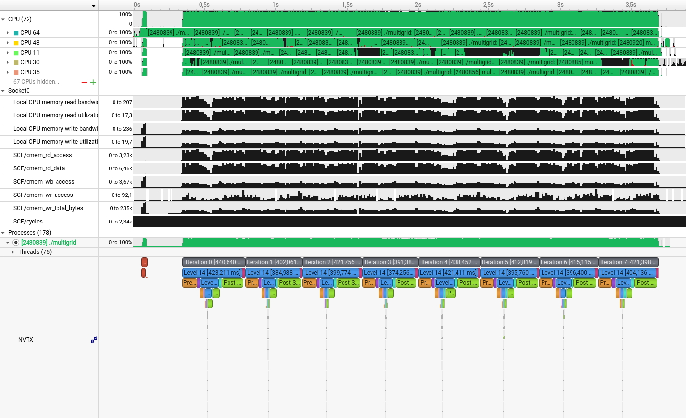

# Task 2b - Parallelization

To optimize our current performance of `39,59` we looked at the result being given by Nsight. For the following we wanted to node that we both used Linux Perf and Nsight simultaneously, however as Nsight delivered clearer visual results we chose to base this report the measurements and graphics provided by Nsight. In addition the source code using NVTX was much simpler to adopt as it didn't depend on any templating. In the following we show the unmodified kernel with just adding the NVTX calls to allow measuring the time of the individual stages:


[Taken from base.nsys-rep](../src/base.nsys-rep)

For the sake of simplification we run the test only with the cache miss events as they provided the most imminent information we needed for optimization together with the runtime ranges of the individual stages. In addition until now we used `taskset` to pin the execution to a specific core we could easily identify in Nsight.

Looking at the runtime ranges we can clearly see most time is spend on the Jacobi iteration, which is why we chose to parallize it first.

## Jacobi Iteration

### Removing pointer usage and relying on index calculation

Although the code states that using pointer completely eliminates "expensive" index calculation we found that after reverting the code to an index based approach it didn't degrade performance in any significant way. It in some way even caused the opposite where we got minimally faster results from the index-based version. However these could also be caused by measurement inaccuracies. AAnother positive it made the kernel much more compact and easier to work with when parallizing.

As a first step we just add the following OMP-clause to distribute the iteration among threads assigning them to different cores:

```cpp
const unsigned int stride = _nx + 2;
#pragma omp parallel for
for (unsigned int x = 1; x < _nx + 1; x++)
{
  for (unsigned int y = 1; y < _ny + 1; y++)
  {
    const unsigned int i = y * stride + x;
    writeField[i] = _RHS * rhs[i];
    writeField[i] += _X * (readField[i - 1] + readField[i + 1]);
    writeField[i] += _Y * (readField[i - stride] + readField[i + stride]);
  }
}
```

After tweaking the scheduling strategy for the threads we found out that dynamic scheduling actually benefited our application. Using non-static scheduling improved our performance. In addition we tried an optimization that would only parallelize the loop if the covered iterations where large enough. This also increased our performance as we would save the overhead of initiating all the threads with the distributed data if it would only run over a very limited amount of iterations.

We also tried collapsing both loops with OMP. This however made the performance worse as it would take away the possibility to vectorize the inner loop. This could be seen in the output while compiling:

```
Jacobi::iterate(double const*, double*, double const*) const:
      8, include "Multigrid.h"
           8, include "Jacobi.h"
               24, Loop not vectorized/parallelized: contains call
               26, Loop not vectorized: data dependency
```

Where as if we didn't collapsed the loops it would say that it generated vectorized code. We would suspect distributing over the y-axis could break data locality for some of the iteration leading to worse performance than just looping over vectorized lines that lay in cache sequentially. (At least for the East and West values.)

Optimizing both the minimal number of iterations for parallization and the number of threads over which we distribute using `OMP_NUM_THREADS` gave us the following heatmap:


Heatmap with all measured ranges can be found [here](img/heatmap_time_elapsed.png)

We there chose the number of minimal iterations to be `196608` and the number of threads to be `72` leaving us with the following kernel:

```cpp
void iterate(const FLOAT *const readField, FLOAT *const writeField, const FLOAT *const rhs) const
  {
    const unsigned int stride = _nx + 2;

    #pragma omp parallel for if (_nx * _ny >= 196608) schedule(dynamic)
    for (unsigned int y = 1; y < _ny + 1; y++)
    {
      for (unsigned int x = 1; x < _nx + 1; x++)
      {
        const unsigned int i = y * stride + x;
        writeField[i] = _RHS * rhs[i];
        writeField[i] += _X * (readField[i - 1] + readField[i + 1]);
        writeField[i] += _Y * (readField[i - stride] + readField[i + stride]);
      }
    }
  }
```

And we got the following measurements in Nsight:


[Taken from jacobi.nsys-rep](../src/jacobi.nsys-rep)

We have zoomed in into one iteration to make the distribution among the individual phase clearer to distinguish. We see that this got us a significant improvement to the pre- and post-smoothing phases which brought down the iteration time (without error correction) just below one second. Which means that our total execution time was right around `14` seconds.

> **Note**: This measurement didn't yet include the gating of the low-number iterations, which we will later see at the final measurements increases the performance even further. The same applies for the number of threads used for OpenMP, which was not set while recording this profiling data.

Next we wanted to optimize either the prolongation or restriction part as both where now clearly the largest contributors to overall execution time. These two ranges we added only in this step to the source code for profiling as they didn't appear significant beforehand when the Jacobi iteration did take much longer.

## Prolongation

We chose to look at the interpolation kernel of the prolongation first. Again, we converted the pointer based approach to an index based one, for the same two reasons we encountered optimizing the Jacobi iteration. We also converted the scatter approach from the original kernel to an gather approach. This means that instead of iterating over each coarse grid cell and distributing (or scattering) this value to each fine grid cell, we go over every fine grid cell. With this method we fetch (or gather) in every iteration from the coarse grid values to set the according value for the fine grid cell. As a result we avoid any synchronization necessary when paralyzing the scatter approach to save overhead in that regard. This leaves us with the following interpolation kernel:

```cpp
for (unsigned int y = 1; y < _nyFineGrid + 1; ++y)
{
  for (unsigned int x = 1; x < _nxFineGrid + 1; ++x)
  {
    const unsigned int fineI = y * fineStride + x;
    const unsigned int coarseI = y / 2 * coarseStride + x / 2;
    
    const FLOAT wy = (y & 1u) ? 0.5f : 1.0f;
    const FLOAT wx = (x & 1u) ? 0.5f : 1.0f;
    
    fineGrid[fineI] +=
        wx * wy * coarseGrid[coarseI] +
        (1.0f - wx) * wy * coarseGrid[coarseI + 1] +
        wx * (1.0f - wy) * coarseGrid[coarseI + coarseStride] +
        (1.0f - wx) * (1.0f - wy) * coarseGrid[coarseI + coarseStride + 1];
  }
}
```

In addition we also applied dynamic scheduling and again gated small iteration counts from being parallelized at all. While this gave us improvements to our performance when trying to collapse both loops we worsened it like for the Jacobi iteration. Our final parallelized kernel looked like this:

```cpp
void interpolation(const FLOAT *const coarseGrid, FLOAT *const fineGrid) const
{
  const unsigned int fineStride = _nxFineGrid + 2;
  const unsigned int coarseStride = _nxCoarseGrid + 2;

  #pragma omp parallel for if (_nxFineGrid * _nyFineGrid >= 196608) schedule(dynamic)
  for (unsigned int y = 1; y < _nyFineGrid + 1; ++y)
  {
    for (unsigned int x = 1; x < _nxFineGrid + 1; ++x)
    {
      const unsigned int fineI = y * fineStride + x;
      const unsigned int coarseI = y / 2 * coarseStride + x / 2;
      
      const FLOAT wy = (y & 1u) ? 0.5f : 1.0f;
      const FLOAT wx = (x & 1u) ? 0.5f : 1.0f;
      
      fineGrid[fineI] +=
          wx * wy * coarseGrid[coarseI] +
          (1.0f - wx) * wy * coarseGrid[coarseI + 1] +
          wx * (1.0f - wy) * coarseGrid[coarseI + coarseStride] +
          (1.0f - wx) * (1.0f - wy) * coarseGrid[coarseI + coarseStride + 1];
    }
  }
}
```

When measuring performance we saw the following very substantial improvement using Nsight:


[Taken from prolongation.nsys-rep](../src/prolongation.nsys-rep)

We see that now the prolongation face is unrecognizably small and out iteration time (without error calculation) is around `0.75` seconds. The total runtime is about `11.7` seconds.

## Restriction

The next logical step was to translate the restriction kernel in a similar fashion next. We again converted the pointer-based accesses into index-based ones and applied the same OMP directives. Experimenting with different scheduling strategies and collapsing both loops showed that not specifying any additional parameters leads to the fastest performance. The final kernel looks like this:

```cpp
void injection(const FLOAT *const fineGrid, const FLOAT *const rhsFineGrid, FLOAT *const rhsCoarseGrid, FLOAT *const coarseGridValues1, FLOAT *const coarseGridValues2) const
{
  const unsigned int fineStride = _nxFineGrid + 2;
  const unsigned int coarseStride = _nxCoarseGrid + 2;

  #pragma omp parallel for
  for (unsigned int y = 1; y < _nyCoarseGrid + 1; y++)
  {
    for (unsigned int x = 1; x < _nxCoarseGrid + 1; x++)
    {
      const unsigned int fineI = y * 2 * fineStride + x * 2;
      const unsigned int coarseI = y * coarseStride + x;

      rhsCoarseGrid[coarseI] = rhsFineGrid[fineI];
      rhsCoarseGrid[coarseI] -= (fineGrid[fineI - 1] - 2.0 * fineGrid[fineI] + fineGrid[fineI + 1]) / _hxFineGrid2;
      rhsCoarseGrid[coarseI] -= (fineGrid[fineI - fineStride] - 2.0 * fineGrid[fineI] + fineGrid[fineI + fineStride]) / _hyFineGrid2;

      coarseGridValues1[coarseI] = 0.0;
      coarseGridValues2[coarseI] = 0.0;
    }
  }
}
```

Measuring the performance with Nsight revealed the following profiling results:


[Taken from restriction.nsys-rep](../src/restriction.nsys-rep)

Again we see that this helped a lot to bring down the time spend for restriction. This lead to an iteration time (without error calculation) of just under half a second and a total runtime of `9.82` seconds.

## Error calculation

Looking at the last image we noticed a substantial latency in between two iterations which would suggest that the error calculation takes a considerable amount of time. We decided to parallize this calulation next and hand to change the implementation slightly. We defined a specific local varaible for the maximal error and assign it at the end to the class variable. This allowed us to use a simple reduction scheme for the max value which made this calculation very efficient. Without this optimization the error calculation would take much longer. The other OMP parameters include dynamic scheduling and gating low iteration counts which resulted in the fastest performance for us leaving us with the following code:

```cpp
void computePointwiseError(const FLOAT *const fineGrid)
{
  // reset error-norm
  FLOAT maxErr = 0.0;

  // loop over all inner grid points and compute pointwise error
  const unsigned int stride = _nx + 2;

  #pragma omp parallel for if (_nx * _ny >= 196608) schedule(dynamic) reduction(max:maxErr)
  for (unsigned int y = 1; y < _ny + 1; y++)
  {
    for (unsigned int x = 1; x < _nx + 1; x++)
    {
      const unsigned int pos = y * stride + x;
      const FLOAT err = fineGrid[pos] - (((FLOAT)x * y) / ((FLOAT)(_nx + 1) * (_ny + 1)));
      _error[pos] = err;
      if (fabs(err) > maxErr)
      {
        maxErr = fabs(err);
      }
    }
  }
  _errorMax = maxErr;
}
```

## Initialization and setting boundary conditions

Last but not least we also tried to parallelize the setup of the boundary calculation. However after trying different setups we found that the parallelization either didn't gain any performance or made it even worse. As the latency from the initialization is minimal anyway the parallelization didn't break even with the overhead from the distribution of the threads which is why we decided to leave the calculation of the boundary conditions sequential. This is unfortunate as in comparison to the runtime of the rest of the kernel saving time from the boundary condition could really make a difference.

## Final results of parallelization

Our current best measured performance was just shy of `3.098` seconds for a full run of `./multigrid 4 6 14 8` with the described parameters. And the average was around `3.071` seconds. This includes all the mentioned tweaks to OMP parameters and gives us the following profiling results with Nsight:


[Taken from final.nsys-rep](../src/final.nsys-rep)

As we see the iteration time (including error calculation) is around `410ms` and tends to be faster for later iterations.

> **Note**: Due to the profiling with high sample rate and a few different events it is not as fast as our reported time values (About `3.8` seconds). These got calculated by using the `time` Linux utility and referring to the real-time measurement.

## Further improvements to parallelization

A potential for further improvement would be to look at the parallelization of the initial boundary condition iteration as it takes a considerable part in the total runtime. Until now we only tried different basic setups keeping the original code mostly in place. Maybe completely rewriting this code would make it much more feasible for parallelization.

Another improvement would be to try different dynamic scheduling numbers. Currently we only specified 64 for the Jacobi iteration, as it made the greatest impact. Choosing other numbers there changed the performance in a measurable way, which was not the case for the other kernels. However 64 was not chosen for any particular besides that it gave us the fastest execution time consistently. This would also mean that trying different values for the other kernels could also improve performance. However this would be an immensely tedious task to optimize and due to our limited team size we wanted to focus on other optimizations. In the future a automated script could be written that test all different combinations to get the optimal one.

In addition the number of OMP threads could be tested for different values via the environmental variable `OMP_NUM_THREADS`. Currently all testing was done using `72` threads as it was the fasted choice when we started tuning the OMP parameters after parallelizing the code. Going back to this and trying further tuning by automating the testing over various values could reveal an even better choice that archives higher performance.

And at last the number we chose as minimum iterations required to apply parallelization `196608` was also chosen at this time point and could be tested against other values to find the optimal threshold. Furthermore it could be individually set for every omg clause which would allow for a very fain grained control which possibly could increase performance even further.

However going forward we tried to focus on several cache optimization schemes as they seemed promising at first, as there seemed to be quite a few cache misses especially in the Jacobi iteration which we tried to eliminate.

