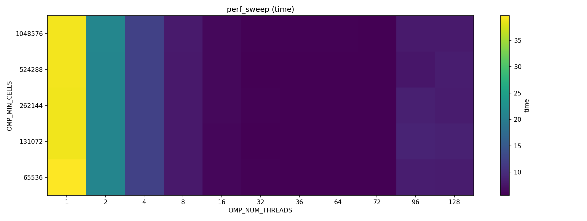
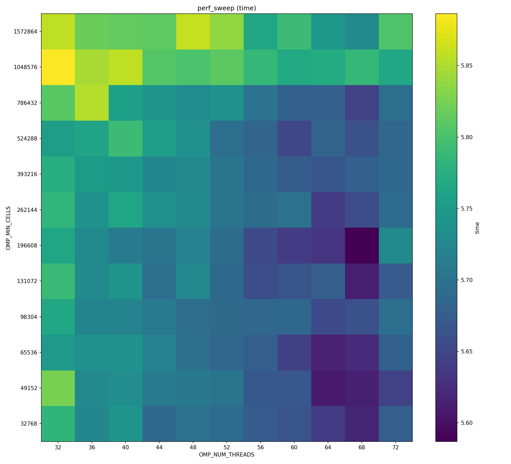

# Task 2b - Parallelization
For small grid sizes, the overhead of managing multiple threads can outweigh the benefits of parallelization we added the environment variable `OMP_MIN_CELLS` which can be set at runtime to control when to start parallelizing. If the size of the grid is smaller than `OMP_MIN_CELLS`, no parallelization will be used. This allows us to avoid the overhead of thread management for small grids.
## ComputeError.h
It is possible to collapse both for loops into a single loop using the `collapse(2)` clause in OpenMP and use a reduction for the error variable.
## Jacobi.h
Parallelize the outer y loop with OpenMP because each row updates distinct elements.
## Restriction.h
Parallelize the outer y loop because each coarse grid point is written exactly once. Indexing is independent per row, so there are no write conflicts. This gives a small speedup since restriction is not the main hotspot.

## Analysis of Parallelization
When runing our parallelized multigrid implementation on GH with differeing threads and cell sizes we noticed the following:


We then reran our experiments for the values between 32 and 72 as they are very close to each other and we wanted to get a better resolution in this area:


From the heatmaps we can see that the best performance is achieved with around 68 threads and a cell size of 196608. This configuration yields the lowest time elapsed of 5.5 seconds which is a speedup of almost 8x compared to the single threaded version (42.2s).
[Data](../src/perf_sweep/)
## Running Perf on the Parallelized Code
We also ran perf on the parallelized code with 68 threads and a cell size of 196608 to see how the performance characteristics changed with parallelization.
```
# Children      Self  Command    Shared Object          Symbol                                                                
# ........  ........  .........  .....................  ......................................................................
#
    76.39%     0.00%  multigrid  multigrid              [.] __nv__ZNK6Jacobi7iterateILj61EL10JacobiType1EEEvPKdPdS3__F3L34_141
            |
            ---__nv__ZNK6Jacobi7iterateILj61EL10JacobiType1EEEvPKdPdS3__F3L34_141
               |          
               |--37.01%--__nv__ZNK6Jacobi7iterateILj64EL10JacobiType1EEEvPKdPdS3__F3L34_138
               |          
               |--31.48%--Jacobi::iterate<0u, (JacobiType)2>
               |          
                --6.38%--__nv__ZNK6Jacobi7iterateILj63EL10JacobiType1EEEvPKdPdS3__F3L34_139
```