# Cach Optimization
To optimize temporal locality we partition our rows in tiles of size `tile` and then compute up to `comb_iter` y values at once. 
Therefore we replaced the iterate function with the following code:

```cpp
void iterate(const FLOAT *const __restrict readField,
             FLOAT *const __restrict writeField,
             const FLOAT *const __restrict rhs) const
{
  const unsigned int tile = 512;
  const unsigned int comb_iter = 2;
  const unsigned int stride = _nx + 2;

  #pragma omp parallel for if (_nx * _ny >= 196608) schedule(dynamic, 64)
  for (unsigned int yBase = 1; yBase <= _ny; yBase += comb_iter)
  {
    const unsigned int yLast = (yBase + comb_iter - 1< _ny) ? (yBase + comb_iter - 1- 1) : _ny;

    for (unsigned int xBlock = 1; xBlock <= _nx; xBlock += tile)
    {
      unsigned int xEnd =(xBlock + tile - 1 < _nx) ? (xBlock + tile - 1) : _nx;
      // Process comb_iter rows for this x-block
      for (unsigned int y = yBase; y <= yLast; ++y)
      {
        const FLOAT *c  = readField   + y * stride + xBlock;
        const FLOAT *s  = c - stride;                 // y-1
        const FLOAT *n  = c + stride;                 // y+1
        const FLOAT *r  = rhs        + y * stride + xBlock;
        FLOAT *out      = writeField + y * stride + xBlock;

        #pragma omp simd
        for (unsigned int x = xBlock; x <= xEnd; ++x)
        {
          *out = _RHS * (*r)
               + _X * (c[-1] + c[1])
               + _Y * (s[0]  + n[0]);

          ++c; ++s; ++n; ++r; ++out;
        }
      }
    }
  }
}
```

We then sweept through multiple configuration and found the following results (basline is tile_x = _nx and row_batch = 1) (Using best OMP parametes):


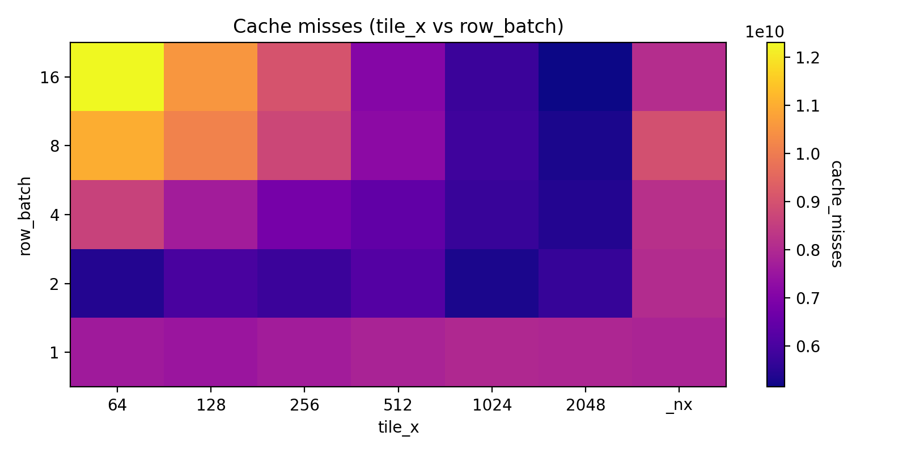
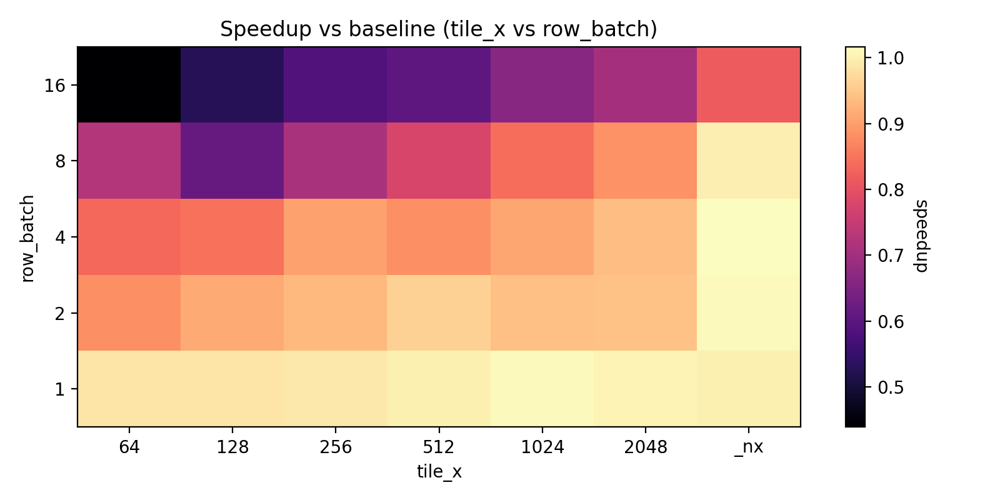
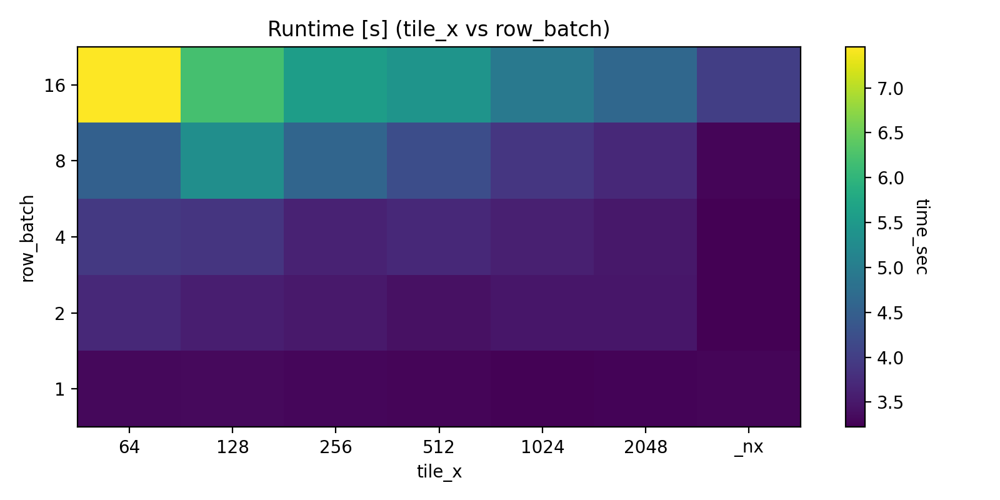
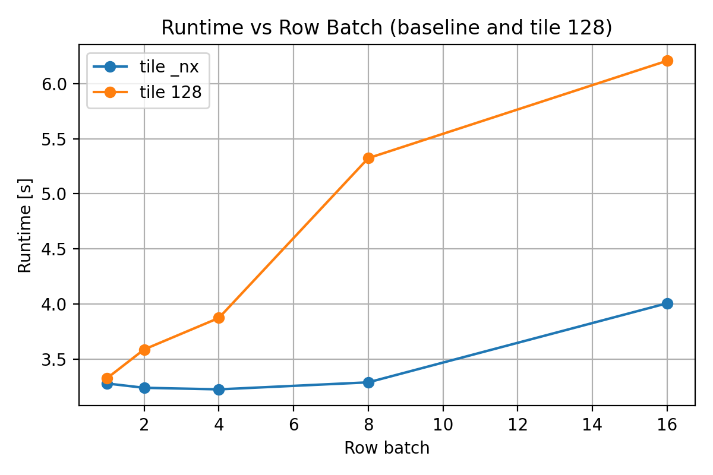
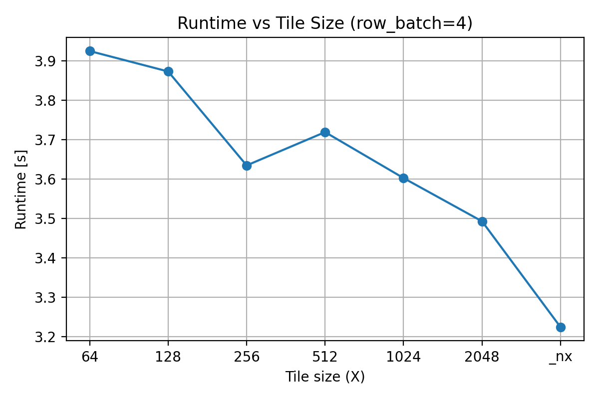
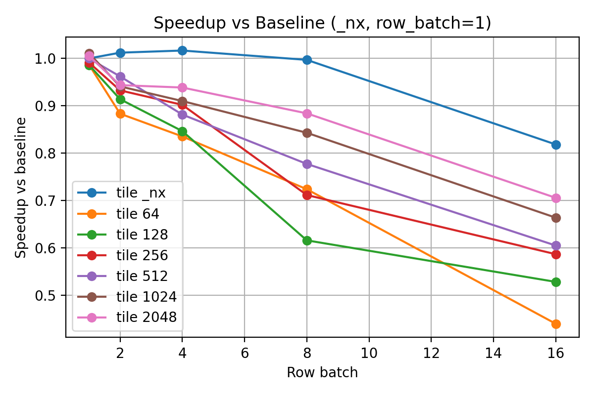
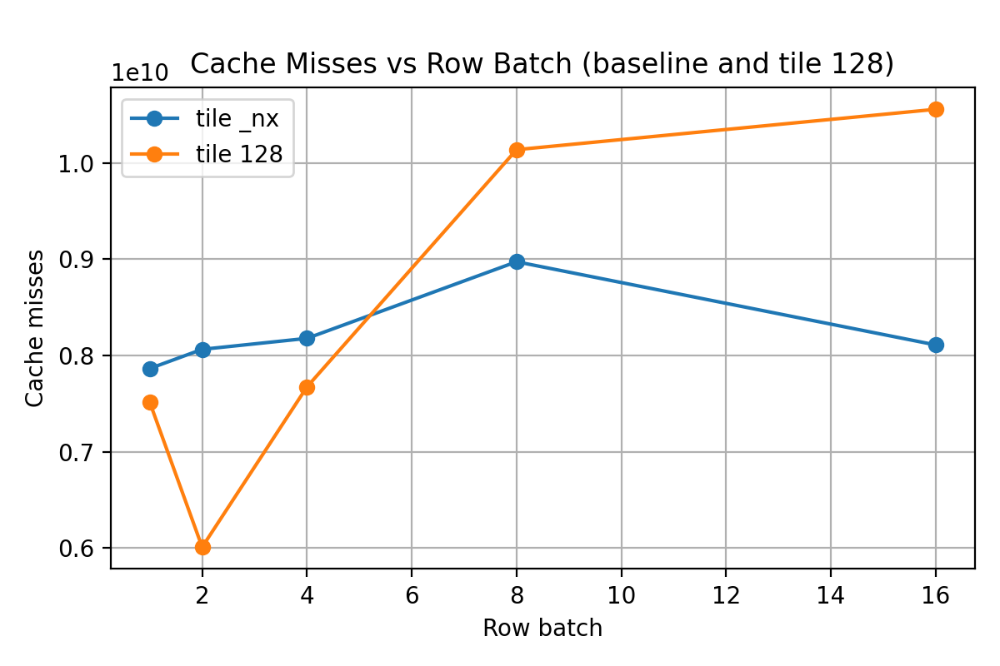

Fastest 5 runs:
| tile_x | row_batch | cache_refs   | cache_misses | cycles        | instructions  | time_sec | speedup  |
|-------:|----------:|--------------|--------------|---------------|---------------|---------:|---------:|
| _nx    | 4         | 299717277655 | 8178902919   | 679384877376  | 1071710698004 | 3.223748 | 1.016636 |
| _nx    | 2         | 217678762354 | 8065221751   | 679751936864  | 749377185711  | 3.238119 | 1.012124 |
| 1024   | 1         | 171663169817 | 7994632928   | 689799964905  | 552226573416  | 3.241588 | 1.011041 |
| 2048   | 1         | 172202678445 | 7946043746   | 694231604552  | 554626415076  | 3.260026 | 1.005323 |
| _nx    | 1         | 170089294429 | 7865782064   | 687237485545  | 560383516207  | 3.277378 | 1.000000 |


## Results
The fastest configuration didn't use tiling, indeed tiling always resulted in a slowdown. Which we expect is due to the overhead introduced by the additional loops and the more complex addressing calculations.

With some parameters we were able to reduce the number of cache misses, and also the number of cache references. Meaning that our optimization did improve temporal locality. Howerver neither less cache misses nor less cach references directly translated into a faster execution time. It's rather a combination of these factors together.

We also were unable to beat our highly optimized OMP version.

We expect there to be the result of overhead introduced by the additional loops and the more complex addressing calculations. 

# Without using OMP (one thread)
We also tested our cach optimization without using OMP parallelization.

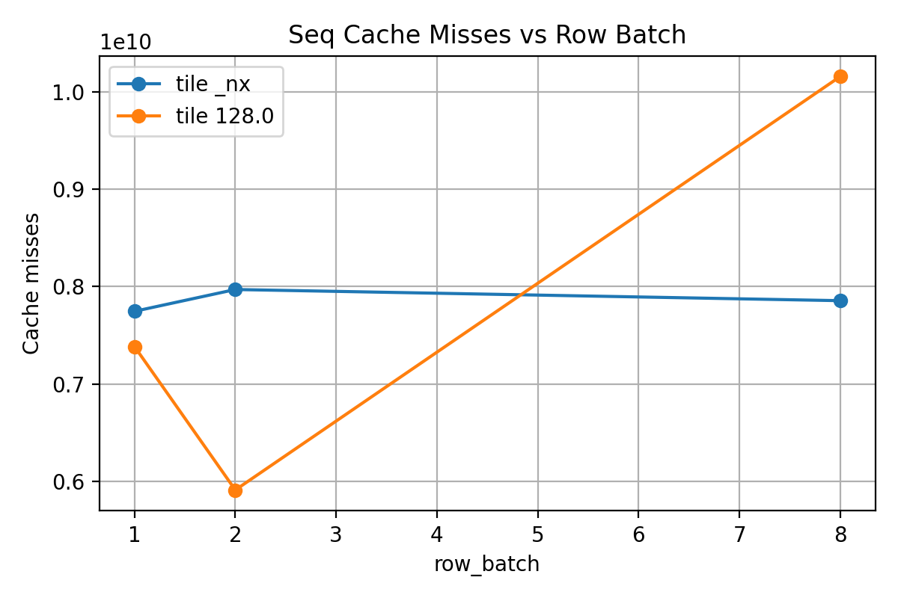
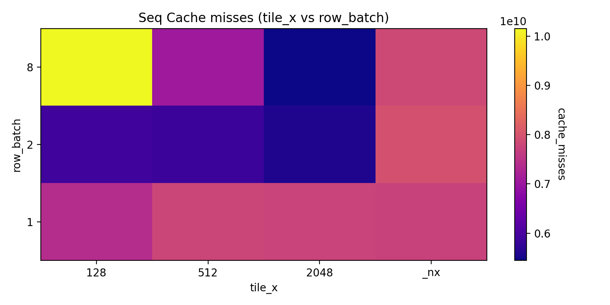
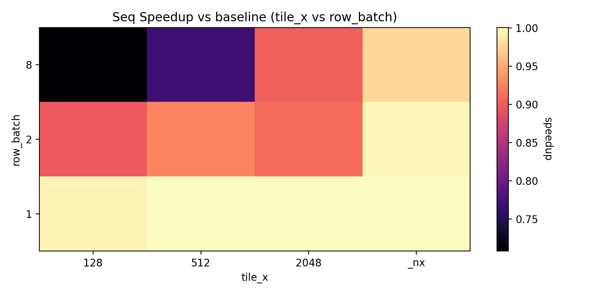
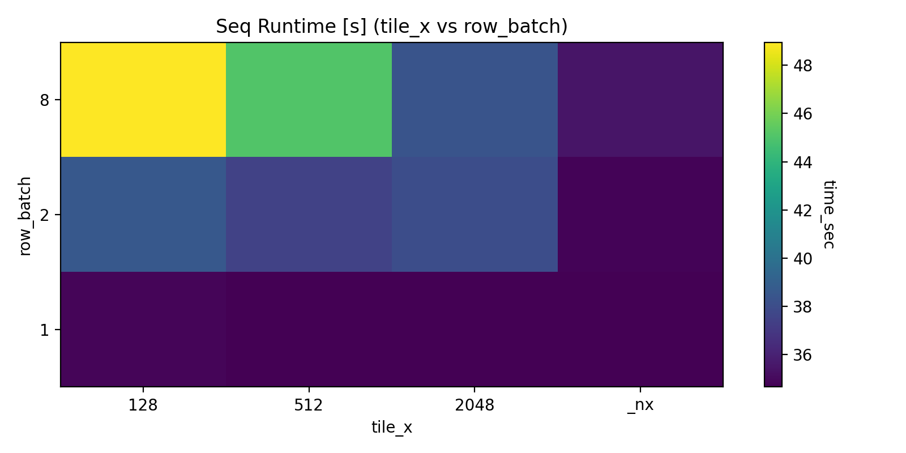
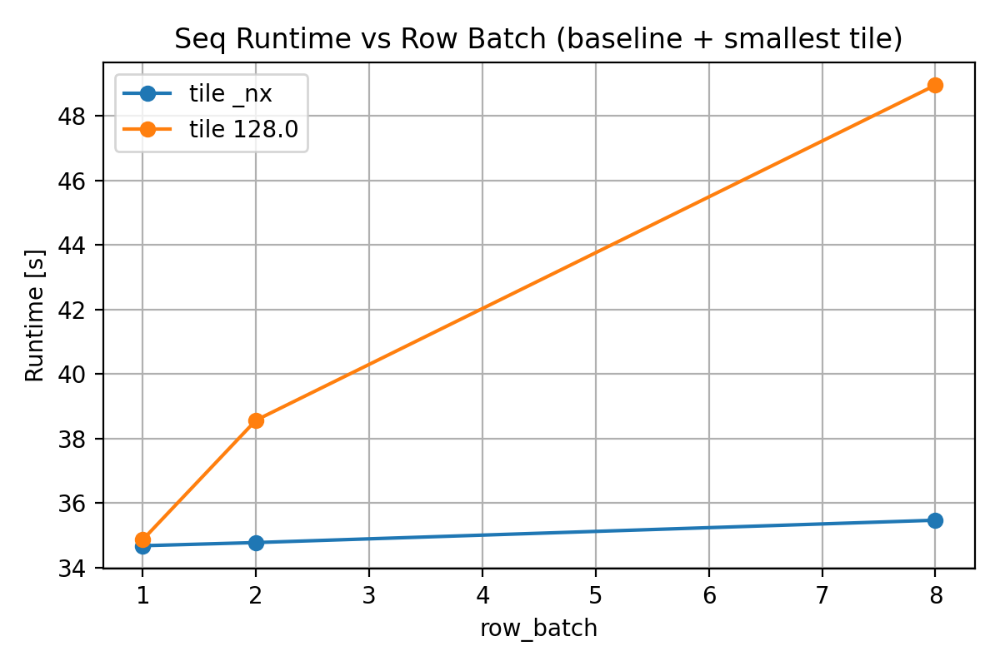
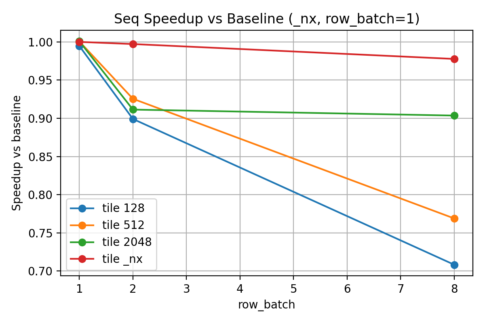

Fastest 3 runs:
| tile_x | row_batch | cache_refs   | cache_misses | cycles        | instructions  | time_sec  | speedup  |
|-------:|----------:|--------------|--------------|---------------|---------------|----------:|---------:|
| 2048   | 1         | 118979890667 | 7751192896   | 113532571188  | 341484470690  | 34.650446 | 1.000771 |
| 512    | 1         | 119813493779 | 7786989240   | 113533620945  | 344540790693  | 34.656076 | 1.000609 |
| _nx    | 1         | 118754548439 | 7746104052   | 113608645507  | 354942882173  | 34.677170 | 1.000000 |

## Interpretation
Here we have similar results as with OMP enabled, we were able to slightly beat the default run (our better way of accessing data improved our version from 41s to around 34s) Howerver further cach optimizations didn't result in further speedups. Even though we were able to reduce the number of cache misses in some configurations.

# Note
The error always stayed the same as in the original version, since we didn't change anything regarding the algorithm itself, only the order of computations.

Due to the group size limitation we were unable to further test more configurations, other cach optimization techniques and we were unable to go in a deeper analysis of the results.

All Data can be found [here](data)