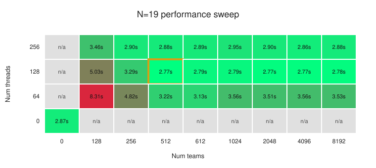
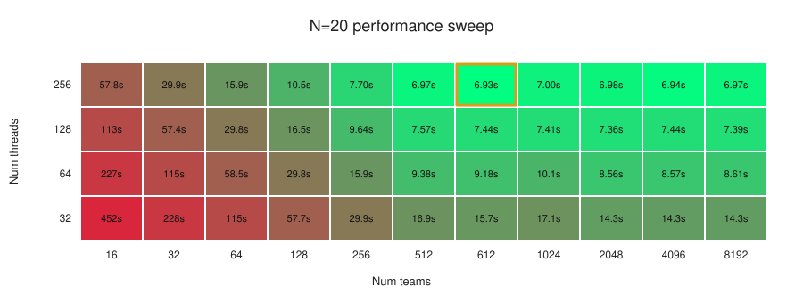
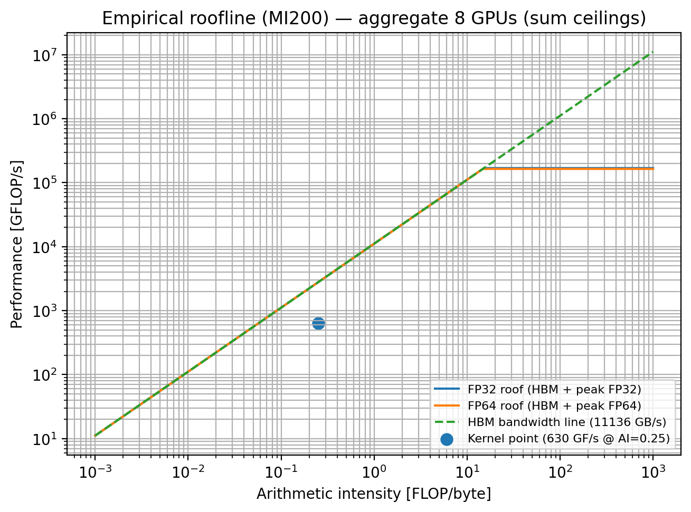
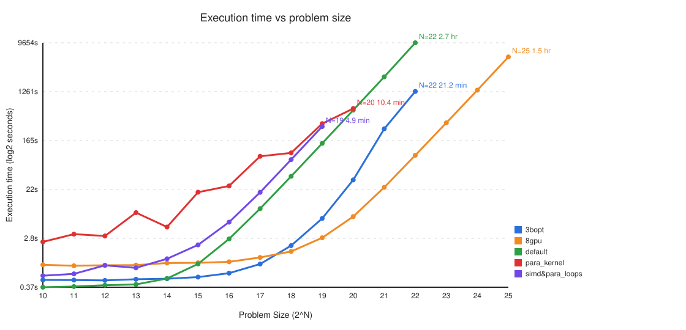

# Multi GPU offloading with OpenMP
## Code
<details>
  <summary><strong>Click to expand code</strong> (OpenMP offload)</summary>


```cpp
  #include <cstdio>
  #include <cstdlib>
  #include <cmath>
  #include <omp.h>

  static inline double neg_inf() { return -1.0e300; }

  void precom_mu(const double *ts, double *mu, int mlen, int sublen)
  {
    double sum = 0.0;
    for (int i = 0; i < sublen; i++)
      sum += ts[i];
    mu[0] = sum / (double)sublen;

    for (int i = 1; i < mlen; i++)
      mu[i] = mu[i - 1] + (ts[i + sublen - 1] - ts[i - 1]) / (double)sublen;
  }

  void precom_norm(const double *ts, const double *mu, double *norm, int mlen, int sublen)
  {
    for (int i = 0; i < mlen; i++)
    {
      double sum = 0.0;
      for (int j = 0; j < sublen; j++)
      {
        double tmp = ts[i + j] - mu[i];
        sum += tmp * tmp;
      }
      norm[i] = sqrt(1.0 / sum);
    }
  }

  static inline void usage()
  {
    printf("Usage: exe <input> <len_log2> <sublen> [start_device] [num_devices] [num_teams] [threads_per_team]\n");
  }

  int main(int argc, char *argv[])
  {
    if (argc < 4)
    {
      usage();
      return 0;
    }

    const char *path = argv[1];
    int len_log2 = atoi(argv[2]);
    int len = 1 << len_log2;
    int sublen = atoi(argv[3]);
    int mlen = len - sublen + 1;
    int start_dev = (argc >= 5) ? atoi(argv[4]) : 0;
    int req_ndev = (argc >= 6) ? atoi(argv[5]) : 0;
    int NUM_TEAMS = (argc >= 7) ? atoi(argv[6]) : 0;
    int THREADS = (argc >= 8) ? atoi(argv[7]) : 0;

    if (mlen <= 0)
    {
      printf("Error: len must be >= sublen\n");
      return 1;
    }

    // DEBUG:
    /*    printf("len=%d (2^%d) sublen=%d mlen=%d | devices_total=%d | using devices [%d..%d]\n",
              len, len_log2, sublen, mlen, ndev_total, start_dev, start_dev + ndev_use - 1);
      printf("requested launch: num_teams=%d threads_per_team=%d\n", NUM_TEAMS, THREADS); */

    FILE *f = fopen(path, "r");
    if (!f)
    {
      perror("fopen");
      return 1;
    }

    double *ts = (double *)malloc((size_t)len * sizeof(double));
    double *mu = (double *)malloc((size_t)mlen * sizeof(double));
    double *norm = (double *)malloc((size_t)mlen * sizeof(double));
    double *mp = (double *)malloc((size_t)mlen * sizeof(double));
    int *mpi = (int *)malloc((size_t)mlen * sizeof(int));
    int ndev_use = (req_ndev <= 0) ? (omp_get_num_devices() - start_dev) : req_ndev;

    for (int i = 0; i < len; i++)
    {
      if (fscanf(f, "%lf", &ts[i]) != 1)
      {
        printf("Error: input file shorter than len=%d\n", len);
        fclose(f);
        return 1;
      }
    }
    fclose(f);

    for (int i = 0; i < mlen; i++)
    {
      mp[i] = neg_inf();
      mpi[i] = -1;
    }

    precom_mu(ts, mu, mlen, sublen);
    precom_norm(ts, mu, norm, mlen, sublen);

    // -- time start
    double tb, te;
    tb = omp_get_wtime();
  #pragma omp parallel num_threads(ndev_use)
    {
      int local = omp_get_thread_num();
      int dev = start_dev + local;

      // part for curr GPU
      int i0 = (int)((long long)mlen * local / ndev_use);
      int i1 = (int)((long long)mlen * (local + 1) / ndev_use);
      int count = i1 - i0;

      omp_set_default_device(dev);
  #pragma omp target teams distribute parallel for map(to : ts[0 : len], mu[0 : mlen], norm[0 : mlen]) map(tofrom : mp[i0 : count], mpi[i0 : count]) num_teams(NUM_TEAMS) thread_limit(THREADS)
      for (int i = i0; i < i1; i++)
      {
        // FOR DEBUGGING:
        /* if(i == i0){
            printf("[DEVICE %d] actual: teams=%d threads=%d | slice=[%d,%d)\n",
                dev, omp_get_num_teams(), omp_get_num_threads(), i0, i1);
        } */

        double best = neg_inf();
        int bestj = -1;

        for (int j = 0; j < mlen; j++)
        {
          int d = i - j;
          if (d < 0)
            d = -d;
          if (d < sublen)
            continue; // bugfix: dont selfcompare overlapping

          double acc = 0.0;
          double mui = mu[i];
          double muj = mu[j];

          for (int t = 0; t < sublen; t++)
          {
            acc += (ts[i + t] - mui) * (ts[j + t] - muj);
          }

          double cr = acc * norm[i] * norm[j];
          if (cr > best || (cr == best && (bestj < 0 || j < bestj)))
          {
            best = cr;
            bestj = j;
          }
        }

        mp[i] = best;
        mpi[i] = bestj;
      }
    }
    const double t = te - tb;
    const uint64_t M = (uint64_t)mlen;
    const uint64_t S = (uint64_t)sublen;
    const uint64_t flops = (M - S) * (3 * (M - S) - 1);
    const double gflops = (double)flops / (t * 1e9);

    printf("Runtime: %lf\n", t);
    printf("GFLOP/S: %.3f\n", gflops);

    for (int i = 0; i < mlen; i++)
    {
      mp[i] = sqrt(2.0 * (double)sublen * (1.0 - mp[i]));
    }

    // Write results
    FILE *fo = fopen("output/mp.txt", "w");
    if (!fo)
    {
      perror("fopen mp.txt");
      return 1;
    }
    for (int i = 0; i < mlen; i++)
      fprintf(fo, "%f\n", mp[i]);
    fclose(fo);

    fo = fopen("output/mpi.txt", "w");
    if (!fo)
    {
      perror("fopen mpi.txt");
      return 1;
    }
    for (int i = 0; i < mlen; i++)
      fprintf(fo, "%d\n", mpi[i]);
    fclose(fo);

    free(ts);
    free(mu);
    free(norm);
    free(mp);
    free(mpi);
    return 0;
  }
```
</details>

Code explainaition:
- Our testing has shown that it is most efficient to compute norm and mu on the host withouth any parallelizm and with optimized array access.
- For the GPU: We split the indice i into contiguous “slices” equally across GPUs (row wise partition of the matrix):
-	GPU g gets i ∈ [i0, i1) where i0 = mlen*g/ndev, i1 = mlen*(g+1)/ndev. With ndev being the number of used devices.
- Each GPU computes mp and mpi only for its slice of i.
- Each i gets handeled by a thread on the GPU
- Furthermore mp and mpi are only updated once at the end for every i, which reduces memory traffic.
This code was also used for the one GPU implementation, with only minor changes. 

## Teams and Threads per team
For both tries the runtime picked 612 Teams and 256 Threads per team. We also analyzed a thread heatmap for N=19 and N=20 to see how many threads and teams would be optimal. However we noticed that the runtime often disregarded the requested number of threads and teams (we analyzed this with simple print statments and perofiling tools).




>Note: We used the average of multiple runs for the heatmap to reduce noise. 

From the heatmap we can see that the optimal number of teams and threads depends on the problem size, but generally the runtime picked a good configuration. We also ran it for hiher problem sizes, but due to the runtime being very long we did no full heatmap analysis however our findings from N=19 and N=20 also seem to hold for higher problem sizes.
Our alogiuthm also splits its work evenly across the GPUs, so each GPU gets the same amount of work. Which we could see by using rocprof:
```
gpu=10  total=1672.025 ms  calls=1  avg=1672.025 ms
gpu=11  total=1645.148 ms  calls=1  avg=1645.148 ms
gpu=12  total=1671.610 ms  calls=1  avg=1671.610 ms
gpu=13  total=1619.251 ms  calls=1  avg=1619.251 ms
gpu=14  total=1600.732 ms  calls=1  avg=1600.732 ms
gpu=15  total=1575.351 ms  calls=1  avg=1575.351 ms
gpu=8  total=1670.233 ms  calls=1  avg=1670.233 ms
gpu=9  total=1623.929 ms  calls=1  avg=1623.929 ms
```
## Analysis
For N=20 we achieved a performance of `600 GFLOP/s`. For larger problem sizes the performance flattens at around `630 GFLOP/s`. 
With rocprof we generated this roofline model (note: we estimated the AI, and tried to use rocprof's output to get a better estimate, however the results were inconclusive):



Which shows that we are in the memory bound region (as expected) however there is still some performace left to gain (The maximum performance should be around 1100-1200 GFLOP/s).

# Other optimizations and problem sizes
Given our multiple approaches to solve the problem we created theses plots to compare the performance of the different implementations:



### explaination of other optimization ideas
- 3b: Parallelize outer i with private QT
  - each thread gets a contiguous i-range
  - each thread initializes QT for its istart
  - then streams QT inside its own range
  - updates go only to thread-local mp_t/mpi_t
  - 
<details>
    <summary><strong>Click to expand code</strong> (3bopt)</summary>

  ```cpp

      #include <cstdio>
      #include <cstdlib>
      #include <string>
      #include <cmath>
      #include <iostream>
      #include <omp.h>

      using namespace std;

      template<typename T>
      void print_buf(const string desc, const T *buf, const int len){
        printf("%s\n", desc.c_str());
        for (int i=0; i<len; i++) std::cout << buf[i] << ", ";
        printf("\n=========\n\n");
      }

      void precom_mu(double* ts, double* mu, int mlen, int sublen){
        double sum = 0.0;
        for (int i=0; i<sublen; i++) sum += ts[i];
        mu[0] = sum / (double)sublen;

        // loop-carried dependency -> keep sequential
        for (int i=1; i<mlen; i++){
          mu[i] = mu[i-1] + (ts[i+sublen-1] - ts[i-1]) / (double)sublen;
        }
      }

      void precom_norm(double* ts, double* norm, double* mu, int mlen, int sublen){
        for (int i=0; i<mlen; i++){
          double sum = 0.0;
          for (int j=0; j<sublen; j++){
            double tmp = ts[i+j] - mu[i];
            sum += tmp*tmp;
          }
          norm[i] = sqrt(1.0 / sum);
        }
      }

      void precom_df(double* ts, double* df, int mlen, int sublen){
        df[0] = 0.0;
        for (int i=0; i<mlen-1; i++)
          df[i+1] = (ts[i+sublen] - ts[i]) * 0.5;
      }

      void precom_dg(double* ts, double* mu, double* dg, int mlen, int sublen){
        dg[0] = 0.0;
        for (int i=0; i<mlen-1; i++)
          dg[i+1] = ts[i+sublen] - mu[i+1] + ts[i] - mu[i];
      }

      static inline void update_best(double &best_val, int &best_idx, double cand_val, int cand_idx){
        if (cand_val > best_val){
          best_val = cand_val;
          best_idx = cand_idx;
        }
      }

      int main(int argc, char* argv[]){
        if(argc < 4){
          printf("Usage: exe <input file> <len> <sublen>\n");
          return 0;
        }

        int len    =1<< atoi(argv[2]);
        int sublen = atoi(argv[3]);
        int mlen   = len - sublen + 1;

        FILE* f = fopen(argv[1], "r");
        if(!f){
          perror("fopen");
          return 1;
        }

        double *ts   = (double*) malloc((size_t)len  * sizeof(double));
        double *mp   = (double*) malloc((size_t)mlen * sizeof(double));
        int    *mpi  = (int*)    malloc((size_t)mlen * sizeof(int));
        double *mu   = (double*) malloc((size_t)mlen * sizeof(double));
        double *norm = (double*) malloc((size_t)mlen * sizeof(double));
        double *df   = (double*) malloc((size_t)mlen * sizeof(double));
        double *dg   = (double*) malloc((size_t)mlen * sizeof(double));

        for(int i=0;i<len;i++){
          if (fscanf(f, "%lf", &ts[i]) != 1){
            printf("Error: input has fewer than LEN=%d values.\n", len);
            fclose(f);
            return 1;
          }
        }
        fclose(f);

        for(int i=0;i<mlen;i++){
          mp[i]  = -1.0;
          mpi[i] = -1;
        }

        precom_mu(ts, mu, mlen, sublen);
        precom_norm(ts, norm, mu, mlen, sublen);
        precom_df(ts, df, mlen, sublen);
        precom_dg(ts, mu, dg, mlen, sublen);

        const int T = omp_get_max_threads();
        const double NEG_INF = -1.0e300;

        double *mp_loc  = (double*) malloc((size_t)T * (size_t)mlen * sizeof(double));
        int    *mpi_loc = (int*)    malloc((size_t)T * (size_t)mlen * sizeof(int));

        #pragma omp parallel
        {
          int tid = omp_get_thread_num();
          double *mp_t  = mp_loc  + (size_t)tid * (size_t)mlen;
          int    *mpi_t = mpi_loc + (size_t)tid * (size_t)mlen;

          #pragma omp for schedule(static)
          for(int k=0;k<mlen;k++){
            mp_t[k]  = NEG_INF;
            mpi_t[k] = -1;
          }
        }
        const int Imax = mlen - sublen; // outer loop upper bound

        #pragma omp parallel
        {
          int tid = omp_get_thread_num();
          int nt  = omp_get_num_threads();

          int istart = (int)((long long)Imax * tid / nt);
          int iend   = (int)((long long)Imax * (tid + 1) / nt);

          double *mp_t  = mp_loc  + (size_t)tid * (size_t)mlen;
          int    *mpi_t = mpi_loc + (size_t)tid * (size_t)mlen;

          int qt_len_max = mlen - istart - sublen;
          if (qt_len_max < 0) qt_len_max = 0;
          double *QT = (double*) malloc((size_t)qt_len_max * sizeof(double));

          if (istart < iend && qt_len_max > 0){
            const double mui = mu[istart];

            for(int k=0;k<qt_len_max;k++){
              int j = istart + sublen + k;
              const double muj = mu[j];
              double acc = 0.0;
              for(int t=0;t<sublen;t++){
                acc += (ts[istart + t] - mui) * (ts[j + t] - muj);
              }
              QT[k] = acc;
            }
          }

          for(int i=istart; i<iend; i++){
            int qt_len = mlen - i - sublen; // valid k range for this i
            if (qt_len <= 0) break;

            for(int j=i+sublen; j<mlen; j++){
              int k = j - i - sublen;

              if (i != istart){
                QT[k] += df[i] * dg[j] + df[j] * dg[i];
              }

              double cr = QT[k] * norm[i] * norm[j];

              update_best(mp_t[i], mpi_t[i], cr, j);
              update_best(mp_t[j], mpi_t[j], cr, i);
            }
          }

          free(QT);
        }

        #pragma omp parallel for schedule(static)
        for(int k=0;k<mlen;k++){
          double best_val = NEG_INF;
          int best_idx = -1;
          for(int t=0;t<T;t++){
            double v = mp_loc[(size_t)t*(size_t)mlen + (size_t)k];
            if (v > best_val){
              best_val = v;
              best_idx = mpi_loc[(size_t)t*(size_t)mlen + (size_t)k];
            }
          }
          mp[k]  = best_val;
          mpi[k] = best_idx;
        }

        free(mp_loc);
        free(mpi_loc);

        #pragma omp parallel for schedule(static)
        for(int k=0;k<mlen;k++){
          mp[k] = sqrt(2.0 * (double)sublen * (1.0 - mp[k]));
        }

        // write results
        f = fopen("output/mp.txt","w");
        for(int i=0;i<mlen;i++) fprintf(f, "%f\n", mp[i]);
        fclose(f);

        f = fopen("output/mpi.txt","w");
        for(int i=0;i<mlen;i++) fprintf(f, "%d\n", mpi[i]);
        fclose(f);

        free(ts); free(mp); free(mpi); free(mu); free(norm); free(df); free(dg);
        return 0;
      }

  ```

</details>

- simd&oara_loops:
  - parallizing other functionls like mu had no meaning ful speedup
- para_kernel
  - creating a two part kernel and parallelizing with simd
  - no meaningful speedup
  - 
<details>
    <summary><strong>Click to expand code</strong> (para_kernel)</summary>

  ```cpp
  for (int i=0; i<mlen-sublen; i++){

    int klen = mlen - (i + sublen); 
    const double dfi = df[i];
    const double dgi = dg[i];
    const double ni  = norm[i];
    #pragma omp simd
    for (int k=0; k<klen; k++){
      int j = i + sublen + k;

      double q = QT[k];
      if (i != 0){
        q = q + dfi * dg[j] + df[j] * dgi;
        QT[k] = q;  
      }

      tmp[k] = q * ni * norm[j];
    }

    for (int k=0; k<klen; k++){
      int j = i + sublen + k;
      double cr = tmp[k];

      if (cr > mp[i]){
        mp[i]  = cr;
        mpi[i] = j;
      }
      if (cr > mp[j]){
        mp[j]  = cr;
        mpi[j] = i;
      }
    }}
  ```
</details>

## Future optimization attempt
This [Paper](../../../../../../../Downloads/Matrix_Profile_II_Exploiting_a_Novel_Algorithm_and_GPUs_to_Break_the_One_Hundred_Million_Barrier_for_Time_Series_Motifs_and_Joins-2.pdf) promises enourmous speedups by using a different algorithm. However when trying to implemnt this we were unable to achieve consistant results and thus we could not include this in our report. However we used ideas from this paper in some of our apporaches. We managed to implment a CPU multi-threaded version of the algorithm described in the paper, however it was slower by a factor of 10x compared to our best implementation.