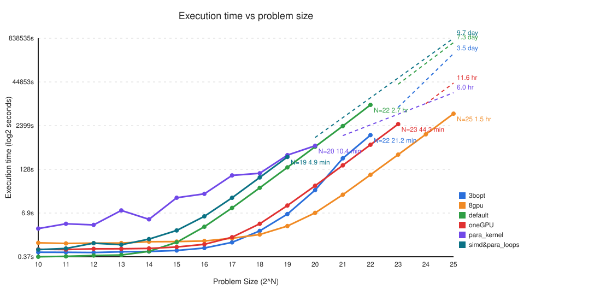

<details>
  <summary><strong>Click to expand code</strong> (OpenMP offload)</summary>


```cpp
  #include <cstdio>
  #include <cstdlib>
  #include <cmath>
  #include <omp.h>

  static inline double neg_inf() { return -1.0e300; }

  void precom_mu(const double *ts, double *mu, int mlen, int sublen)
  {
    double sum = 0.0;
    for (int i = 0; i < sublen; i++)
      sum += ts[i];
    mu[0] = sum / (double)sublen;

    for (int i = 1; i < mlen; i++)
      mu[i] = mu[i - 1] + (ts[i + sublen - 1] - ts[i - 1]) / (double)sublen;
  }

  void precom_norm(const double *ts, const double *mu, double *norm, int mlen, int sublen)
  {
    for (int i = 0; i < mlen; i++)
    {
      double sum = 0.0;
      for (int j = 0; j < sublen; j++)
      {
        double tmp = ts[i + j] - mu[i];
        sum += tmp * tmp;
      }
      norm[i] = sqrt(1.0 / sum);
    }
  }

  static inline void usage()
  {
    printf("Usage: exe <input> <len_log2> <sublen> [start_device] [num_devices] [num_teams] [threads_per_team]\n");
  }

  int main(int argc, char *argv[])
  {
    if (argc < 4)
    {
      usage();
      return 0;
    }

    const char *path = argv[1];
    int len_log2 = atoi(argv[2]);
    int len = 1 << len_log2;
    int sublen = atoi(argv[3]);
    int mlen = len - sublen + 1;
    int start_dev = (argc >= 5) ? atoi(argv[4]) : 0;
    int req_ndev = (argc >= 6) ? atoi(argv[5]) : 0;
    int NUM_TEAMS = (argc >= 7) ? atoi(argv[6]) : 0;
    int THREADS = (argc >= 8) ? atoi(argv[7]) : 0;

    if (mlen <= 0)
    {
      printf("Error: len must be >= sublen\n");
      return 1;
    }

    // DEBUG:
    /*    printf("len=%d (2^%d) sublen=%d mlen=%d | devices_total=%d | using devices [%d..%d]\n",
              len, len_log2, sublen, mlen, ndev_total, start_dev, start_dev + ndev_use - 1);
      printf("requested launch: num_teams=%d threads_per_team=%d\n", NUM_TEAMS, THREADS); */

    FILE *f = fopen(path, "r");
    if (!f)
    {
      perror("fopen");
      return 1;
    }

    double *ts = (double *)malloc((size_t)len * sizeof(double));
    double *mu = (double *)malloc((size_t)mlen * sizeof(double));
    double *norm = (double *)malloc((size_t)mlen * sizeof(double));
    double *mp = (double *)malloc((size_t)mlen * sizeof(double));
    int *mpi = (int *)malloc((size_t)mlen * sizeof(int));
    int ndev_use = (req_ndev <= 0) ? (omp_get_num_devices() - start_dev) : req_ndev;

    for (int i = 0; i < len; i++)
    {
      if (fscanf(f, "%lf", &ts[i]) != 1)
      {
        printf("Error: input file shorter than len=%d\n", len);
        fclose(f);
        return 1;
      }
    }
    fclose(f);

    for (int i = 0; i < mlen; i++)
    {
      mp[i] = neg_inf();
      mpi[i] = -1;
    }

    precom_mu(ts, mu, mlen, sublen);
    precom_norm(ts, mu, norm, mlen, sublen);

    // -- time start
    double tb, te;
    tb = omp_get_wtime();
  #pragma omp parallel num_threads(ndev_use)
    {
      int local = omp_get_thread_num();
      int dev = start_dev + local;

      // part for curr GPU
      int i0 = (int)((long long)mlen * local / ndev_use);
      int i1 = (int)((long long)mlen * (local + 1) / ndev_use);
      int count = i1 - i0;

      omp_set_default_device(dev);
  #pragma omp target teams distribute parallel for map(to : ts[0 : len], mu[0 : mlen], norm[0 : mlen]) map(tofrom : mp[i0 : count], mpi[i0 : count]) num_teams(NUM_TEAMS) thread_limit(THREADS)
      for (int i = i0; i < i1; i++)
      {
        // FOR DEBUGGING:
        /* if(i == i0){
            printf("[DEVICE %d] actual: teams=%d threads=%d | slice=[%d,%d)\n",
                dev, omp_get_num_teams(), omp_get_num_threads(), i0, i1);
        } */

        double best = neg_inf();
        int bestj = -1;

        for (int j = 0; j < mlen; j++)
        {
          int d = i - j;
          if (d < 0)
            d = -d;
          if (d < sublen)
            continue; // bugfix: dont selfcompare overlapping

          double acc = 0.0;
          double mui = mu[i];
          double muj = mu[j];

          for (int t = 0; t < sublen; t++)
          {
            acc += (ts[i + t] - mui) * (ts[j + t] - muj);
          }

          double cr = acc * norm[i] * norm[j];
          if (cr > best || (cr == best && (bestj < 0 || j < bestj)))
          {
            best = cr;
            bestj = j;
          }
        }

        mp[i] = best;
        mpi[i] = bestj;
      }
    }
    const double t = te - tb;
    const uint64_t M = (uint64_t)mlen;
    const uint64_t S = (uint64_t)sublen;
    const uint64_t flops = (M - S) * (3 * (M - S) - 1);
    const double gflops = (double)flops / (t * 1e9);

    printf("Runtime: %lf\n", t);
    printf("GFLOP/S: %.3f\n", gflops);

    for (int i = 0; i < mlen; i++)
    {
      mp[i] = sqrt(2.0 * (double)sublen * (1.0 - mp[i]));
    }

    // Write results
    FILE *fo = fopen("output/mp.txt", "w");
    if (!fo)
    {
      perror("fopen mp.txt");
      return 1;
    }
    for (int i = 0; i < mlen; i++)
      fprintf(fo, "%f\n", mp[i]);
    fclose(fo);

    fo = fopen("output/mpi.txt", "w");
    if (!fo)
    {
      perror("fopen mpi.txt");
      return 1;
    }
    for (int i = 0; i < mlen; i++)
      fprintf(fo, "%d\n", mpi[i]);
    fclose(fo);

    free(ts);
    free(mu);
    free(norm);
    free(mp);
    free(mpi);
    return 0;
  }
```
</details>

Code explainaition:
- mu and norrm are computed on host
- Split the subsequence start indices i into contiguous “slices” across GPUs (row-wise partition of the matrix):
	-	GPU g gets i ∈ [i0, i1) where i0 = mlen*g/ndev, i1 = mlen*(g+1)/ndev.
  - Each i gets handeled by a thread on the GPU
#### precom 
```cpp
  precom_mu(ts, mu, mlen, sublen);
  precom_norm(ts, mu, norm, mlen, sublen);
```
It is possible to offload the precomputation steps to the device as well, however either the full precom needs to be computed on every device or the precomputed values of the slice given to the devices would need to be transfered to the other devices. When implementing we found that the performance decreases when trying to offload the precomputation steps due to the overhead of data transfer (e.g. for N=20 we went from 6.9 to 7.0 secods). Thus we kept them on the host (given their small size they aren't worth to further optimize).
### Different Teams and Threads per team
Importantly, the runtime often disregarded the requested number of threads, so it was possible to set a lower number of threads than the runtime determiend however we could not go beyond the runtime determined maximum. The number of maximal Threads is different for every number of Teams. The number of teams was always as requested. 


### Performance comparison [Data](../src/mp/data)
>**Note**: Due to the high runtimes of some implementations we ran each version only for reasonable problem sizes. From the results gained we than used a linear fit on the last 4 measured points to extrapolate the performance for larger problem sizes (This approach gave us reliable estimates).

>**Note 2**: To gain insight into the behavior of the different implementations we used `perf`.




### Some profiling
Using rocprof we could see that all GPU get utilized almost equally:
```
gpu=10  total=1672.025 ms  calls=1  avg=1672.025 ms
gpu=11  total=1645.148 ms  calls=1  avg=1645.148 ms
gpu=12  total=1671.610 ms  calls=1  avg=1671.610 ms
gpu=13  total=1619.251 ms  calls=1  avg=1619.251 ms
gpu=14  total=1600.732 ms  calls=1  avg=1600.732 ms
gpu=15  total=1575.351 ms  calls=1  avg=1575.351 ms
gpu=8  total=1670.233 ms  calls=1  avg=1670.233 ms
gpu=9  total=1623.929 ms  calls=1  avg=1623.929 ms
```
# Result
Best achieved result for N=20: 600Gflops
The achieved amount of GFLOP is direct proportional to the problem size for n=15 we achieved 10 GFLOP. 
The performance flatens at aroun 630GFLOP for larger problem sizes (N>22) which is likely due to a reasonn?..