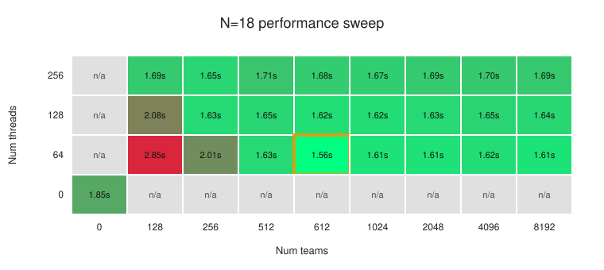
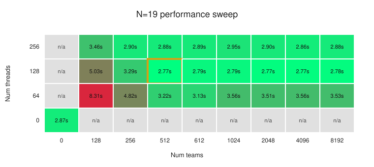
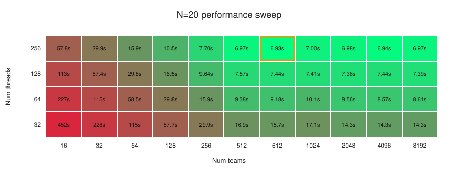
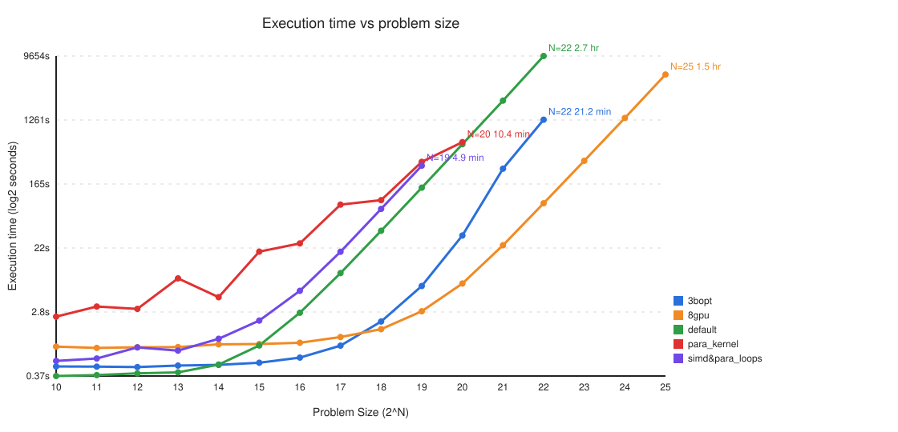
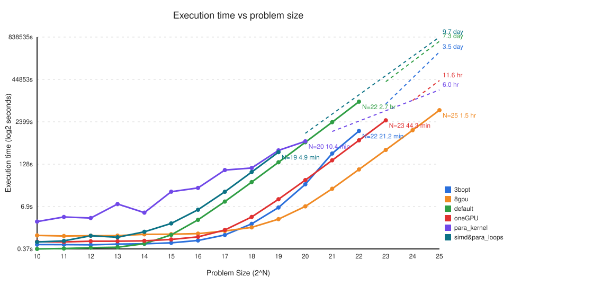

# Task 1a
## Dependecies
### Loop-Carried Dependencies
```cpp
for (int i=0;i<mlen-sublen;i++){
    // TODO loop tiling and simd parallelization
	  for (int j=i+sublen;j<mlen ;j++){
      // streaming dot product
		  if (i!=0)
		    QT[j-i-sublen] +=  df[i]*dg[j] + df[j]*dg[i];

		  double cr = QT[j-i-sublen] * norm[i] * norm[j];

      // updating the nearest neighbors information
		  if (cr > mp[i]){
		    mp[i]=cr;
		    mpi[i]=j;
		  }

	  	if (cr > mp[j]){
		    mp[j]=cr;
		    mpi[j]=i;
		  }
	  }
  }
```
#### Inner Loop
In theory the inner loop contains arithmetic coputations that could be parallelized using SIMD calculations, however due to the comparisons in the loop this is not tatively possible:
```cpp
if (cr > mp[i]){
		    mp[i]=cr;
		    mpi[i]=j;
		  }
```
What would be possible is to use OMP reduction clauses to find the maximum value in parallel and then update the arrays outside of the parallel region.
Alternatively it would be possible to use temporary arrays to store the intermediate maximum values and indices for each thread and then reduce these after the parallel region. However this would lead to overhead. This bascially creates a two loop Kernel:
<details>
  <summary><strong>Click to expand code</strong> </summary>

  ```cpp
  int start = 0;
    for(int i=sublen; i<mlen; i++){
      double acc = 0.0;
      for(int j=0; j<sublen; j++){
        acc += (ts[start + j] - mu[start]) * (ts[i + j] - mu[i]);
      }
      QT[i - sublen] = acc;
    }

    // ------------------------------------------------------------
    // Two-phase kernel with SIMD on Phase 1:
    // Phase 1: SIMD compute/store cr into tmp[]
    // Phase 2: scalar update mp/mpi using tmp[]
    // ------------------------------------------------------------
    for (int i=0; i<mlen-sublen; i++){

      int klen = mlen - (i + sublen); // number of js for this i
      const double dfi = df[i];
      const double dgi = dg[i];
      const double ni  = norm[i];

      // Phase 1 (SIMD): compute QT[k] update + cr and store into tmp[k]
      // Note: this is vectorizable because each iteration writes tmp[k]
      // and uses independent k (unique QT[k]).
      #pragma omp simd
      for (int k=0; k<klen; k++){
        int j = i + sublen + k;

        double q = QT[k];
        if (i != 0){
          q = q + dfi * dg[j] + df[j] * dgi;
          QT[k] = q;  // keep streaming update
        }

        tmp[k] = q * ni * norm[j];
      }

      // Phase 2: update mp/mpi (scalar, branchy)
      for (int k=0; k<klen; k++){
        int j = i + sublen + k;
        double cr = tmp[k];

        if (cr > mp[i]){
          mp[i]  = cr;
          mpi[i] = j;
        }
        if (cr > mp[j]){
          mp[j]  = cr;
          mpi[j] = i;
        }
      }
```
</details>
However this result is slower than the default N=17 default 9sec this 12sec.
#### With parallelized outer loop
<details>
  <summary><strong>Click to expand code</strong> </summary>

  ```cpp
  #include <cstdio>
  #include <cstdlib>
  #include <string>
  #include <cmath>
  #include <iostream>
  #include <omp.h>

  using namespace std;

  void precom_mu(double* ts, double* mu, int mlen, int sublen){
    double sum = 0.0;
    for (int i=0; i<sublen; i++) sum += ts[i];
    mu[0] = sum / (double)sublen;

    for (int i=1; i<mlen; i++)
      mu[i] = mu[i-1] + (ts[i+sublen-1]-ts[i-1]) / (double)sublen;
  }

  void precom_norm(double* ts, double* norm, double* mu, int mlen, int sublen){
    for (int i=0; i<mlen; i++){
      double sum = 0.0;
      for (int j=0; j<sublen; j++){
        double tmp = ts[i+j] - mu[i];
        sum += tmp*tmp;
      }
      norm[i] = sqrt(1.0 / sum);
    }
  }

  void precom_df(double* ts, double* df, int mlen, int sublen){
    df[0]=0.0;
    for (int i=0; i<mlen-1; i++)
      df[i+1] = (ts[i+sublen] - ts[i]) * 0.5;
  }

  void precom_dg(double* ts, double* mu, double* dg, int mlen, int sublen){
    dg[0] = 0.0;
    for (int i=0; i<mlen-1; i++)
      dg[i+1] = ts[i+sublen] - mu[i+1] + ts[i] - mu[i];
  }

  // tie-break: prefer smaller index if equal value
  static inline void upd_best(double &bestv, int &besti, double v, int idx){
    if (v > bestv || (v == bestv && (besti < 0 || idx < besti))){
      bestv = v;
      besti = idx;
    }
  }

  int main(int argc, char* argv[]){
    if(argc < 4){
      printf("Usage: exe <input file> <len> <sublen>\n");
      return 0;
    }

    int len    = atoi(argv[2]);
    int sublen = atoi(argv[3]);
    int mlen   = len - sublen + 1;

    FILE* f = fopen(argv[1],"r");
    if(!f){
      perror("fopen");
      return 1;
    }

    double *ts   = (double*) malloc((size_t)len  * sizeof(double));
    double *mp   = (double*) malloc((size_t)mlen * sizeof(double));
    int    *mpi  = (int*)    malloc((size_t)mlen * sizeof(int));
    double *mu   = (double*) malloc((size_t)mlen * sizeof(double));
    double *norm = (double*) malloc((size_t)mlen * sizeof(double));
    double *df   = (double*) malloc((size_t)mlen * sizeof(double));
    double *dg   = (double*) malloc((size_t)mlen * sizeof(double));

    for(int i=0;i<len;i++){
      if (fscanf(f, "%lf", &ts[i]) != 1){
        printf("Error: input shorter than len=%d\n", len);
        fclose(f);
        return 1;
      }
    }
    fclose(f);

    for(int i=0;i<mlen;i++){
      mp[i]  = -1.0;
      mpi[i] = -1;
    }

    precom_mu(ts,mu,mlen,sublen);
    precom_norm(ts,norm,mu,mlen,sublen);
    precom_df(ts,df,mlen,sublen);
    precom_dg(ts,mu,dg,mlen,sublen);

    // --------- Task: safe outer parallelization ---------
    const int T = omp_get_max_threads();
    const double NEG_INF = -1.0e300;
    const int Imax = mlen - sublen;           // outer loop: i in [0, Imax)
    const int mlen_sz = mlen;

    // thread-local mp/mpi (avoid races); merge later
    double *mp_loc = (double*) malloc((size_t)T * (size_t)mlen * sizeof(double));
    int    *mi_loc = (int*)    malloc((size_t)T * (size_t)mlen * sizeof(int));

    #pragma omp parallel
    {
      int tid = omp_get_thread_num();
      double *mp_t = mp_loc + (size_t)tid * (size_t)mlen_sz;
      int    *mi_t = mi_loc + (size_t)tid * (size_t)mlen_sz;

      #pragma omp for schedule(static)
      for(int k=0;k<mlen_sz;k++){
        mp_t[k] = NEG_INF;
        mi_t[k] = -1;
      }
    }

    // Parallel region: each thread gets contiguous i-range to keep streaming QT valid
    #pragma omp parallel
    {
      int tid = omp_get_thread_num();
      int nt  = omp_get_num_threads();

      int istart = (int)((long long)Imax * tid / nt);
      int iend   = (int)((long long)Imax * (tid + 1) / nt);

      double *mp_t = mp_loc + (size_t)tid * (size_t)mlen_sz;
      int    *mi_t = mi_loc + (size_t)tid * (size_t)mlen_sz;

      // local buffers
      int qt_len_max = mlen_sz - istart - sublen;
      if(qt_len_max < 0) qt_len_max = 0;

      double *QT  = (double*) malloc((size_t)qt_len_max * sizeof(double));
      double *tmp = (double*) malloc((size_t)qt_len_max * sizeof(double));

      // initialize QT for i = istart by direct dot-products (first row for this block)
      if(istart < iend && qt_len_max > 0){
        const double mui = mu[istart];
        for(int k=0;k<qt_len_max;k++){
          int j = istart + sublen + k;
          const double muj = mu[j];
          double acc = 0.0;
          for(int t=0;t<sublen;t++){
            acc += (ts[istart + t] - mui) * (ts[j + t] - muj);
          }
          QT[k] = acc;
        }
      }

      // stream inside [istart, iend)
      for(int i=istart; i<iend; i++){
        int klen = mlen_sz - (i + sublen);
        if(klen <= 0) break;

        const double dfi = df[i];
        const double dgi = dg[i];
        const double ni  = norm[i];

        // Phase 1: SIMD compute/store cr into tmp[k], and update QT[k]
        if(i == istart){
          // i==istart: QT already initialized correctly for this block
          #pragma omp simd
          for(int k=0;k<klen;k++){
            int j = i + sublen + k;
            tmp[k] = QT[k] * ni * norm[j];
          }
        } else {
          #pragma omp simd
          for(int k=0;k<klen;k++){
            int j = i + sublen + k;
            double q = QT[k] + dfi * dg[j] + df[j] * dgi;
            QT[k] = q;
            tmp[k] = q * ni * norm[j];
          }
        }

        // Phase 2: scalar update (thread-local mp/mpi)
        for(int k=0;k<klen;k++){
          int j = i + sublen + k;
          double cr = tmp[k];

          upd_best(mp_t[i], mi_t[i], cr, j); // row best for i
          upd_best(mp_t[j], mi_t[j], cr, i); // column best for j
        }
      }

      free(QT);
      free(tmp);
    }

    // merge thread-local results into global mp/mpi
    #pragma omp parallel for schedule(static)
    for(int k=0;k<mlen_sz;k++){
      double bestv = NEG_INF;
      int besti = -1;
      for(int t=0;t<T;t++){
        double v = mp_loc[(size_t)t*(size_t)mlen_sz + (size_t)k];
        int idx  = mi_loc[(size_t)t*(size_t)mlen_sz + (size_t)k];
        if(v > bestv || (v == bestv && (besti < 0 || (idx >= 0 && idx < besti)))){
          bestv = v;
          besti = idx;
        }
      }
      mp[k]  = bestv;
      mpi[k] = besti;
    }

    free(mp_loc);
    free(mi_loc);

    // correlation -> Euclidean distance
    #pragma omp parallel for schedule(static)
    for(int k=0;k<mlen_sz;k++){
      mp[k] = sqrt(2.0 * (double)sublen * (1.0 - mp[k]));
    }

    // write results
    f = fopen("output/mp.txt","w");
    for (int i=0;i<mlen;i++) fprintf(f, "%f\n", mp[i]);
    fclose(f);

    f = fopen("output/mpi.txt","w");
    for (int i=0;i<mlen;i++) fprintf(f, "%d\n", mpi[i]);
    fclose(f);

    free(ts); free(mp); free(mpi); free(mu); free(norm); free(df); free(dg);
    return 0;
  }
  ```
</details>
Still slower than 3b solution but very very close
## 3b solution
<details>
  <summary><strong>Click to expand code</strong> </summary>

  ```cpp
  #include <cstdio>
  #include <cstdlib>
  #include <string>
  #include <cmath>
  #include <iostream>
  #include <omp.h>

  using namespace std;

  template<typename T>
  void print_buf(const string desc, const T *buf, const int len){
    printf("%s\n", desc.c_str());
    for (int i=0; i<len; i++) std::cout << buf[i] << ", ";
    printf("\n=========\n\n");
  }

  void precom_mu(double* ts, double* mu, int mlen, int sublen){
    double sum = 0.0;
    for (int i=0; i<sublen; i++) sum += ts[i];
    mu[0] = sum / (double)sublen;

    // loop-carried dependency -> keep sequential
    for (int i=1; i<mlen; i++){
      mu[i] = mu[i-1] + (ts[i+sublen-1] - ts[i-1]) / (double)sublen;
    }
  }

  void precom_norm(double* ts, double* norm, double* mu, int mlen, int sublen){
    for (int i=0; i<mlen; i++){
      double sum = 0.0;
      for (int j=0; j<sublen; j++){
        double tmp = ts[i+j] - mu[i];
        sum += tmp*tmp;
      }
      norm[i] = sqrt(1.0 / sum);
    }
  }

  void precom_df(double* ts, double* df, int mlen, int sublen){
    df[0] = 0.0;
    for (int i=0; i<mlen-1; i++)
      df[i+1] = (ts[i+sublen] - ts[i]) * 0.5;
  }

  void precom_dg(double* ts, double* mu, double* dg, int mlen, int sublen){
    dg[0] = 0.0;
    for (int i=0; i<mlen-1; i++)
      dg[i+1] = ts[i+sublen] - mu[i+1] + ts[i] - mu[i];
  }

  static inline void update_best(double &best_val, int &best_idx, double cand_val, int cand_idx){
    if (cand_val > best_val){
      best_val = cand_val;
      best_idx = cand_idx;
    }
  }

  int main(int argc, char* argv[]){
    if(argc < 4){
      printf("Usage: exe <input file> <len> <sublen>\n");
      return 0;
    }

    int len    =1<< atoi(argv[2]);
    int sublen = atoi(argv[3]);
    int mlen   = len - sublen + 1;

    FILE* f = fopen(argv[1], "r");
    if(!f){
      perror("fopen");
      return 1;
    }

    double *ts   = (double*) malloc((size_t)len  * sizeof(double));
    double *mp   = (double*) malloc((size_t)mlen * sizeof(double));
    int    *mpi  = (int*)    malloc((size_t)mlen * sizeof(int));
    double *mu   = (double*) malloc((size_t)mlen * sizeof(double));
    double *norm = (double*) malloc((size_t)mlen * sizeof(double));
    double *df   = (double*) malloc((size_t)mlen * sizeof(double));
    double *dg   = (double*) malloc((size_t)mlen * sizeof(double));

    for(int i=0;i<len;i++){
      if (fscanf(f, "%lf", &ts[i]) != 1){
        printf("Error: input has fewer than LEN=%d values.\n", len);
        fclose(f);
        return 1;
      }
    }
    fclose(f);

    for(int i=0;i<mlen;i++){
      mp[i]  = -1.0;
      mpi[i] = -1;
    }

    // precompute (same as baseline)
    precom_mu(ts, mu, mlen, sublen);
    precom_norm(ts, norm, mu, mlen, sublen);
    precom_df(ts, df, mlen, sublen);
    precom_dg(ts, mu, dg, mlen, sublen);

    // ---------------------------
    // Task 3b: Privatize outputs
    // ---------------------------
    const int T = omp_get_max_threads();
    const double NEG_INF = -1.0e300;

    double *mp_loc  = (double*) malloc((size_t)T * (size_t)mlen * sizeof(double));
    int    *mpi_loc = (int*)    malloc((size_t)T * (size_t)mlen * sizeof(int));

    // init thread-local outputs
    #pragma omp parallel
    {
      int tid = omp_get_thread_num();
      double *mp_t  = mp_loc  + (size_t)tid * (size_t)mlen;
      int    *mpi_t = mpi_loc + (size_t)tid * (size_t)mlen;

      #pragma omp for schedule(static)
      for(int k=0;k<mlen;k++){
        mp_t[k]  = NEG_INF;
        mpi_t[k] = -1;
      }
    }

    // ------------------------------------------
    // Task 3b: Parallelize outer i with private QT
    // - each thread gets a contiguous i-range
    // - each thread initializes QT for its istart
    // - then streams QT inside its own range
    // - updates go only to thread-local mp_t/mpi_t
    // ------------------------------------------
    const int Imax = mlen - sublen; // outer loop upper bound

    #pragma omp parallel
    {
      int tid = omp_get_thread_num();
      int nt  = omp_get_num_threads();

      int istart = (int)((long long)Imax * tid / nt);
      int iend   = (int)((long long)Imax * (tid + 1) / nt);

      double *mp_t  = mp_loc  + (size_t)tid * (size_t)mlen;
      int    *mpi_t = mpi_loc + (size_t)tid * (size_t)mlen;

      // private QT buffer (max needed for this thread's istart)
      int qt_len_max = mlen - istart - sublen;
      if (qt_len_max < 0) qt_len_max = 0;
      double *QT = (double*) malloc((size_t)qt_len_max * sizeof(double));

      // initialize QT for i = istart:
      // QT[k] = dot( (ts[istart..istart+sublen-1]-mu[istart]),
      //              (ts[j..j+sublen-1]-mu[j]) )
      // where j = istart + sublen + k
      if (istart < iend && qt_len_max > 0){
        const double mui = mu[istart];

        for(int k=0;k<qt_len_max;k++){
          int j = istart + sublen + k;
          const double muj = mu[j];
          double acc = 0.0;
          for(int t=0;t<sublen;t++){
            acc += (ts[istart + t] - mui) * (ts[j + t] - muj);
          }
          QT[k] = acc;
        }
      }

      // stream over this thread's i-range
      for(int i=istart; i<iend; i++){
        int qt_len = mlen - i - sublen; // valid k range for this i
        if (qt_len <= 0) break;

        for(int j=i+sublen; j<mlen; j++){
          int k = j - i - sublen;

          if (i != istart){
            // streaming update: QT[k] corresponds to diagonal (i-1, j-1) -> (i, j)
            QT[k] += df[i] * dg[j] + df[j] * dg[i];
          }

          double cr = QT[k] * norm[i] * norm[j];

          // update local best for i and j (no races: thread-local arrays)
          update_best(mp_t[i], mpi_t[i], cr, j);
          update_best(mp_t[j], mpi_t[j], cr, i);
        }
      }

      free(QT);
    }

    // ---------------------------
    // Merge thread-local results
    // ---------------------------
    #pragma omp parallel for schedule(static)
    for(int k=0;k<mlen;k++){
      double best_val = NEG_INF;
      int best_idx = -1;
      for(int t=0;t<T;t++){
        double v = mp_loc[(size_t)t*(size_t)mlen + (size_t)k];
        if (v > best_val){
          best_val = v;
          best_idx = mpi_loc[(size_t)t*(size_t)mlen + (size_t)k];
        }
      }
      mp[k]  = best_val;
      mpi[k] = best_idx;
    }

    free(mp_loc);
    free(mpi_loc);

    // convert correlation -> Euclidean distance
    #pragma omp parallel for schedule(static)
    for(int k=0;k<mlen;k++){
      mp[k] = sqrt(2.0 * (double)sublen * (1.0 - mp[k]));
    }

    // write results
    f = fopen("output/mp.txt","w");
    for(int i=0;i<mlen;i++) fprintf(f, "%f\n", mp[i]);
    fclose(f);

    f = fopen("output/mpi.txt","w");
    for(int i=0;i<mlen;i++) fprintf(f, "%d\n", mpi[i]);
    fclose(f);

    free(ts); free(mp); free(mpi); free(mu); free(norm); free(df); free(dg);
    return 0;
  }
  ``` 
</details>  

with:
```
export OMP_NUM_THREADS=128
export OMP_PROC_BIND=spread
export OMP_PLACES=cores
```
## 3c solution
With parallelized outer loop in the above basically nothing new done
## 5a
<details>
  <summary><strong>Click to expand code</strong> (OpenMP offload)</summary>


    ```cpp
    #include <cstdio>
    #include <cstdlib>
    #include <cmath>
    #include <omp.h>

    static inline double neg_inf() { return -1.0e300; }

    void precom_mu(const double* ts, double* mu, int mlen, int sublen){
    double sum = 0.0;
    for(int i=0;i<sublen;i++) sum += ts[i];
    mu[0] = sum / (double)sublen;

    // dependency -> sequential
    for(int i=1;i<mlen;i++)
        mu[i] = mu[i-1] + (ts[i+sublen-1] - ts[i-1]) / (double)sublen;
    }

    void precom_norm(const double* ts, const double* mu, double* norm, int mlen, int sublen){
    for(int i=0;i<mlen;i++){
        double sum = 0.0;
        for(int j=0;j<sublen;j++){
        double tmp = ts[i+j] - mu[i];
        sum += tmp*tmp;
        }
        norm[i] = sqrt(1.0 / sum);
    }
    }

    static inline void usage(){
    printf("Usage: exe <input> <len_log2> <sublen> [start_device] [num_devices] [num_teams] [threads_per_team]\n");
    }

    int main(int argc, char* argv[]){
    if(argc < 4){
        usage();
        return 0;
    }

    const char* path = argv[1];
    int len_log2 = atoi(argv[2]);
    int len      = 1 << len_log2;
    int sublen   = atoi(argv[3]);
    int mlen     = len - sublen + 1;

    int start_dev = (argc >= 5) ? atoi(argv[4]) : 0;
    int req_ndev  = (argc >= 6) ? atoi(argv[5]) : 0; // 0 -> all available from start_dev
    int NUM_TEAMS = (argc >= 7) ? atoi(argv[6]) : 0; // 0 -> runtime chooses
    int THREADS   = (argc >= 8) ? atoi(argv[7]) : 0; // 0 -> runtime chooses

    if(mlen <= 0){
        printf("Error: len must be >= sublen\n");
        return 1;
    }

    int ndev_total = omp_get_num_devices();
    if(ndev_total <= 0){
        printf("Error: omp_get_num_devices() returned %d (no target devices)\n", ndev_total);
        return 1;
    }
    if(start_dev < 0) start_dev = 0;
    if(start_dev >= ndev_total){
        printf("Error: start_device=%d but only %d devices available\n", start_dev, ndev_total);
        return 1;
    }

    int ndev_use = (req_ndev <= 0) ? (ndev_total - start_dev) : req_ndev;
    if(start_dev + ndev_use > ndev_total) ndev_use = ndev_total - start_dev;
    if(ndev_use <= 0){
        printf("Error: no devices selected (start=%d, req=%d, total=%d)\n", start_dev, req_ndev, ndev_total);
        return 1;
    }

    printf("len=%d (2^%d) sublen=%d mlen=%d | devices_total=%d | using devices [%d..%d]\n",
            len, len_log2, sublen, mlen, ndev_total, start_dev, start_dev + ndev_use - 1);
    printf("requested launch: num_teams=%d threads_per_team=%d\n", NUM_TEAMS, THREADS);

    // ---------- Read input ----------
    FILE* f = fopen(path, "r");
    if(!f){ perror("fopen"); return 1; }

    double* ts   = (double*)malloc((size_t)len  * sizeof(double));
    double* mu   = (double*)malloc((size_t)mlen * sizeof(double));
    double* norm = (double*)malloc((size_t)mlen * sizeof(double));
    double* mp   = (double*)malloc((size_t)mlen * sizeof(double));
    int*    mpi  = (int*)   malloc((size_t)mlen * sizeof(int));

    for(int i=0;i<len;i++){
        if(fscanf(f, "%lf", &ts[i]) != 1){
        printf("Error: input file shorter than len=%d\n", len);
        fclose(f);
        return 1;
        }
    }
    fclose(f);

    for(int i=0;i<mlen;i++){
        mp[i]  = neg_inf();
        mpi[i] = -1;
    }

    // Precompute on host (stable baseline). We can offload later if wanted.
    precom_mu(ts, mu, mlen, sublen);
    precom_norm(ts, mu, norm, mlen, sublen);

    // ---------- Multi-GPU offload ----------
    // Split i in contiguous chunks across devices.
    // Each device writes only its slice mp[i0:i1), mpi[i0:i1) -> no merge needed.
    #pragma omp parallel num_threads(ndev_use)
    {
        int local = omp_get_thread_num();
        int dev   = start_dev + local;

        // chunk for this device
        int i0 = (int)((long long)mlen * local / ndev_use);
        int i1 = (int)((long long)mlen * (local + 1) / ndev_use);
        int count = i1 - i0;

        omp_set_default_device(dev);

        // (Optional) device-side debug (prints multiple times across devices; OK)
        // We print once per device by guarding on i == i0.
        #pragma omp target teams distribute parallel for \
            map(to: ts[0:len], mu[0:mlen], norm[0:mlen]) \
            map(tofrom: mp[i0:count], mpi[i0:count]) \
            num_teams(NUM_TEAMS) thread_limit(THREADS)
        for(int i=i0; i<i1; i++){
        if(i == i0){
            printf("[DEVICE %d] actual: teams=%d threads=%d | slice=[%d,%d)\n",
                dev, omp_get_num_teams(), omp_get_num_threads(), i0, i1);
        }

        double best = neg_inf();
        int bestj = -1;

        // independent per i -> safe
        for(int j=0;j<mlen;j++){
            int d = i - j; if(d < 0) d = -d;
            if(d < sublen) continue; // exclusion zone

            double acc = 0.0;
            double mui = mu[i];
            double muj = mu[j];

            // dot product over sublen
            for(int t=0;t<sublen;t++){
            acc += (ts[i+t] - mui) * (ts[j+t] - muj);
            }

            double cr = acc * norm[i] * norm[j];

            // tie-break: pick smaller j if equal (more deterministic)
            if(cr > best || (cr == best && (bestj < 0 || j < bestj))){
            best = cr;
            bestj = j;
            }
        }

        mp[i]  = best;
        mpi[i] = bestj;
        }
    }

    // Convert correlation -> Euclidean distance on host
    for(int i=0;i<mlen;i++){
        mp[i] = sqrt(2.0 * (double)sublen * (1.0 - mp[i]));
    }

    // Write results
    FILE* fo = fopen("output/mp.txt","w");
    if(!fo){ perror("fopen mp.txt"); return 1; }
    for(int i=0;i<mlen;i++) fprintf(fo, "%f\n", mp[i]);
    fclose(fo);

    fo = fopen("output/mpi.txt","w");
    if(!fo){ perror("fopen mpi.txt"); return 1; }
    for(int i=0;i<mlen;i++) fprintf(fo, "%d\n", mpi[i]);
    fclose(fo);

    free(ts); free(mu); free(norm); free(mp); free(mpi);
    return 0;
    }
    ```

</details>

## 5c is also above 
```
./mp_mgpu <input> <len_log2> <sublen> [start_device] [num_devices] [num_teams] [threads_per_team]
```

- use all: OMP_TARGET_OFFLOAD=MANDATORY ./bin/mp_mgpu input/randomlist25.txt 17 10
- use only GPU 0: OMP_TARGET_OFFLOAD=MANDATORY ./bin/mp_mgpu input/randomlist25.txt 17 10 0 1
- use GPU 1 and 2: OMP_TARGET_OFFLOAD=MANDATORY ./bin/mp_mgpu input/randomlist25.txt 17 10 1 2
- "Force THreads and teams": OMP_TARGET_OFFLOAD=MANDATORY ./bin/mp_mgpu input/randomlist25.txt 17 10 0 0 624 256
- 
### Code explaination
#### Multi-GPU offload
We split contiguous chunks across devices and each device onyl accesses its own slice.
#### precom 
```cpp
  precom_mu(ts, mu, mlen, sublen);
  precom_norm(ts, mu, norm, mlen, sublen);
```
It is possible to offload the precomputation steps to the device as well, however either the full precom needs to be computed on every device or the precomputed values of the slice given to the devices would need to be transfered to the other devices. When implementing we found that the performance decreases when trying to offload the precomputation steps due to the overhead of data transfer (e.g. for N=20 we went from 6.9 to 7.0 secods). Thus we kept them on the host (given their small size they aren't worth to further optimize).
### Different Teams and Threads per team
Importantly, the runtime often disregarded the requested number of threads, so it was possible to set a lower number of threads than the runtime determiend however we could not go beyond the runtime determined maximum. The number of maximal Threads is different for every number of Teams. The number of teams was always as requested. 






Too low number of Teams and Threads per team lead to underutilization of the GPU resources and thus poor performance. It is impossible (runtime) to get more than the suggested amout of threads allthough more threads usualyl is better. Having many Teams is also beneficial.

## Parallelization other loops
The template has many other loops (e.g.precom_mu) that can be parallelized with OMP directives. We strontgly suggest to avoid this. For reasonable problemsizes for the sequential and even partial parallelized version these loops are so small that the overhead of thread creation and management is far higher than the gain of parallelization (see amount of CPU context switches). In theory for very large problemsizes this could be beneficial, however the main computation time is spent elsewhere and thus the overall gain would be neglectable.
### Optimized Version
performance results for the optimized version are by far worse simple due to the overhead of thread creation. Leading to ~60000(@N=18) CPU migrations. This is because of the reductions which are less performant than simple sequential code for small loops.



